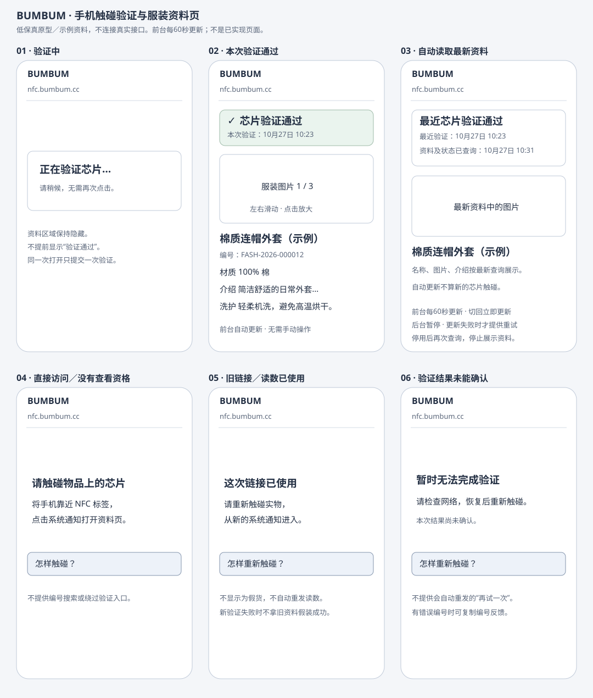

# 产品需求：要做什么，怎样才算完成

本文件供 cece 判断产品流程、开发顺序和完成标准。先读第 0 节了解产品总览与阅读导航，再按需要进入对应的详细需求。Phase 表示长期功能阶段，验收就是按约定检查结果；阶段归类不等于当前任务状态。

本文只维护产品规则与验收标准，当前任务及分支见[TODO](TODO.md)，验收与合并证据见[CHANGELOG](CHANGELOG.md)，可用接口见[实现概览](API_CONTRACT.md#04-当前能做到哪一步)。登录步骤见[管理员登录](docs/ADMIN_LOGIN.md)，运行步骤见[本地说明](docs/LOCAL_DEVELOPMENT.md)，技术与接口规则分别见[技术说明](TECH_SPEC.md)、[接口说明](API_CONTRACT.md)。更新日期：2026-10-27。

## 0. 产品总览与阅读导航

### 0.1 产品定位

BUMBUM 的长期产品愿景与跨业务线设计原则见 [PRODUCT.md](PRODUCT.md)。当前产品用 NFC 将实体服装、手串、佛牌等连接到网页资料与数字体验；本 PRD 仍只定义共用基础能力与服装主线的产品规则和验收。

### 0.2 核心流程与交付边界

核心流程是“管理员建档与绑定 → 真实卡配置 → 用户手机触碰 → 后端验证 → 展示对应资料”。端到端流程以第 3 节为准，MVP 目标、优先级与交付顺序只以第 4.0 节为准；这里不重复列第二份功能清单。

### 0.3 按问题快速查阅

| 想确认什么 | 阅读位置 |
|---|---|
| 管理后台 Ant Design 改版与编辑、删除等补全需求（待审核） | [第 10 节](#10-管理后台优化与功能补全审核稿) |
| 长期产品愿景与跨业务线原则 | [PRODUCT.md](PRODUCT.md) |
| 产品目标、用户和业务线 | [第 1–2 节](#1-项目想解决什么问题) |
| 手串 NFC 数字价值探索与旧方案复盘 | [探索说明](docs/BRACELET_NFC_EXPLORATION.md)；[旧祈愿 PRD](docs/NFC_PRAYER_H5_PRD.md)已废弃 |
| 管理员与用户的端到端流程 | [第 3 节](#3-核心业务流程) |
| MVP 交付顺序与优先级 | [第 4.0 节](#40-两档交付目标与执行顺序) |
| 管理端、触碰验证与统计需求 | [第 4.1–4.2 节](#41-phase-1第一阶段先跑通管理员操作当前) |
| 手机触碰、资料刷新与异常状态 | [第 4.2.4 节](#424-本小步手机触碰验证与服装资料页) |
| 用户故事与验收标准 | [第 5 节](#5-用户故事与验收标准) |
| 页面清单与非功能要求 | [第 6–7 节](#6-需要设计哪些页面供-figma-设计时对照) |
| 术语 | [第 8 节](#8-阅读时可能遇到的名称) |
| 第一阶段整体完成条件 | [第 9 节](#9-第一阶段怎样判断是否完成) |
| 当前接口是否已实现 | [API_CONTRACT 第 0.4 节](API_CONTRACT.md#04-当前能做到哪一步) |
| 当前任务、分支、阻塞与下一步 | [TODO.md](TODO.md) |
| 重要决定、变更与验收证据 | [CHANGELOG.md](CHANGELOG.md) |

### 0.4 本文件的边界

本 PRD 维护 BUMBUM 共用基础能力与当前服装主线的产品目标、用户可见行为、业务规则与验收标准；手串 NFC 数字体验与权益处于[探索阶段](docs/BRACELET_NFC_EXPLORATION.md)，旧祈愿 PRD 已废弃，新业务需求尚未定稿。本文件不维护接口实现状态、技术机制或当前任务进度。完整文件分工见 [README](README.md) 和 [AGENTS 第 2 节](AGENTS.md#2-不同规则去哪里查)。

---

## 1. 项目想解决什么问题

每件服装、手串、佛牌等实体物品可以嵌入 NFC 芯片。NFC 是手机靠近芯片即可读取信息的方式；芯片的固定编号叫 UID。当前登记、芯片关联和所有权功能以各阶段 PRD、接口契约及实际验收状态为准。

长期目标中，数字藏品拥有独立身份，实体物品与芯片是可更换的载体；同一数字藏品原则上同一时刻只有一个当前持有人和一个有效实体载体。所有权关联稳定的用户账户 ID，手机号只用于账户验证、联系或恢复，不作为永久身份主键。完整账户、载体换新与权益流转尚未全部交付，设计原则见 [PRODUCT.md](PRODUCT.md)。

用户用手机碰一下，就能打开物品网页（H5），查看资料、验证真伪，并在相应阶段绑定账户或体验数字权益。

项目包含两个业务线：

- **数字服装（fashion）**：核心是数字收藏体验，数字权益（可兑新、可流转、可溯源）。
- **数字文创饰品（jewelry）**：当前重新探索普通手串触碰后的数字体验或权益，不预设祈愿、福卡或每日使用；问题、复盘与边界见[探索说明](docs/BRACELET_NFC_EXPLORATION.md)，具体需求待重新评审。

两条业务线共用芯片登记、密钥、所有权和动态防伪验证（SDM），各自的页面和业务功能分开。

已确认：用同版本全局共享的 K1 解开芯片编号和读取序号，再用这枚芯片独立的 K2 核对防伪码。K0/K2/K3/K4 根据项目、芯片编号和各自用途分别计算。K1 泄露影响该版本所有芯片的编号和读数隐私；在密钥和权限正确分开的前提下，仅知道 K1 不应得到 K2。完整职责、流程和版本规则见 [密钥说明](TECH_SPEC.md#31-各把钥匙负责什么)。

---

## 2. 目标用户与角色

| 角色 | 描述 | 主要诉求 |
|---|---|---|
| 系统管理员（cece 及未来运营人员） | 负责芯片入库、物品建档、绑定关系维护、密钥管理、写卡 | 高效、可追溯、不易出错 |
| 用户（物品所有者） | 购买或获赠实体物品的人 | 碰一碰即可查看物品信息、验证真伪、绑定所有权、体验数字权益或养成 |
| 潜在买家/验证者 | 在二手流转或线下场景中，想验证物品真伪的人 | 快速判断芯片是否为正品、物品是否被篡改 |

---

## 3. 核心业务流程

### 3.1 管理员侧：芯片入库到写卡

1. 管理员先登记芯片编号，状态为待绑定 `pending`；项目可以暂不分配，已确定用途时也可选择服装或饰品。支持网页手动登记，以及NFC.cool先批量写固定文本、再批量读卡自动通知后台（Webhook，扫描回调）；两种方式均已验收。
2. 管理员在后台创建物品，填写名称、材质等基础资料。服装的来源记录、品牌故事和购买渠道在第三阶段补充编辑功能；饰品可填写寓意。
3. 管理员把待绑定芯片关联到物品；未分配项目时按物品确定，已有项目必须一致。未绑定或项目未确定不能进入本次密钥流程。物品所有权维护是另一项功能，不能把芯片关联当作用户认领。
4. 按已确认方案生成并加密保存密钥，不覆盖已有记录；逐卡计算、受控查看和配置核验规则见第4.1.5节。不具备配置条件时明确提示不可用，不使用默认秘密或假成功。
5. 管理员确认后查看密钥与写卡配置，使用经过核验的工具逐枚配置。真实写卡是另行授权的操作，不属于文档修订。
6. 绑定物品、完成写卡、可以出厂，是三件事。要另行记录写卡配置完成，并通过真实单卡测试；批量生产和出厂检查标准以后再确认。

### 3.2 用户侧：触碰与绑定

1. 用户手机触碰物品上的 NFC 芯片。
2. 浏览器打开芯片生成的动态链接（SUN URL），网页接收这次读取的数据。链接格式见[触碰验证流程](TECH_SPEC.md#51-验证流程)，配置核验与用户验证分开验收，不能把前者通过当作本流程已经可用。
3. 网页把加密芯片信息 `picc_data` 和防伪码 `cmac` 交给后台。后台先解出候选编号，再核对防伪码和读取序号；全部通过才能信任这个身份。
4. 验证通过：
   - 服装：展示物品信息、溯源、品牌故事、购买渠道；若未绑定所有者，展示“绑定手机号”入口。
   - 饰品：第二阶段展示饰品信息、寓意；若未绑定，展示绑定入口。第三阶段确认谁能操作、谁能查看后，再显示养成进度。
5. 结果按原因区分：防伪检查未通过、物品当前不可用、旧链接及服务故障分别提示；不能把停用或系统故障直接判断为仿冒。各类结果的用户可见行为以对应功能需求和验收标准为准。

### 3.3 所有权流转

本节区分长期目标与当前已交付能力，不能把目标设计视为已经实现。

- **长期账户原则：** 所有权关联稳定的用户账户 ID；手机号只用于验证、联系或账户恢复。手机号更换或丢失不应直接改变藏品所有权。
- **当前阶段边界：** 首次认领、管理员绑定/解绑等具体行为，按本 PRD 对应阶段需求和 [API_CONTRACT.md](API_CONTRACT.md) 的实现状态执行。芯片认证只能证明相应芯片认证流程通过，不单独证明触碰者是所有者；手机号验证也不应被当作永久账户身份。
- **长期流转方向：** 允许在明确授权和服务端校验下转移数字藏品的当前持有人关系，并记录必要的绑定、解绑、冻结、迁移、退役与恢复事件。
- **创新方向：** 优先探索“数字权益迁移 + 实体载体换新”，即转移数字藏品身份及约定可转移权益，由品牌向新持有人提供全新实体和新芯片；具体状态机、取消/退款、履约和异常恢复规则须另行定义，当前不视为已实现功能。完整愿景见 [PRODUCT.md](PRODUCT.md)。

---

## 4. 功能需求清单

### 4.0 两档交付目标与执行顺序

cece已确认按用户闭环重排交付顺序；五天基础目标为“真实触碰 → 动态验证 → 查看服装资料”，短信首次认领为追加目标。此处明确目标与边界，当前任务和状态只维护在[TODO](TODO.md)。不保证外部依赖能在目标期内完成，也不把本次整理当作重新起算五天。

| 档位 | 最小可验收结果 | 边界 |
|---|---|---|
| 基础目标 | 后台建档及绑定，测试卡完成配置；手机真实触碰通过验证并显示对应服装资料；失败、停用、旧链接及系统故障正确处理；公网可用且管理入口隔离 | 少量样品、服装先行；物品启用、芯片绑定、写卡完成与真实验证分别核验；不以静态UID查询或模拟防伪代替真实通过 |
| 追加目标 | 基础流程稳定后，真实短信验证并首次认领；同一物品只有一个当前所有者，失败不留半完成记录 | 不包含个人收藏、长期用户登录及完整所有权流转后台；短信失败不能用固定验证码冒充通过 |

P0指阻断现有核心流程或可能产生错误数据等必须先修的问题；P1指下一步核心业务任务，按依赖排序；P2指后续体验、效率或扩展功能。基础目标必需但尚未实现的功能属于P1，不自动当作P0缺陷。

先推进绑定及真实卡参数核验，再完成必要密钥/配置、触碰验证、用户页和部署验收。卡片信息收集、短信服务准备、页面框架及部署设计可提前进行，真实写卡与服务器部署仍单独授权。芯片停用/恢复是试用配套；试用前明确误绑定纠错办法，不用临时改库解决。后续需求不删除，见TODO保留清单。

下文Phase表示长期功能归类，不要求先做完所有后台、所有权和管理界面才开发用户查看。完成基础目标也不等于第一阶段全部完成；管理员流转、饰品体验、运营与养成仍按后续任务交付。

### 4.1 Phase 1（第一阶段）：先跑通管理员操作（当前）

本节只描述操作、业务规则和验收结果。表名、字段名、接口参数、错误码和保存方式见[接口说明](API_CONTRACT.md)及[技术附录](docs/IMPLEMENTATION_DETAILS.md#12-产品规则的技术对应位置)。芯片编号UID、编号示例和输入限制保留，因为管理员实际需要识别或填写。

| 编号 | 功能 | 角色 | 验收标准 |
|---|---|---|---|
| F1-01 | 扫描后自动登记芯片 | 管理员 | 扫描芯片后，后台可查到该编号，状态为“待绑定” |
| F1-02 | 创建、查看、修改、停用物品 | 管理员 | 可创建、查看、编辑、停用物品；物品编号在整个系统中不重复 |
| F1-03 | 芯片-物品绑定 | 管理员 | 可把待绑定芯片关联到物品；未分配项目时按物品确定，已分配时必须一致；一个物品最多一枚芯片 |
| F1-04 | 芯片停用/启用 | 管理员 | 停用后保留绑定；恢复时，有关联物品回到“已绑定”，没有则回到“待绑定”，不能用改状态代替绑定 |
| F1-05 | 生成芯片密钥 | 管理员 | 按已确认的密钥方案；具体参数核验和真实单卡测试完成后，首次生成并加密保存，不覆盖已有密钥 |
| F1-06 | 查看密钥（写卡用） | 管理员 | 已有密钥才能查看；检查权限并确认后，先保存操作记录再展示，不缓存、不写入浏览器本地存储 |
| F1-07 | 管理员手动绑定所有权 | 管理员 | 可输入手机号绑定物品；保留当前所有者和历次流转记录 |
| F1-08 | 管理员解绑/转赠 | 管理员 | 可解绑或转赠；写入流转历史 |
| F1-09 | 管理端登录 | 管理员 | 一个表单填写账号、密码、Authenticator 的 6 位验证码（TOTP）；全部通过才登录；服务器完成首次设置和丢失后重置，MVP 不做备份码 |

**阶段归类**：用户网页、在线防伪验证、短信验证码和用户自助绑定归第二阶段，饰品养成归第三阶段；交付先后按第4.0节执行，不因阶段编号阻塞已确认的基础目标。

cece 已确认本小步先通过管理网页手动填写UID，可暂不分配项目，批次可空；重复登记不分配、清空或覆盖原项目。仅当原记录已有项目且本次明确选择另一个项目时拒绝，并说明原记录未修改。先验收登记和列表，再接 NFC.cool 扫描；手动登记不代表 F1-01 的真实扫描验收通过，检查步骤见 [芯片登记验收](docs/CHIP_REGISTRATION.md)。

扫描MVP及来源收尾已由cece于2026-10-25验收并合入main。流程为单台手机用NFC.cool先批量写固定文本cece，再批量读卡；App自动保存并回调，无需逐张点保存。6枚卡均登记成功、后台可查，全部重扫无重复。手机仅开启NFC触发，使用已有管理员名及独立扫码密码；新增登记为未分配，重复扫描保留原资料，记录凭证归属和来源。失败后人工重扫，不做离线队列、实时推送、绑定或后台自动写卡。

完全未写内容的卡在本轮实测中无回调，不作为本轮通过条件。登记使用真实7字节UID；已开启随机UID/SUN的卡不按随机编号登记，也不在本接口解密。测试环境建议及第三方证据见[技术说明第2.5节](TECH_SPEC.md#25-手机扫描后自动登记)。

cece已确认本次收尾采用精简方案B：只在芯片记录增加首次登记来源，后台列表显示“手机扫描／网页手工／历史未知”。不保存或展示扫描内容、手机时间；重复登记不改变首次来源及原资料。来源由后台根据入口确定，手机或网页不能自行指定。来源展示、原有数据保留及清理更新已由cece验收并合入main。

### 4.1.1 本小步：物品草稿创建与列表

本小步只建立物品身份，名称、材质、图片和启停由下一节定义，芯片绑定另行实现；不自动编号、不写卡、不生成密钥。完成草稿不代表F1-02全部完成。

物品编号代表一件物品，全系统唯一；款式编号可不填、可重复，多件同款物品可以共用。项目必选，服装编号以FASH开头，饰品编号以JEW开头。

| 输入 | 本小步规则 |
|---|---|
| 物品编号 | 去首尾空白，只接受规定的半角大写前缀、连字符和半角数字：FASH-YYYY-NNNNNN或JEW-YYYY-NNNNNN；年份4位、序号6位。小写、全角及其他形式的数字拒绝，不猜测修正 |
| 年份与序号 | 不要求当前年或连续；0000、000000格式允许，业务不推荐；不据此推断生产年份 |
| 款式编号 | 可以不填写；空白视为未填写。有内容时去首尾空白，最多64个字符 |
| 初始结果 | 固定为“草稿”；创建表单不提供状态选项。项目和物品编号创建后不可改，本小步也不提供款式编号修改 |

创建草稿只建立物品身份，基础资料显示为“未填写”。物品和操作记录必须一起保存；失败不留下半完成记录。编号重复时明确提示并拒绝创建，不覆盖原记录；与芯片重复登记时显示原记录的处理方式区分。

创建表单与列表筛选是两个独立区域。采用方案A：创建成功后显示含编号的成功卡片，保留表单项目选择、清空物品编号与款式编号；列表清除项目/状态/关键词筛选并刷新第一页，按记录建立的先后顺序，最新在前。不自动把编号填入关键词。成功卡片独立保留，即使随后列表刷新失败，也不将已创建改报失败；并发新增时不承诺该记录永远是第一行。

列表展示编号、项目、款式编号、状态、创建时间；支持项目/状态筛选，关键词对编号或款式编号做包含式模糊匹配，%和_按普通文字。每页默认20条，空列表明确提示；不轮询。启用/停用/归档筛选暂时为空属于预期。本小步不做完整导航或设计系统。

只有后端保存成功才显示成功；超时提示先按编号查询再决定是否重试。登录失效回登录区；页面防冒用校验失效时提示刷新页面后重新提交，不自动重发创建请求。列表失败显示错误，不用旧数据冒充本次结果。

验收包括两项目创建、可空及可重复款式编号、重复不覆盖、前缀不匹配与小写/年份3位/序号5位/其他形式的数字拒绝、成功卡片和表单清空/列表重置、空列表及倒序、筛选分页、刷新保留和退出隐藏。操作记录、多人同时操作及失败撤销由独立测试环境的自动检查覆盖，cece无需查库。人工验收示例数据保留是预期，不提供删除入口。操作见[物品草稿验收](docs/ITEM_DRAFTS.md)。

### 4.1.2 本小步：服装基础资料编辑与启停

五天基础目标为真实触碰、动态验证和查看资料，短信认领为追加目标；本小步只准备服装档案，不代表该目标已完成。不等待Figma，沿用现有管理页面；不做自动编号、饰品编辑、尺码表、图片上传、溯源/故事/渠道、芯片绑定、密钥/写卡、用户页或认领。

管理员在列表点击服装的“编辑资料”，读取最新身份与资料；列表增加名称，未填写时明确标注。编辑区只读展示项目、物品编号、款式编号与状态，可填写名称、介绍、材质、洗护说明和图片地址。首次保存创建资料，以后更新同一份；保存不改变状态，成功后保留内容、刷新当前列表页并保留筛选。只有后端确认才显示成功，列表刷新失败与保存结果分别提示。

| 填写内容 | 规则 |
|---|---|
| 名称 | 必填；去首尾空白后1–128个字符 |
| 介绍 | 可空，最多4000个字符，保留内部换行 |
| 材质 | 可空，最多256个字符 |
| 洗护说明 | 可空，最多2000个字符，保留内部换行 |
| 图片地址 | 每行一个，忽略空白行并去首尾空白；最多20项，每项最多2048字符，完整HTTP/HTTPS地址，不含账号密码、空白或控制字符；保留顺序，首张作为后续首图 |

介绍等内容按普通文字展示。清空可选文字或图片后保存，表示删除对应内容；名称合格即可保存。图片建议使用公网HTTPS地址，格式合格但预览失败时仍可保存，并提示加载失败；后台不代为下载图片。本次仅编辑上述五项，不展示或编辑尺码表，已有尺码资料保持原样。

关闭、切换物品、查询/翻页/创建导致离开时，有修改须确认放弃；浏览器离开使用原生提醒，不承诺异常退出恢复。无自动保存或持久浏览器草稿。读取失败不当作空资料，禁止保存；保存超时提示重新读取核对，不自动重发，重新读取替换输入前确认；登录失效按现有流程处理；页面防冒用校验失效提示刷新重提，不自动重发。多人编辑以最后成功保存的整份可编辑资料为准，不做冲突合并；页面提醒先读取最新资料。

保存与启停是独立按钮：草稿或停用物品填写有效名称后可启用；启用物品可停用，资料与关联保留。相同目标状态重复请求返回当前结果，不重复写状态变更记录；不允许退回draft、归档或恢复归档。草稿、启用和停用物品均可编辑，归档只读；本次仅支持编辑和启停服装。未保存时操作状态先确认放弃或取消，保存/操作中禁止切换或重复提交。启用只表示物品状态允许使用，不证明芯片绑定、写卡或防伪通过；用户接口必须检查物品和芯片、配置及凭证的当前状态；用户端停用效果按[手机页验收边界](#424-本小步手机触碰验证与服装资料页)及对应手册单独验证。

仅已登录且通过页面防冒用及访问来源检查的管理员可操作。资料或状态、修改时间和操作记录必须一起保存，任何一步失败都不保留部分修改。一件物品只维护一份资料，不改物品身份与款式编号，不提供删除。人工验收五组：首次保存与重读；完整修改/清空/图片；输入与未保存/故障；启用停用及编辑不改状态；饰品边界及原有功能回归。操作记录、多人同时操作及失败撤销和不误改尺码资料由独立测试环境的自动检查覆盖；操作见[物品手册](docs/ITEM_DRAFTS.md#4-服装资料与启停验收)。

### 4.1.3 本小步：桌面管理端整合

以cece提供的bumbum.zip中的Make管理端为视觉来源。管理端只面向桌面浏览器，不做移动端适配；全部管理页面纳入，手机H5不进入本小步。登录页未提供，按管理端视觉补建账号/密码/Authenticator同表单页面，不新增注册、找回密码或网页设置验证器。

保留侧栏、顶栏、工作台、芯片、物品、所有权及系统状态页面。真实登录/退出、后端/数据库检查、芯片登记/列表和物品创建/资料/启停复用既有接口；业务规则以本需求与对应技术定义为准，不从演示数据推导芯片绑定。物品及芯片继续服务端查询和每页20条分页，不改为本地滚动模拟加载；物品搜索仅编号和款式，不承诺名称搜索。创建与登记改为弹窗，字段、默认值、去重和成功后的查询行为保留。

工作台仅显示后台实际统计的芯片总数、待绑定芯片数及物品数；请求失败显示读取失败，不填0，也不据当前页推算全库。所有权数、趋势和未支持统计明确暂未提供，不保留演示数量。所有权页面保留布局并说明功能未开放，不能把未读取记录伪装为空列表。设置、通知、导出、更多、所有权操作等未实现按钮弹“当前版本暂未实现”，不发业务请求、不保存假结果。顶栏预览H5替换为运行检查，侧栏系统状态提供同一真实检查能力；不静态宣称系统正常。

保留页面外层不滚动的布局；桌面页面、长表格、侧栏、登录页和弹窗独立滚动，矮窗口可到达所有输入和按钮，弹窗支持焦点管理、Escape和关闭确认。后台加载、成功、空内容、失败分开；保存/创建/登记中不关闭弹窗或切页。存在未保存输入时，关闭/切页/退出先确认，不自动重发写请求。登录失效隐藏管理数据，刷新通过会话恢复，不存本地登录秘密。实现及权限保留不等于已人工验收或已部署。

人工验收五组见[桌面管理端手册](docs/ADMIN_DESKTOP.md)：登录会话；全部导航和运行检查；芯片回归；物品与服装资料启停；未实现提示及桌面滚动。页面整合不改变既有业务规则或部署方式；所用框架、组件与版本由对应技术文档维护。

### 4.1.4 本小步：芯片绑定物品

本节产品需求及产品语言修订已获cece确认；两项目共用规则、允许绑定非归档物品及本步不提供解绑/换绑的边界不变。本节定义产品规则；具体可用接口见接口说明，任务与验收状态分别见TODO和CHANGELOG，需求或技术方案通过不等于人工验收通过。

**目标与范围**

管理员能把一枚已登记、待绑定芯片关联到一件已创建物品，并在芯片列表查到结果。这是实体芯片与数字档案的关联，不是用户认领，不触碰或改写真实卡，也能验收后台关联是否正确。

- 在现有桌面“芯片管理”增加绑定入口及弹窗，复用物品查询，不新建整套详情页。
- 两项目使用同一绑定规则；服装为主要操作场景，同时验证饰品项目匹配及跨项目拒绝，不增加饰品资料编辑或用户页。
- 只做首次绑定和结果查询；不做解绑、换绑、批量绑定、芯片启停、密钥、写卡、用户查看、所有权及自动编号。
- 已有归档或停用数据仍保留；本小步不为验收而增加删除入口，不把占位按钮显示为已实现。

**解绑、换绑为什么后置**

本步先验证“建立正确关联并能查回”的最小流程。解绑会改变已有关系，还需明确解除后项目、密钥、写卡记录、用户访问和所有权如何处理；换绑还要保证旧关联解除与新关联建立同时成功，不能出现旧关联已丢失、新关联却未建成。

这是交付顺序的取舍，不是功能做不了，也不表示所有解绑都必须等到完整流转后台。代价是本步发生误绑定时，管理员不能自行纠正，所以必须使用专用样例并在确认前核对双方编号。真实试用前需明确受控纠错办法；若优先需要纠正尚未写卡、尚未被用户认领的关联，可另出范围受限的解绑小步，不默认开放已写卡或已认领物品的自由换绑。

**正常操作流程**

1. 登录后，在芯片列表找到目标UID，点击该行“绑定物品”。入口显示条件为芯片处于“待绑定”且未关联物品；其他状态显示已有物品编号或不可绑定原因，不提供快捷换绑。
2. 弹窗顶部只读显示芯片UID、当前项目、批次和状态；项目未分配明确显示“绑定时按目标物品确定”。
3. 输入物品编号或款式编号，点击查询；关键词按已有物品查询功能做包含式匹配，不承诺名称搜索。项目已确定时按对应项目查询；未分配时可选择服装或饰品。候选排除已被任何芯片关联的物品，原芯片停用或丢失也仍算占用；总数和分页按排除后结果计算。每页20条，可翻页，不加载全库，不轮询；普通物品管理列表仍显示所有符合其筛选条件的物品。
4. 候选行展示项目、物品编号、款式编号、名称（未填写则标明）和状态；明确单选，不自动选择第一条。查询条件改变或换页时清除旧选择；再次查询前标明列表仍是上次结果并禁止确认，避免误绑未生效筛选。新查询失败时旧结果不可选。候选列表不承诺全部可绑定，最终以后端提交时检查为准。
5. 选择后，在同一弹窗显示完整芯片UID、目标项目及物品编号的确认区，并提示“绑定不等于写卡；本版本暂不提供解绑或换绑”。管理员勾选已核对后才能点击“确认绑定”；仅为操作确认，不新增认证步骤。
6. 只有后端确认保存成功，才关闭弹窗并显示含UID和物品编号的成功卡片。芯片列表清除项目/状态筛选，以该完整UID查询第一页，显示“已绑定”、已确定项目及物品编号；列表刷新失败单独提示，不能把已经成功的绑定改报失败或再次提交补偿。

候选查询只是协助选择，不预先占用物品。确认前的勾选在更换选择或查询后清除。取消弹窗不保存；已选择目标时关闭须确认放弃，查询文字不持久保存。提交中禁用重复提交、关闭及切换；浏览器异常退出不保证恢复输入。页面不自动重发绑定请求。

**业务规则与操作限制**

| 情况 | 规则与结果 |
|---|---|
| 芯片与物品 | 都必须已登记或创建；绑定时不自动新建。页面展示芯片编号与物品编号，管理员核对后选择 |
| 选择与确认 | 必须选择一个明确的目标物品并确认双方编号；未选择不能提交。绑定表单不允许另行修改项目、状态或登记来源；项目按既定规则确定 |
| 芯片条件 | 必须为“待绑定”且未关联物品；已绑定、停用或丢失的芯片不能直接绑定，不提供恢复或强制覆盖操作 |
| 项目 | 芯片未分配时，首次绑定按目标物品确定；已有项目必须匹配，不能通过绑定更改项目。确认区显示项目变化 |
| 物品状态 | 允许草稿、启用和停用物品，拒绝归档物品。无需先有名称/图片或启用；这是建立关联，不代表可以面向用户使用 |
| 物品已有关联芯片 | 拒绝，包含其原芯片处于停用或丢失状态的情形，不抢占、不自动解绑 |
| 重复请求 | 已绑定即按已有规则拒绝，包括同一芯片重复绑定同一物品；不改原关系，不重复记录成功变更，不做“重复也返回新增成功” |
| 绑定成功 | 仅保存必要绑定/项目/状态和更新时间、对应操作记录；芯片转为“已绑定”。不改物品状态、资料、首次来源、批次、UID、原密钥、写卡时间或计数器，不新增所有权 |
| 绑定失败 | 项目、关联、状态和成功变更记录一起撤销；未知提交结果须先查询核实，不能依据超时断言未保存 |
| 同时提交 | 多人抢同一物品或同一芯片时，只能一个请求建立关联；其他请求明确拒绝，不能产生一物多芯片或部分项目分配 |

物品已启用不代表绑定后就可验证。未来用户验证仍必须检查物品、芯片、密钥及写卡配置的当前状态。实现时必须保留已有资料，不能通过清空或重建数据完成升级；具体保存及升级方案在技术文档中核对。

**异常与反馈**

- 参数错误、记录不存在、重复绑定、项目冲突、目标已被占用和状态不允许分别提示；沿用已有业务规则，不显示内部程序或数据库报错。发生争抢时提示重新查询当前关系，不自动选择其他物品。
- 登录失效按现有流程隐藏管理数据；页面防冒用校验失效提示刷新页面后重新核对提交，不自动刷新并重发。
- 网络超时或响应不可读提示“结果尚未确认，请按此UID查询”；可确认已保存才显示成功，可确认未绑定后才由管理员重新选择提交。查询失败继续提示未确认，不伪装成未绑定。
- 可确认的业务拒绝保留当前选择供核对；重新读取发现已失效时禁止提交。后端验证永远优先于打开弹窗时的旧状态。
- 真实误绑定没有本步自助纠错入口：保留UID、物品编号、操作时间和错误编号（若有）反馈；停止对该芯片后续写卡，不在聊天指示改库。技术方案与测试用例不能绕过该边界。

**人工验收与技术验证**

| 验收组 | 操作与通过条件 |
|---|---|
| 正常绑定与结果保留 | 未分配项目芯片绑定服装草稿，确认区显示项目；成功后芯片为“已绑定”且关联正确，物品仍为草稿。刷新及重新登录后关系仍在 |
| 已确定项目及候选选择 | 同项目正常绑定；饰品执行相同通用规则。芯片已确定项目时只列对应项目；查询、分页、更换条件后不会沿用旧选择；归档不可绑定。绕过页面跨项目提交由技术测试验证拒绝且不改原资料 |
| 重复与状态保护 | 可用两个提前打开的窗口验证同芯片重复提交拒绝；另一芯片抢同物品拒绝。停用或丢失的芯片不允许绑定，不自动覆盖或恢复；人工环境缺少状态样本时由隔离技术测试覆盖，不要求cece改库造数据 |
| 取消与异常 | 取消不改数据；登录失效、防冒用校验失败及超时处理符合上述规则；成功与随后列表失败分别提示。故障模拟由AI在独立临时环境覆盖，cece无需破坏现有服务 |
| 原流程回归与边界 | 登录、登记及去重、物品创建/资料/启停仍可用；绑定不生成密钥、不改变登记来源或写卡记录，不显示用户所有权已绑定 |

多人争抢、操作记录与业务修改一起保存或撤销、提交时再次核对登录、绕过页面的非法操作及不同失败提示，由独立测试环境的自动检查覆盖。人工样例绑定会保留，优先用专用样例，不能因为没有解绑入口就清空数据库。此处是验收设计，实施后再补现有手册的准确操作位置。

### 4.1.5 本小步：测试卡密钥与配置

管理员先完成芯片与物品绑定，再生成密钥、确认查看并按操作手册配置测试卡，最后提交两次独立触碰取得的链接进行核验。两个项目使用同一套操作；暂不做批量导出和完整密钥管理页面，需求保留在TODO待排期。

页面明确区分“密钥未生成／已生成”和“配置未核验／已核验”。生成密钥不会写入卡片；已有密钥不允许覆盖。查看前说明其中一把钥匙影响同版本全部芯片，并要求主动确认；关闭弹窗或退出后不保留展示内容。

配置完成须同时满足：两次读数属于该芯片、防伪检查通过、读取序号递增，并由管理员确认管理认证及文件权限已经人工核对。系统核验与人工确认分开记录。成功不自动启用物品，不代表用户手机资料页或防重放功能已经验收；错误和未知结果不得显示假成功，重复确认不能重置既有记录。

人工验收按生成保护、受控查看、实卡配置核验、错误/重复保护及双卡对照五组执行，见[真实卡手册](docs/NFC_CARD_VERIFICATION.md#4-密钥与配置联合验收)。技术规则集中在[技术附录第14节](docs/IMPLEMENTATION_DETAILS.md#14-测试卡密钥与配置方案)，精确请求及错误在API，不在产品需求重复字段。

### 4.2 Phase 2（第二阶段）：用户验证与绑定

| 编号 | 功能 | 角色 | 验收标准 |
|---|---|---|---|
| F2-01 | 触碰验证 | 用户 | 触碰后，网页展示验证结果；防伪码核对失败时展示警告 |
| F2-02 | 服装信息页 | 用户 | 展示基础资料；来源记录、故事、渠道没有内容时显示暂无内容；第三阶段补充编辑功能，不公开订单号 |
| F2-03 | 饰品信息页 | 用户 | 展示名称、寓意和图片；养成进度在第三阶段明确权限后增加 |
| F2-04 | 短信验证码发送 | 用户 | 同一手机号 60 秒内只能发一次 |
| F2-05 | 用户自助绑定手机号 | 用户 | 验证通过 + 短信验证码正确后，绑定成功；已绑定物品提示“已被绑定” |
| F2-06 | 防伪警告页 | 用户 | 验证失败时展示明确警告，不泄露芯片内部信息 |

### 4.2.1 本小步：触碰验证后端

目标：手机真实触碰后，系统核验本次动态读数，为对应物品提供五分钟查看许可。共用验证覆盖服装和饰品；用户手机页面仍优先交付服装，不同时展开饰品编辑、养成或完整用户体验。

- 仅接受已登记、绑定关系正确、密钥与配置完成、芯片可用且物品启用的全新有效读数。配置核验不是用户触碰，必须另取新读数。
- 成功后可在许可有效期内重复获取对应资料；不证明购买资格、访问者身份或所有权，不提供短信认领、长期登录或养成。
- 正在验证时等待本次结果，不自动重复提交；旧链接、重复或乱序读数提示重新触碰，不直接判定假货。
- 原触碰查看凭证与持续查看资格是不同权限，不能凭旧读数重新取得新的查看资格；五分钟凭证期限不等于用户正常阅读时长。持续查看的用户行为以[第4.2.4节](#424-本小步手机触碰验证与服装资料页)为准，接口契约和实现机制分别见 API_CONTRACT 与技术附录。
- 未配置完成、物品未启用、停用、验证不通过、许可过期和服务故障分别提示。服务故障不能展示为假货，失败不能展示成功资料。
- 验证成功但资料加载失败时，说明资料未加载完成；原许可仍有效时可重试获取资料，不重复验证原链接。
- 超时可能发生在服务器已经接受之后，不自动重发验证请求；结果无法确认时提示重新触碰。五分钟到期后，原许可不能继续向服务器获取资料，不自动续期；不因此清空已成功取得并正在阅读的资料。
- 仅展示对应项目允许公开的物品资料和是否已认领，不展示芯片内部编号、计数器、密钥、手机号或订单号；没有维护的扩展内容显示暂无。

验收分五组：正确读数及物品对应；重复/乱序/并发只接受一次；未就绪/停用及错误读数拒绝；查看许可的有效期、对应物品和状态重查；保存失败无半完成、超时无假成功和重启后防重复仍有效。自动接口检查、真实卡检查、手机页面与公网部署分别取证。

### 4.2.2 工作台：有效触碰统计

本节定义统计目标、统计口径、页面布局和交互；接口契约见 API_CONTRACT 第 8 节，实现机制见[技术附录第16节](docs/IMPLEMENTATION_DETAILS.md#16-工作台有效触碰统计技术方案待审核)。当前可用范围以 API_CONTRACT 第 0.4 节为准，任务状态与验收证据见 TODO 和 CHANGELOG。只读桌面管理网页，沿用现有视觉风格、侧栏与顶栏，不做移动适配或扩展整套设计系统。

**目标与范围**

让管理员回答：所选时间内有多少次有效触碰、涉及多少件物品、每天的变化怎样、哪些物品被触碰及最近何时被触碰。覆盖服装和饰品，可选全部项目或单一项目。第一版不能判断触碰者是谁，也不能判断物品是否已经卖出。

一次有效触碰，是服务器通过完整验证、接受新读数并成功保存的事件。不直接采用芯片内部计数器数值或差值；同一读数重复请求、刷新或并发只计一次。后台配置核验、失败请求、重复获取资料不计入；验证成功后资料未加载完成，也已算一次有效触碰，因此该指标不等于资料页浏览量或看完次数。

**页面位置与布局**

沿用侧栏“工作台”，登录后可直接查看；不新增一级导航、独立统计后台或弹窗。页面从上到下为：

| 区域 | 本期内容 | 范围与交互 |
|---|---|---|
| 页面标题 | 保留现有问候及工作台入口 | 文案说明可看库存与有效触碰情况 |
| 全局库存概况 | 芯片总数、待绑定芯片、数字物品数 | 显式标注“全局库存”；保留刷新概况，不受下方触碰筛选影响；移除未接入的有效所有权数字占位 |
| 快捷操作 | 登记与查询芯片、维护物品资料、检查运行环境 | 保留现有真实入口，不增加统计专用快捷按钮 |
| 有效触碰统计 | 项目、时间、查询统计、刷新统计 | 筛选只作用于本区域；显示当前已生效条件、具体起止日期和数据截至时间 |
| 指标卡片 | 有效触碰次数、被触碰物品数 | 两项均为所选项目与时间范围；不可点击，不增加钻取入口 |
| 每日趋势 | 每日有效触碰次数柱状图 | 替换原未实现的入库趋势占位；不再保留查看详情的未实现按钮 |
| 物品触碰明细 | 关键词查询、表格、分页 | 只列所选范围内发生过有效触碰的物品；关键词只影响本表 |
| 口径说明 | 计数规则、历史覆盖起点 | 常驻简短说明，不要求靠悬浮才能发现指标限制 |

保留body禁止滚动及工作区内部滚动。桌面矮窗口可滚动到趋势、明细和分页，不把按钮或提示裁掉；表格必要时在自身区域横向滚动，不新增明细表内的竖向滚动层。

**项目、时间与刷新**

- 初次进入默认“全部项目＋近7天”，自动查询第一页，不需要再点查询；不使用模拟数据填充未返回的区域。
- 项目选项为全部项目、服装、饰品，不按数据库数字编号展示。某个项目无记录时仍可选择，不能隐藏或用另一个项目的数据代替。
- 时间选项为近7天、近30天、累计。近7/30天含今天，按北京时间自然日划分；今天只统计到本次数据截至时间，不声称整天已结束。
- 例如在10月27日查询近7天，日期范围是10月21日至27日，而非往前滚动168小时。累计涵盖所选项目全部已记录的有效事件；不推算首次记录之前的数据。
- 修改下拉选项暂不发请求，显示“筛选条件已修改，点击查询统计生效”；旧内容仍标示原先已生效条件，不把新下拉值当作旧数字的标签。改回原条件后提示消失。
- 点击“查询统计”后提交项目与时间，清空明细关键词并回第一页；成功后卡片、趋势、明细和数据截至时间一起更新。
- “刷新统计”只按当前已生效的条件重新获取，不提交尚未查询的下拉选项或关键词，保留已生效明细关键词和页码。没有待生效改动时也不自动轮询。
- 查询或刷新期间显示对应动作的加载状态，暂时禁用本区域的重复请求与翻页；不阻塞退出登录或其他页面导航。离开后返回，重新使用默认条件查询，不持久保存筛选条件。
- 全局库存的“刷新概况”仅刷新库存；触碰区域的“刷新统计”仅刷新触碰。两个区域分别显示反馈，避免一个成功掩盖另一个失败。

**指标与趋势**

| 内容 | 展示规则 |
|---|---|
| 有效触碰次数 | 本范围内有效事件总数；显示完整整数，可用千位分隔，不用四舍五入的“万”代替精确值 |
| 被触碰物品数 | 本范围内至少有一次有效触碰的不同物品数量；同一物品触碰两次，次数为2，物品数为1 |
| 每日趋势 | 一天一根柱；近7/30天补齐没有事件的日期并显示0，不能把缺失或失败响应补成0 |
| 全部项目 | 展示两个项目合计趋势；切换单项目后展示该项目，不额外增加多系列对比或饼图 |
| 日期与数值提示 | 鼠标悬浮或键盘聚焦某一天，可读出完整日期、星期和有效次数；今天标注“今日未结束” |
| 累计趋势 | 从所选项目首条有效记录所在日到今天，按天呈现并补零；日期标签随宽度减少显示密度，不能无提示截掉较早数据 |

没有有效记录时，卡片显示0；趋势区显示“所选时间暂无有效触碰记录”，近7/30天仍可展示全零日期基线，不画假走势。指标区注明“非独立用户数、非售后专属统计”。

**物品触碰明细**

| 列 | 展示规则 |
|---|---|
| 项目 | 服装或饰品；全部项目查看时用于区分，单项目也保留 |
| 物品编号 | 完整业务编号；不显示芯片内部编号、读取计数器或密钥 |
| 名称 | 当前名称；没有名称显示“未填写”，仍可按编号识别；长名称允许换行，不因截断而无法读全 |
| 有效触碰次数 | 当前项目与时间范围内该物品的次数，与上方使用同一计数口径 |
| 最近触碰时间 | 当前所选范围内最近一次有效触碰，显示北京时间，精确到秒 |

- 默认按次数倒序；次数相同按最近触碰时间倒序，再按物品编号稳定排序。第一版不增加点击表头改排序。
- 一行一件物品，不列出未发生触碰的库存。物品后来停用或归档仍保留历史；未来换绑不迁移既有归属。第一版无“从未触碰物品”清单或触碰率，避免提前引入未定义的分母。
- 关键词支持物品编号或当前名称的模糊匹配，去首尾空白，最多128个字符；超长就地提示，不发送请求。输入不自动查询，点击“查询物品”或按回车才生效；输入改动后说明尚未查询。
- 关键词区明确标注“仅筛选下方明细，不影响上方指标与趋势”。生效后显示当前关键词；点击“清空”时清空关键词、回第一页并查询，不改变已生效项目和时间。明细查询与清空都不提交上方尚未查询的项目或时间选项。
- 每页固定20件，不增加页大小选择；显示“共N件／第X页，共Y页”，上一页和下一页在边界禁用。空列表显示“共0件”，不显示第1/0页。
- 关键词查询回到第一页；翻页保留已生效项目、时间及关键词，不能顺便提交未查询的输入。若刷新后当前页超出范围，自动回到有效末页并提示已调整；无结果回到空列表。
- 明细查询、清空、翻页也会获取同一时点的整组统计。关键词本身不改变卡片口径；这期间若发生新有效触碰，卡片和趋势可随新数据同步变化，数据截至时间同时更新。各次查询/翻页是新的时点，排名可随新增触碰变化；第一版不提供跨页冻结报表。
- 本期行不可点击，不增加物品详情弹窗、逐次触碰日志、导出、删除或手工修改次数入口。

**数据时间与保留**

显示“当前统计：全部项目／近7天／实际日期区间”和“数据截至：年月日时分秒（北京时间）”。同一组卡片、趋势和明细采用同一次成功查询的数据，不能混用不同项目或时点的结果。

有历史记录时另显示所选项目“首条有效记录时间”；没有记录显示“尚无有效记录”。累计无记录时不虚构起始日期。首条记录不是系统上线时间或交付时间，不能用它推算更早的行为。名称按当前资料显示，项目和物品归属按触碰发生时保留；后续修改资料、停用或归档不减少累计次数。恢复了更早的数据库备份则需另行核对数据覆盖，本期不承诺跨数据库恢复仍能补回丢失事件。

**加载、空状态与失败**

| 场景 | 页面行为 |
|---|---|
| 首次加载 | 卡片显示加载占位，趋势和明细显示正在读取；不显示0或上次会话数字 |
| 查询新条件中 | 可保留上次内容并标注原范围与“正在更新”；成功后整组替换，不让旧数字套上新项目标签 |
| 统计读取失败 | 显示“触碰统计读取失败”和重试、错误编号（后端提供时）；首次不展示数字，已有结果则明确标为上次成功结果及原截至时间 |
| 重试 | 重试刚才失败的那一组条件；成功才把新条件标为生效。失败条件与上次成功条件不同时，页面同时说明，不能让人误以为新条件已查询成功 |
| 范围内没有事件 | 卡片为0、趋势无事件提示、明细为空；不是错误，不弹成功或失败Toast |
| 仅关键词无匹配 | 保留上方正常指标与趋势，明细提示“没有匹配的物品”，提供清空关键词；不把全局触碰次数改成0 |
| 库存失败、触碰成功或反之 | 失败区域单独提示；成功区域正常展示，不显示整页假成功或假零值 |
| 登录失效 | 清除库存和统计展示，回登录；重新登录后重新查询，不保留前一个登录状态下的数字 |
| 连续操作或离开页面 | 禁止重复提交；离开后的旧响应不能覆盖新页面，不能在退出后重新显示统计内容 |

**本期不做**

不区分售前/售后，不做独立用户数、停留时长、转化率、触碰率、无触碰库存、逐次日志、下载报表、复杂筛选、自选日期、自动轮询或手工改数。交付标记与售后统计继续按第4.2.3节单独排期。数据准备依赖触碰验证后端及其日志升级；统计页面完成不代替真实卡、公网用户页或销售链路验收。

**五组验收**

1. 数字与范围：同一物品两次独立有效触碰显示2次/1件；配置核验、重复或失败不增加。两个项目分别与全部汇总正确，无记录项目显示0，停用后历史仍在。
2. 筛选与查询：默认全部/近7天；修改未查询不改变结果标签；查询切换项目/时间并重置明细；关键词只影响明细，回车、清空、20件分页和排序正确。
3. 趋势与日期：北京时间边界和含今天的7/30天准确，零日期补齐，今日未结束标识正确，累计不截掉早期记录；悬浮/聚焦可读当天数值。
4. 刷新与故障：刷新保留已生效条件，未查询输入不偷生效；同一组结果及截至时间一致。初次失败不是0，上次结果保留时有清楚标签，重试恢复，关键词空结果与全局无事件区分。
5. 页面与权限：桌面矮窗口能滚动到所有内容，快捷入口可用、库存不受触碰筛选影响；退出/会话失效清除数据，旧请求不回填。真实事件与专属临时库构造数据分别记录，不用模拟页面冒充已接入。

### 4.2.3 后续：交付标记与售后统计

保留管理员记录物品交付时间的需求，以此观察交付后触碰次数及已交付物品触碰率；不扩展成订单系统。另行确定补录、更正、撤销、分母和历史重算规则后排期，当前不新增交付字段或入口。交付后触碰仍不能证明触碰者是买家。

### 4.2.4 本小步：手机触碰验证与服装资料页

**目标与确认边界**

让用户用普通手机网络完成“碰卡 → 点击系统通知 → 网页自动验证 → 查看对应服装资料”，不再复制链接到电脑或操作命令行。成功事件按第4.2.2节计入对应环境的工作台统计；不是按页面刷新、图片切换或芯片自身读数差值计数。

cece 已确认：本次只做验证与资料查看，不显示认领等未来功能入口；先做简洁可用版，再按需要接入 Figma。正常阅读不因五分钟到期而被打断，整页刷新始终重新向服务器读取最新资料，不采用“恢复上次公开资料副本”代替查询。前台每 60 秒自动更新、切回立即更新、后台暂停及失败反馈等产品规则已确认；不提供常驻手动更新按钮。本节只定义产品行为和验收边界；接口契约见 API_CONTRACT 第 9 节，实现机制见 TECH_SPEC 第 5.5 节及技术附录第 17 节，当前任务状态见 TODO。

**阅读、资料刷新与重新验证的分工**

原触碰查看凭证的五分钟期限不是用户阅读时长；“同一旧读数不能重复验证”和“已有查看资格时刷新读取最新资料”是两条独立规则。前台必须重新获取最新资料及当前可查看状态，不能依赖旧资料副本冒充最新结果；刷新和自动查询不得重新提交原触碰读数或增加计数。接口契约与实现机制见 API_CONTRACT 第 9 节及技术附录第 17 节。

| 核心业务规则 | 规则 |
|---|---|
| 首次碰卡 | 用这次新读数验证；只有成功后才能查看对应物品，按一次成功事件计数 |
| 正常阅读 | 不计时关闭、不遮挡、不因原临时许可五分钟到期而清空，不出现阅读倒计时 |
| 再次碰卡 | 执行一次新的芯片验证；通过后更新最近芯片验证时间及对应资料，按新成功事件计数 |

自动更新、刷新、资料变更、停用和资格撤销后的页面行为集中在下方“资料页与交互细节”及“异常页面与重试边界”表中，避免同一规则维护两份。

查看最新资料与重新证明持有实物分开：刷新可以确认资料和可查看状态，但不能证明用户刚刚又碰了芯片。刷新后保留原“最近芯片验证时间”，另显示“本次资料读取时间”，不把资料查询时间写成新的验证时间，不宣称持续监测实物。

**持续查看的权限边界**

- 首次真实验证成功后，为当前浏览器本次访问建立仅限对应物品的持续查看能力；不要求用户登录，也不直接开放按物品编号任意查询。
- 持续查看不具备认领、转赠或其他写操作权限，不自动续期未来认领操作的资格；不把现有五分钟触碰凭证直接改成永久通用凭证。
- 不能只凭可手工替换的物品编号、前端变量或历史验证时间获得查看权限；每次查询由服务器核对当前资格、绑定和物品状态，不依赖本地资料副本授权。
- 刷新、浏览器返回或恢复当前页面时可以重新查资料，不应因为原五分钟凭证过期反复要求碰卡；不承诺跨设备、清除浏览器数据后仍可访问或个人收藏能力。访问资格如何保存、期限及撤销机制在技术方案说明，但不能暗中恢复已被否决的“五分钟后必须重碰”体验。
- 切换到新读数时先验证这次读数，不能用旧查看资格跳过验证；新验证失败不拿原物品资料假装本次成功。旧链接在没有相应查看资格时仍须重新碰卡，防旧读数重复验证规则保留。

公网部署前须具备上述持续查看能力。接口契约集中在 API_CONTRACT 第 9 节，实现机制集中在 TECH_SPEC 第 5.5 节及技术附录第 17 节；本节不重复列出技术参数。公网部署仍须单独验收。

**低保真原型**

以下六幅为布局与状态示意，全部内容为示例，不是已实现页面；第03幅按已确认的“刷新读取最新资料”更新。颜色和字形不是最终视觉规范，不提前扩展设计系统。

[打开原型大图](docs/images/mobile-tap-wireframe.svg)。正常资料页可上下滚动，图中下半部分仅示意，不压缩进固定高度。手机用户页独立使用自然页面滚动，不继承桌面管理端禁止body滚动的规则。

**资料页与交互细节**

| 区域／操作 | 行为 |
|---|---|
| 顶部品牌 | 显示BUMBUM；本次不设置导航、登录入口或未完成菜单 |
| 验证中 | 立即显示“正在验证芯片，请稍候”；隐藏资料及成功标识，同一次打开只提交一次，不提供重复提交按钮 |
| 本次验证成功 | 显示“芯片验证通过”和验证时间；表达本次芯片读数通过检查，不承诺整件商品绝对保真，不表示当前访问者是所有者 |
| 图片 | 沿用后台图片顺序；左右滑动切换，显示当前张数／总张数；单张时不显示切换控件，不自动轮播 |
| 图片放大 | 点击图片打开大图，左右滑动切换，明确关闭按钮；关闭回到原阅读位置，不重新验证、不增加次数 |
| 图片缺失或加载失败 | 保留稳定占位和“图片暂不可用”；其他资料继续显示，不将整页变成错误页，不重发验证 |
| 名称与物品编号 | 名称为主要标题，编号为次要信息；长名称换行，不用横向滚动截掉内容；资料正文按普通文字显示 |
| 材质、介绍、洗护说明 | 有内容才显示对应区块；保留正常分段和换行；未填内容不堆“暂无”占位 |
| 本次不展示 | 尺码表、溯源、品牌故事、购买渠道、所有权状态、认领、手机号、收藏、转赠、养成及后台操作；不留未来功能按钮 |
| 连续阅读 | 不因经过五分钟遮挡已取得资料；展示最近芯片验证时间和最近成功读取资料时间，不把查询资料当成再次碰卡 |
| 前台自动更新 | 页面可见时每60秒查询最新资料与状态；成功后整组更新内容和资料读取时间，不重发原验证读数、不增加计数。后台或锁屏时暂停，不弹全屏遮罩、不跳回顶部，不打断图片浏览 |
| 切回页面／网络恢复 | 返回前台时立即查询一次；断网期间停止无用请求，网络恢复后尝试查询；合并同时发生的触发，避免重复请求 |
| 整页刷新／返回恢复 | 凭已有查看资格向服务器重新获取最新资料，不自动重发原验证读数；整页刷新尚无可显示资料时用加载状态，不读取旧资料副本伪装最新 |
| 怎样重新验证 | 按钮只展开提示：“将手机离开标签，再靠近，点击新的系统通知”；不是模拟NFC扫描或自动重发旧请求的按钮 |
| 更新失败与重试 | 移除常驻“更新资料”按钮。后台更新失败可保留当前资料，但标明“资料更新失败，当前显示上次内容”及上次成功时间，不能更新时间或标作最新。失败时才提供“重试更新”，只查询资料、不重新验证；恢复成功后撤下错误提示 |
| 重新触碰 | 新链接进入验证中状态，新的验证成功后替换资料并按实际成功事件计数；本页不通过刷新制造新验证 |
| 长页面和可操作性 | 使用手机自然滚动、可读字号及明显的按钮状态；图片有名称说明，加载/错误状态能被辅助阅读识别，不仅用颜色区分 |

成功时不展示芯片内部编号、密钥、读数、手机号码或原始动态参数；不提供复制或分享验证链接入口，不把链接参数显示在错误提示或外部图片跳转地址中。

**异常页面与重试边界**

| 场景 | 文案与下一步 |
|---|---|
| 直接访问且没有对应物品查看资格 | “请用手机触碰物品上的NFC芯片”，可展开怎样触碰；无编号搜索或绕过验证入口 |
| 参数缺少或格式错误 | “链接信息不完整，请重新触碰物品”；不展示任何推测出来的物品资料 |
| 旧链接／读数已使用 | “这次链接已使用，请重新触碰实物，从新的系统通知进入”；不判定是假货 |
| 防伪检查未通过 | “本次芯片验证未通过，请重新触碰；仍有问题请联系物品提供方”；不泄露具体密钥或内部编号 |
| 未登记／未绑定／未配置完成 | “该物品暂未准备好，暂不可查看，请联系物品提供方”；不提供管理员操作入口 |
| 芯片或物品停用／归档 | 首次验证或之后查询均显示“该物品当前暂不可查看”，停止展示资料，不写“是假货”；查询前不能保证自动感知后台变化 |
| 新验证时断网、超时或服务故障 | “暂时无法完成验证，请检查网络，恢复后重新触碰”；结果未确认，不自动重发可能已成功的验证请求，不显示假成功 |
| 请求过于频繁 | 提示稍后再触碰，按服务返回的等待时间显示；等待结束不自动提交旧读数 |
| 验证成功但资料未能显示完整 | 明确说明“芯片已验证，资料暂未完整加载”，可在已有查看资格下重新读取；不得重复验证旧读数或只因原五分钟许可到期就强制重碰 |
| 自动更新时断网／超时／服务故障 | 已有资料保留并标为上次内容，显示更新失败与“重试更新”；初次加载或整页刷新没有内容时只显示读取失败。网络恢复后再查，不把服务故障说成芯片验证失败 |
| 持续查看资格不存在或被撤销 | 根据服务器结果提示“本次查看资格不可用，请重新触碰”；不得将普通五分钟到期当作这种情况。物品已停用时优先说明当前不可查看，避免引导反复触碰 |
| 饰品通过验证 | “芯片验证通过，当前版本暂不支持展示该类物品”；不误报假货，不混入服装版式。后端已接受的新有效事件仍按既有口径计数 |

错误页有后端错误编号时提供“复制错误编号”，不复制完整链接或凭证。未得到成功验证和对应资料时，不填入示例服装或前一次其他物品内容。无人工客服渠道时不放不可用的“在线客服”按钮。

**公网链路与环境要求**

- 入口沿用已确定的https://nfc.bumbum.cc/tap，优先保留当前测试卡链接；用户用正常手机移动网络可访问，不依赖电脑、同一Wi-Fi或命令行。
- 用户页面只访问必要的用户接口，不能借公开域名访问管理页面或管理接口；管理端原有IP及登录限制继续保留，不整体取消限制。
- 触碰发生在哪套环境，只增加该环境后台的统计；手机访问云端不自动同步电脑本地数据，资料页刷新和图片浏览不增加有效次数。
- 云端物品、绑定、密钥、配置核验和卡上实际配置必须对应；本地通过不推定云端已有同样数据，不自动导入本地整库或重新配卡。
- 初次公网交付按小范围测试准备；测试体验标识与正式品牌文案在部署前确认。域名、证书、服务器现状及配置由技术方案列出核对项；代码、部署、数据准备和真实手机验收分别取证，实际部署另行授权。

**验收五组**

1. 真机正常流程：移动网络碰已配置且物品启用的服装卡，点击通知后自动验证并显示正确资料，无须登录或命令行；验证中不提前成功，同一次打开只提交一次。
2. 资料及图片：名称编号对应、长文可读；多图切换和放大关闭可用，空字段隐藏；缺图不阻断文字，尺码表及未来功能入口不出现。
3. 阅读与刷新：正常阅读超过五分钟资料仍在；此后后台修改服装资料，页面前台通常60秒内自动显示最新内容，切回和整页刷新也取得最新资料，无需再碰卡；后台或锁屏暂停查询。之后停用，下一次查询停止展示资料。芯片验证时间不变，资料读取时间更新；自动更新失败保留内容并明确标旧；整页刷新无资料时显示失败，网络恢复后再查。更新不抢滚动位置、不打断看图。
4. 异常与计数：旧链接、错误读数、停用、未就绪及网络/服务异常提示正确；一次新验证成功加一次，刷新/自动更新/重试更新/看图不加，验证成功但页面显示失败也不冲销已接受事件。
5. 公网隔离与保留：手机可访问，用户域名无法访问管理功能；对应云后台能查询成功事件，重启后资料与记录仍保留。本地、自动检查和服务器实测分别记录，不把其中一项当作全部通过。

### 4.3 Phase 3（第三阶段）：运营和养成

| 编号 | 功能 | 角色 | 验收标准 |
|---|---|---|---|
| F3-01 | 服装溯源维护 | 管理员 | 可按阶段维护溯源记录，网页按时间线展示 |
| F3-02 | 服装品牌故事维护 | 管理员 | 可维护标题、正文、媒体 |
| F3-03 | 服装购买渠道维护 | 管理员 | 可维护渠道类型、名称、订单号、购买时间 |
| F3-04 | 饰品养成进度 | 用户 | 触碰后增加经验，展示等级、经验、累计触碰次数 |
| F3-05 | 饰品任务与奖励 | 管理员/用户 | 管理员配置任务和奖励；用户完成任务获得经验或奖励 |
| F3-06 | 饰品养成冷却 | 系统 | 目标为防止重复加经验；按物品还是用户计算、间隔多久、谁能操作，仍待确认 |

### 4.4 Phase 4（第四阶段）：后续优化

以后根据运营情况，评估云端托管密钥服务（KMS）、使用设备或指纹等登录的通行密钥（Passkey），以及服务器容量和成本优化。它们不属于当前第一阶段；采购或新增运行服务另行确认。

---

## 5. 用户故事与验收标准

### 5.1 管理员：扫描入库

> 作为管理员，我希望先给出厂芯片批量写入固定文本，再用手机扫描，系统自动登记 UID，这样我不需要手动抄写 UID。

验收：

- 按cece确认的流程，先人工批量写固定文本，再用批量读卡自动保存并触发回调，无需逐张点保存。预写操作不属于后台自动写卡功能，也不代表SUN配置完成；完全空白卡直接登记不作为本轮通过条件。
- 扫描后 2 秒内，管理后台芯片列表出现该 UID。
- 重复扫描同一芯片，不产生重复记录。
- 扫描回调的身份检查失败时，芯片不入库，返回 401（未通过身份检查）。

### 5.2 管理员：查看密钥并写卡

> 作为管理员，我希望在后台查看某枚芯片的 5 个密钥和动态链接模板，然后按已核验的 NFC.cool 操作步骤写卡。

验收：

- 查看密钥前必须二次确认。
- 保存查看记录，能查到操作人、芯片编号、时间和访问来源。IP 按技术附录第 5 节保存为指纹（不可直接还原的校验值），不保存原始地址。
- 密钥以明文展示，但页面不缓存、不写入浏览器本地存储。
- 动态链接模板见 TECH_SPEC 第 5.1 节。密钥分工已确认；具体访问权限、写卡参数和工具实际能力仍须核验。
- 展示 K1 时明确提示它是该版本全局共享秘密，影响 fashion 与 jewelry 全部相关芯片；不因查看的是单枚芯片而误认为泄露只影响该卡。
- 拒绝覆盖已有芯片密钥；确认弹窗之外，后台仍须检查登录和操作权限。

### 5.3 用户：触碰查看服装信息

> 作为用户，我用手机触碰服装芯片，希望立刻看到这件衣服的信息和溯源，确认它是正品。

验收：

- 触碰后 3 秒内页面加载完成（正常网络）。
- 验证通过展示物品信息；验证失败展示防伪警告。
- 页面不公开芯片编号原文、密钥、读取序号等内部信息。

### 5.4 用户：绑定手机号

> 作为用户，我拿到一件未绑定的物品，希望用手机号绑定它，成为它的所有者。

验收：

- 绑定前必须通过短信验证码。
- 绑定成功后，再次触碰显示“已绑定”。
- 已被绑定的物品，其他人无法重复绑定，提示“该物品已被绑定”。

### 5.5 用户：饰品养成

> 作为用户，我每天触碰手串，希望它慢慢升级，获得祈福反馈。

验收：

- 每次有效触碰增加经验，展示等级和进度。
- 短时间内重复触碰不重复加经验，这段等待时间叫冷却。
- 升级时有明确视觉反馈。
- 以下仍待 cece 确认：是否只有所有者可以养成、如何确认操作者身份、转赠后进度归谁、冷却按物品还是用户计算。确认前不实现增加经验的 touch 接口；查到登记所有者（ownership）不代表当前访问者就是他。

---

## 6. 需要设计哪些页面（供 Figma 设计时对照）

### 6.1 管理端（`admin.bumbum.cc`）

- 工作台（全项目有效触碰统计，支持项目及时间筛选，详见第4.2.2节）
- 登录页（同一个表单：账号 + 密码 + Authenticator 验证码；首次设置和丢失后重置通过服务器完成，不做对应网页）
- 芯片列表（筛选、分页、状态标签）
- 芯片详情（绑定物品、生成密钥、查看密钥、停用/启用）
- 物品列表（按项目筛选）
- 物品编辑（服装 / 饰品的基础资料，接口中称 profile）
- 服装溯源编辑（第三阶段）
- 服装品牌故事编辑（第三阶段）
- 服装购买渠道编辑（第三阶段）
- 所有权列表（绑定、解绑、转赠）
- 管理员操作记录页（可选；操作记录本身仍必须保存）

### 6.2 用户侧（`nfc.bumbum.cc`）

以下为长期页面清单；本次只做[第4.2.4节](#424-本小步手机触碰验证与服装资料页)的验证、服装资料及必要异常状态，不提前展示认领等入口。

- 触碰加载页（验证中）
- 服装信息页（名称、图片、描述、溯源时间线、品牌故事、购买渠道、绑定入口）
- 饰品信息页（第二阶段：名称、寓意、图片、绑定入口；第三阶段再加养成）
- 绑定手机号页（手机号 + 短信验证码）
- 绑定成功页
- 防伪警告页（验证失败）
- 饰品养成详情页（第三阶段；确认操作者身份、权限和进度归属后实现）

---

## 7. 速度、安全和兼容性要求

| 类别 | 要求 |
|---|---|
| 性能 | 用户触碰后 3 秒内首屏可见（正常 4G 网络）；管理端列表 2 秒内返回 |
| 安全 | 网站传输全程加密（HTTPS）；数据库中的秘密分两层加密保存；管理端只允许指定 IP 访问并要求验证器验证码；检查扫描回调身份；数据库不对公网开放 |
| 可用性 | 目标：用户验证服务可用时间比例达到 99.5%，管理端故障不影响已出厂芯片的验证；这是验收目标，尚未实测 |
| 隐私 | 用户手机号仅用于绑定和必要通知；页面不展示他人手机号；日志中的手机号隐藏部分数字 |
| 兼容性 | 用户网页兼容 iOS Safari 14+、Android Chrome 最新版；管理端兼容 Chrome / Edge 最新版 |
| 可维护性 | 所有接口有统一返回结构；关键操作保存可追查的记录；数据库变更记录在 `CHANGELOG.md` |

---

## 8. 阅读时可能遇到的名称

| 术语 | 含义 |
|---|---|
| NTAG424 DNA | 本项目计划使用的 NXP 芯片型号，能随读取生成用于防伪核验的数据 |
| SUN | 芯片每次读取生成动态链接数据的机制；URL 就是网页地址 |
| SDM | 芯片生成动态验证数据的安全机制，服务器按规定核对真伪 |
| `picc_data` | 链接中的加密芯片信息，包含编号和读取序号；只解密成功还不能信任它 |
| `cmac` | 芯片按 AES-CMAC 算法生成的防伪码；后台用该芯片的密钥按规定核对数据是否可信 |
| `chip_uid` | 芯片自带的固定编号，长度为 7 字节 |
| `item_uid` | 物品的业务标识，如 `FASH-2026-000001`，不出现在 NFC URL 中 |
| `tap_token` | 触碰验证后得到的临时凭证，有效期 5 分钟；查看或发短信不会用掉，成功绑定时才标记已用；不证明访问者是所有者 |
| 信封加密 | 先用临时钥匙（DEK）加密秘密，再用独立的存储密钥加密临时钥匙；见技术说明第 3.2 节 |
| 密钥派生 | 按固定规则计算密钥；K0/K2/K3/K4根据项目根密钥、芯片编号和用途分别计算；K1按版本独立随机生成并全局共享。固定实现及核验依据见技术附录第14节 |

---

## 9. 第一阶段：怎样判断是否完成

**要做的功能**：扫描回调登记芯片；创建、查看、修改、停用物品；芯片与物品绑定；停用/启用芯片；生成和查看密钥；管理员维护所有权；密码加验证器登录。密钥及测试卡配置检查不替代跨项目实卡、用户触碰闭环或批量生产验收；各项实际范围看API概览，任务状态只维护在TODO。

**阶段边界与交付顺序**：用户网页、在线防伪验证和短信认领归第二阶段，但基础目标优先包含用户查看，追加目标包含认领，按第4.0节交付；饰品养成、服装来源记录/故事/渠道编辑仍后置。本节保留长期第一阶段的完整验收标准，不把基础目标完成等同于第一阶段整体完成。

**基础管理检查**：

- 登录：账号、密码和 Authenticator 验证码全部通过才能进入；同一时段验证码不能重复使用，连续失败会暂锁，其他网站不能借登录状态修改数据。退出、禁用或重置验证器后，旧凭证失效。
- 管理：登录后能登记芯片、创建物品、在同一项目内唯一绑定、启用停用，以及绑定/解绑/转赠所有权；同一物品不会出现多个当前所有者，没有权限的操作被拒绝，关键操作记录完整。
- 未完成部分：不具备条件的密钥功能明确显示不可用，不伪造成功。

**密钥与写卡检查**：仍属于第一阶段目标。先核验实际权限、密钥计算方法和写卡参数，记录工具及标签版本，再取得真实写卡授权。用真实测试卡检查密钥和动态链接数据，确认同版本跨项目 K1 相同、不同芯片 K2 独立、错误密钥不能通过验证并获得凭证。链接看起来正确不能证明防伪码或密钥设置正确。此部分未完成时，只能说基础管理就绪，不能说第一阶段全部完成。

---

## 10. 管理后台优化与功能补全（审核稿）

修订日期：2026-11-03。**已确认需求不再要求先发生事故才成立；需求方向确认不等于具体方案已批准。** 本节为当前文档分支审核稿，未授权本轮业务构建、生产改动或实卡改写。关键页面原型、接口、数据升级及技术方案仍须按阶段审核。

### 10.1 目标、证据与状态

已确认的方向：

1. 芯片、物品管理均不好用，要统一列表、创建、详情、编辑的组件规范、设计风格与交互行为，管理后台采用Ant Design。
2. 不可编辑字段只读展示，说明原因及纠错办法；普通批次、款式等维护字段纳入本轮，不因没有错填事故排除。
3. 查询覆盖实际管理所需业务字段，基础条件加展开筛选，不只提供少数现成条件。
4. cece需要必要的生产测试与验证，也需要正式的测试数据清理办法；普通测试仍在测试环境进行。
5. 芯片挂失、新实体及新芯片接续原数字身份和约定权益是明确业务需求，独立提高方案优先级。**当前转售必须换新实体及相应新芯片；未来只有实际业务需求变化并重新评审才调整，不列为待决定项。** 转售和同一持有人的丢失换新分别定义。

事实基线为main=9a05fc347d7a9c9b3647b3894bca3c7da32399b1。代码、API、历史及生产观察的证据分开：

| 范围 | 已实现／已合并证据 | 已验收／已部署边界 |
|---|---|---|
| 登录、芯片登记查询、首次来源、物品草稿及服装资料启停、桌面后台 | main有代码、接口与既有测试 | 历史cece验收见CHANGELOG；本会话实际浏览生产列表，NFC.cool生产5条登记已由cece确认，不外推为新改版已验收 |
| 首次绑定、密钥与配置核验、用户验证及统计 | main有对应实现；精确能力查API概览 | 既有验收保留；杭州部署最后已知版本查TODO/杭州手册，不把main文档更新视为生产发布 |
| 普通字段扩展编辑、生产验证清理、挂失换新及转售 | 本轮无对应完整实现；预留接口、状态枚举不算可用 | 本节只是产品设计，不视为已验收或已部署 |

本轮不关联婚礼业务，不重启旧祈愿方案。产品长期概念见[PRODUCT](PRODUCT.md)，精确已实现范围见[API概览](API_CONTRACT.md#04-当前能做到哪一步)，进度只看[TODO](TODO.md)。

### 10.2 分开推进的工作流

| 工作流 | 已确认需要解决什么 | 本轮产品设计范围／后续交付边界 |
|---|---|---|
| A 日常后台改版与维护 | 操作割裂、信息难理解、维护与查询不完整 | 统一交互、创建到详情/编辑、只读解释、批次/款式维护、业务查询覆盖；窗口形式经原型验证，分页面实施 |
| B 生产验证与数据清理 | 生产验证结束后有正式退出与清理办法 | 覆盖草稿、已配置/触碰的验证记录和真实用户数据边界；先决定清理规则与统计口径，再独立实现，不限于草稿删除 |
| C 建档与绑定纠错 | 身份/关联不能任意编辑，但必须有处理路径 | 区分普通错填、错误项目、错误身份及误绑定；实卡已配置时单独评估，不用改库冒充实卡修复 |
| D 挂失、换新与转售接续（P1独立业务方案） | 丢失换新保留数字身份/约定权益；转售必须换新实体 | 优先对齐身份与授权规则；分阶段设计、实卡验证、履约及所有权变化；不夹在字段编辑里开发，不等于现在实现交易平台 |

A/B/C/D分别审核、技术设计、测试和验收，不捆成一次发布，不承诺两周全部完成。D的产品方案可与A并行澄清，生产实施先后在依赖明确后确认。批量操作、图片上传、历史查询界面、旧表单冲突提示仍为候选，不把所有后续想法列为本轮必交付。

### 10.3 Ant Design与统一操作原则

采用Ant Design统一管理端的布局、字段分组、表格、表单、按钮、校验、弹层、通知、加载与错误行为；覆盖芯片与物品核心流程，不以只换几个控件后长期混搭作为完成。保留现有React + Vite + TypeScript工程与认证机制。Ant Design Pro作参考，ProComponents按技术收益评估，不自动引入Umi或重写后端；用户H5另行设计。

创建、详情、编辑共享清楚的身份区、资料区、关联与状态区。根据任务决定用抽屉、弹窗或页面，**不预先强制登记一种窗口、编辑另一种窗口**；原型验证一致的保存/取消、返回与键盘行为。危险动作独立说明，不层层套弹窗。主按钮对应当前任务，不能让用户靠大段技术警告理解操作。

移除未实现的所有权、设置、通知、导出、空“更多”等日常入口，必要处直接说明待开放；修正“绑定后续接入”等过时说明。系统检查保留真实入口。字段只读也必须可见，解释为什么不能改，并提供当前可执行办法或明确标注专用流程待交付；不能以不存在的纠错按钮伪造可用能力。

保留既有未保存离开确认、防重复提交、未知结果核对、会话/CSRF检查及必要审计。迁移组件不得退化已有正确行为。1280×720、1440×900桌面可完成核心任务，键盘焦点及返回正确，按钮不裁切、宽表格内部滚动；手机后台另排。现有控件在迁移期间可短暂并存，整条已交付流程须完成统一及回归。

### 10.4 列表、创建、详情与编辑的连续流程

| 位置 | 内容与动作 | 完成后去向 |
|---|---|---|
| 芯片列表/详情 | UID及复制、项目、批次、首次来源、状态、关联物品、密钥生成/核验摘要、登记时间；不直接展示秘密 | 查询/登记后可直接看该卡，详情进入可编辑字段；关联可跳转，关闭恢复列表位置 |
| 物品列表/详情 | 编号、名称或未填写、项目、款式、状态、关联芯片及配置摘要；服装资料可编辑；饰品资料模板仍另定 | 创建成功按实际返回记录直接查看/完善，也能继续创建；不靠“最新第一行”猜记录 |
| 普通编辑 | 明确区分可编辑资料与只读身份；已有值、字段校验、保存/取消一致 | 成功刷新确切记录，关闭回原列表；无修改不提交，出错保留输入 |
| 专用处理 | 停用、纠错、清理、挂失/接续按已交付能力展示，含影响说明 | 未交付时只给说明或受控人工处理指引，不以普通编辑替代 |

创建成功保留项目、清空已提交编号及款式供继续创建；另提供查看/完善新记录入口，不丢原列表条件。编辑成功但记录不再符合当前筛选时提示原因，不暗改条件。列表刷新失败不将已保存改报失败。删除后当前页为空则回前一有效页。

列表条件、已提交关键词、页码及详情返回位置可恢复，刷新与浏览器前后退不无故丢工作上下文；具体URL/路由方案由技术设计确定，链接不含凭证。区分空库、查询无结果、读取失败；分别给创建引导、清条件、重试。每页默认20，50条及列偏好在原型中评估，不把它们设为统一改版必备条件。

### 10.5 查询覆盖与可编辑字段

下表是**目标查询覆盖提案**，不是现有API已支持清单。基础区建议只放关键词、项目、状态，其余展开；查询在服务端按完整条件过滤并计算总数，再分页。日期按北京时间、包含起止日，非法范围明确提示。不同查询方式不能改变写权限。

| 对象／业务字段 | 当前查询能力 | 本稿建议覆盖方式／边界 |
|---|---|---|
| 芯片UID | 关键词支持，可忽略冒号及字母大小写 | 保留关键词；与关联物品号可明确区分匹配来源 |
| 芯片项目、状态 | 选项支持，项目含未分配 | 保留选项；新挂失/退役状态只有业务方案定稿后才加入 |
| 芯片批次 | 可展示，不可按批次查询 | 关键词或独立批次条件，原型决定；与批次编辑一起明确 |
| 首次登记来源 | 可展示，筛选不支持 | 展开选项：手机扫描、网页手工、历史未知 |
| 关联物品编号／名称 | 编号可展示，关联关键词未支持 | 关键词查找关联对象；关联状态用有/无选项；名称仅在有资料时匹配 |
| 密钥生成、配置核验状态 | 摘要可展示，筛选未支持 | 展开选项，区分未生成/已生成、未核验/已核验，不搜密钥内容 |
| 芯片登记/更新时间 | 数据可读取，范围筛选未支持 | 展开日期范围，标明是哪一种时间 |
| 芯片配置核验时间 | provisioned_at可读取，范围筛选未支持 | 展开日期范围；未核验单独可选，不当作时间为零 |
| 物品编号、款式编号 | 关键词支持 | 保留并支持字段维护后的结果；编号与款式含义不同 |
| 物品名称 | 资料有值可展示，列表关键词不匹配名称 | 纳入关键词；没有资料的记录不伪造名称 |
| 物品项目、状态 | 选项支持 | 保留；测试清理/删除相关状态定稿后同步，不凭现有归档枚举开放操作 |
| 物品关联芯片UID/关联状态 | 普通列表缺完整摘要；unbound_only用于候选 | 关联UID关键词及关联状态选项；管理查询与可绑定候选不是同一个过滤规则 |
| 物品创建/更新时间 | 数据可读取，范围筛选未支持 | 展开日期范围；“更新时间”按实际保存语义说明，不误称任何操作最后时间 |
| 生产验证标识/处理状态 | 未实现 | B确认轻量标识后作为选项，不从编号或名称自动推断 |
| 描述、材质、养护说明、图片地址、尺码表 | 部分有资料；没有上述查询入口 | 本轮不作全文搜索：长内容非主要定位身份方式；详情查看，若有按材质找库存任务再增加结构化条件 |
| 创建人、批次供应商、当前持有人、最近触碰时间 | 来源/实现各不同，不能从现有记录臆造 | 未在当前视图可靠提供的不承诺本轮筛选；操作者不等于登记来源，持有人待所有权方案，最近触碰继续从既有统计查 |
| 数据库内部ID、原始计数、配置版本等技术字段 | 部分内部存在 | 不作为普通管理默认筛选；确需定位时放受控诊断，不能当用户身份 |
| 密钥、密码、token、认证头、动态读数及敏感个人资料 | 非普通业务查询内容 | 不进入普通关键词、筛选或导出；不因“全字段查询”暴露秘密 |

API列表当前还没有按上述所有关联及名称筛选；新增需在技术方案中核对查询性能、权限、字段来源和升级，禁止前端仅过滤当前页冒充完整查询。

| 字段／动作 | 已确认维护需要 | 建议规则及纠错路径（待审核） |
|---|---|---|
| 芯片批次 | 纳入本轮 | 可补录、修改、清空；去首尾空白、最多64字符，不改芯片身份/关联/实卡 |
| 物品款式编号 | 纳入本轮，两项目共用 | 可修改/清空、允许重复、最多64字符，不改物品身份 |
| 服装五项资料 | 改善已有能力 | 名称、介绍、材质、养护、图片地址沿用已定校验；只更新可编辑字段、保留尺码表等其他资料；可选清空的影响说清 |
| UID、物品编号、物品项目 | 只读可见并解释 | 芯片是真实硬件身份；物品编号是现行稳定身份；错误身份走C，不任意覆盖历史；编号重用规则按B另议 |
| 芯片项目/关联 | 专用纠错 | 未分配仍由首次绑定确定；分错项目、误绑定交给C检查配置/历史，不能隐藏后就无处理办法 |
| 首次来源、密钥/配置/计数 | 非任意编辑字段 | 来源由登记入口确定；密钥已有受控动作，重配和计数不是普通资料修改；确有问题走专用诊断/实卡方案 |

普通资料编辑不强制填原因。保存资料与启停等动作分开；有未保存输入时选择保存后继续、放弃继续或取消，不隐式保存。危险确认强度在对应工作流决定，不默认所有操作都填原因和完整编号。

### 10.6 B：生产验证识别及生命周期清理

**生产验证和正式清理是已确认需求，具体清理机制待审核；不能用只删草稿代替完整方案。** 普通功能、故障模拟和自动测试仍用独立测试环境；生产仅执行必要的上线验证，每次明确对象、动作范围与退出条件，不因本稿授权直接执行生产测试或清理。

| 数据生命周期 | 清理目标与允许操作提案 | 必须保留／依赖检查 | 统计影响与失败处理 |
|---|---|---|---|
| L1 无关联、无配置、无使用历史的错建/测试草稿（包括芯片登记和物品草稿，分别核对） | 真正移除无用条目；比较受限直接删除与简单隐藏，不能默认只能停用 | 检查当前及历史关联、实卡/外部引用、密钥/核验、触碰、所有权等；记录必要清理动作，不泄露资料 | 无有效触碰则不影响次数；有依赖则拒绝归入L1，不级联删除；超时先核对结果 |
| L2 已绑定/配置/触碰的生产验证对象 | 停止验证服务、退出默认业务列表；清理允许移除的资料及测试关联，按计划处理芯片是否再用 | 保留阻止旧卡/旧凭证重生所需身份、计数或退役约束及必要验证/审计证据；清理不等于解除真实芯片配置 | 验证触碰如何展示/排除待决定，不通过偷偷删日志改历史；失败明确列已完成/未完成，服务保持安全状态 |
| L3 已承载真实用户权益的业务对象 | 不纳入测试删除；采用停用、挂失、退役、换新或其他已批准业务流程 | 保留数字身份、权益、关联历史及必要审计；不能事后标测试绕过保护 | 保留真实有效历史，不迁移成新物品的历史；更正须有明确说明，不用清库纠正统计 |

**轻量识别提案：** 验证开始前由cece明确标记专用验证对象；标识覆盖哪些物品、芯片及本轮验证事件由B技术方案确定，不只凭芯片当前标签回溯解释所有历史。不创建专门平台、任务中心或实时监听。已有记录可人工核对后补记识别依据，不自动按名称、批次或少量记录猜测；真实用户数据不能被普通切换标识转为可清理测试数据。是否允许验证对象转正式业务及其条件须决定，默认未定前不混用。

清理先预览：显示目标、生命周期、依赖、会移除与会保留内容、实卡是否需处理、统计影响；提交时后端重查。L2可能跨库记录与实卡，不能承诺一键事务全部撤销；先阻断授权，再按已审方案执行可核对步骤。中途失败保留进度及安全边界，不盲重跑、不自动重置芯片。清理后以列表/依赖/资格/统计核对真实结果，而不是只显示“删除成功”。

| 最小方案比较 | 适合情形与收益 | 成本/限制及本稿建议 |
|---|---|---|
| 受限直接删除 | L1依赖、外部引用均已排除；无需维护回收站 | 不可恢复，需接受误删后果；先评估是否足够，不自动排除 |
| 简单逻辑删除/隐藏 | 需保留最少证据或依赖，不想正常列表干扰 | 必须说明记录仍存在；可否恢复另议，不能把隐藏冒充所有数据已删除 |
| 回收站及恢复 | 确实需要用户自助找回误删资料 | 增加查询、恢复冲突、编号管理与测试成本；不默认绑定删除需求 |

编号重用按是否进入实卡、公开URL、外部清单、关联或业务历史判断：仅库内未用草稿可讨论允许重用；已使用身份默认建议保留防混淆，但具体规则待cece决定。芯片真实UID不会因删除改变，已配置芯片的再次登记/启用必须有受控规则，不能丢旧计数后当新卡接受。没有定稿前沿用当前唯一约束，不自行回收编号。

B待决定：L1直接删还是隐藏、是否真需恢复；编号重用分类；验证标识及补标权限；验证触碰默认统计的处理与历史口径说明；L2保留哪些最小证据、芯片是否再利用。输入编号、填写原因等确认措施按误操作后果选择，不作为已批准必填规则。

### 10.7 C：日常建档与绑定纠错

普通字段按10.5编辑。错误项目、错误UID/物品身份、误绑定必须有专用处理说明，不能为提供“改”按钮随意改身份。

| 情形 | 建议路径（尚待审核，不冒充当前可用） |
|---|---|
| 未用草稿身份填错 | 先检查L1条件，按B清理/重建，明确编号可否重用；不要求cece直接改库 |
| 芯片预分配项目错、未绑定/无配置/历史 | 核对后允许专用项目纠错；已有配置时不沿用此简化路径 |
| 已关联但未配置的误绑定 | 比较受控解除/重建关联，保留必要更正历史；重新检查双方占用 |
| 已配置或触碰后的误绑定 | 必须评估密钥、卡内URL、资格、计数及历史归属；不能只更新item_id，不给出自动可恢复实卡的承诺 |

具体合法动作、可逆条件、所需证据及人工核对由C独立产品/技术方案补全。真实纠错阻塞使用时重新排优先级，不以缺事故永久后置，也不借纠错执行真实权益转移。

### 10.8 D：挂失、换新与转售的独立业务方案

**已确认目标：** 原数字身份及约定可接续权益保留 → 旧芯片挂失/停止服务 → 新实体及新芯片准备、配置、核验 → 正式接续 → 保留历史。转售必须换新实体；挂失换新通常是同持有人，转售则另有所有权变化，不能用换绑替代所有权转移。

| 概念 | 产品含义与当前限制 |
|---|---|
| 数字身份 | 可跨实体/芯片延续的数字对象；不能直接假定现有item已完整实现 |
| 实体载体 | 某一件实际服装/饰品，可能损坏/丢失/被替换；需辨识每次载体更换 |
| 芯片 | 某载体的认证入口；验签不证明合法持有人；同一数字身份同一时刻最多一个有效芯片，允许挂失后暂时没有有效芯片 |
| 当前持有人 | 经约定方式确认的权利主体，不能从碰卡或管理员录入直接推定；完整认领/所有权能力尚未交付 |
| 历次关联 | 哪枚芯片、哪件实体在何时承载过哪个数字身份，保留追溯但不授予历史卡当前访问权 |

现有schema在chip.item_id上唯一，停用/丢失也保留占用；首次绑定拒绝已被另一卡占用的物品。它支持现有唯一绑定，不足以直接表达“历次关联＋唯一当前授权”。技术方案需决定item与数字身份/实体载体的职责，不能仅去掉唯一约束或清空旧关联，不能把预留ownership/history表当已验收所有权服务。

| 必要业务动作 | 必须达到的结果／待设计部分 |
|---|---|
| 临时停用/恢复 | 阻断当前服务但保留关联，不代表丢失或替换；恢复检查对象、关联及当前授权。是否永久撤销停用前资格作为独立规则确认，不能因恢复自动假定安全 |
| 挂失/解除挂失 | 先按资格证据确认申请者，再阻断旧卡和已有资格；解除仅在尚未替换、无退役/争议等条件下考虑，资格与审批待定 |
| 永久退役 | 旧芯片不再获得该数字身份授权；不能通过普通“恢复”或重新登记生效 |
| 新芯片准备与核验 | 登记、配置、实卡验证是准备步骤，不等于对真实用户启用；需有不授予当前业务权益的核验路径，具体技术另审 |
| 正式接续 | 唯一当前授权切换与必要记录一致生效；旧卡永久退出，资格撤销不随状态恢复复活；不得留下双有效载体 |
| 接续失败/取消 | 明确发生在准备前、准备中或正式切换后；默认保持旧卡已挂失及新卡未激活的安全状态，恢复需明确条件，不自动让丢失旧卡复活 |

现有短凭证与持续查看资格都需覆盖；“每次查当前状态”不等于永久撤销。接续前已签发资格即使未使用也必须按规则失效；新卡正式接续后重新签发资格。方案需验证并发、响应丢失及恢复后的旧凭证，不只测新碰卡能打开网页。

同持有人换新不自动改变所有权，但须核对申请资格。转售必须按新实体履约及所有权确认规则处理，旧卡退役和持有人变更的完成时点要一致可解释；申请、支付/订单（如需要）、发货、签收与正式切换不预设同一时刻。哪些公开档案/权益延续、消耗型权益是否补回、私人资料是否隔离必须列清单，不复制旧芯片全部数据。当前无自动继承全部权益的承诺。

D待决定：申请和持有人资格证明；丢失/损坏换新的费用与次数；可接续权益清单和隐私边界；解除挂失条件；新实体确认及正式接续时点；履约失败/取消/争议处置。**转售必须换新实体已确定，不再列待选项。** 状态名称数量由业务动作推导，不自动增加一串枚举或完整交易平台。

### 10.9 权限、异常与统计保护

现有登录、会话、CSRF及服务端业务检查保留；每次写入重查条件，不仅隐藏按钮。失效会话隐藏管理资料，CSRF失败不自动重放危险写入；未知结果先查询再决定重试。普通编辑的变更与必要审计一起成功或失败；跨实卡/履约流程则分步骤保留可恢复进度，不宣称数据库事务能回退芯片。

记录必要操作者、对象、动作、时间及变更依据；不记录密钥、密码、认证头、完整动态参数或凭证。清理历史不清掉阻止旧身份/旧卡复活所需证据。真实有效触碰发生时的物品归属保留，不随换卡移到另一数字身份；测试统计与清理规则在B确认前沿用现行统计，不暗改累计数。

### 10.10 分工作流验收与技术前置核对

以下为计划，不是已通过；新写能力先在隔离环境用样例验证，生产仅在明确授权下做必要验证及按规则退出。

| 验收组 | 可独立检查的任务与结果 |
|---|---|
| 1 A统一流程 | 芯片/物品查找→确切记录→详情→编辑→返回/继续创建；视觉和行为一致，只读原因及纠错说明可见，移除假入口，键盘及矮窗口可用 |
| 2 A字段与查询 | 批次/款式/服装资料合法编辑；不可任改身份；覆盖表逐项核对关键词、选项、日期及不支持原因，含跨页总数、无结果及筛选返回，不以当前页过滤冒充全库 |
| 3 B验证退出/清理 | 分别用L1、L2、L3样例：预览依赖及保留内容、清理/拒绝、编号与实卡再用、资格及统计；失败可核对，不删真实用户历史，不以删草稿替代L2 |
| 4 C纠错 | 未配/已配两类误建误绑，合法路径与拒绝原因清楚；历史、密钥、实卡与身份一致，不出现改库成功但实物失效的假完成 |
| 5 D接续及共用回归 | 挂失后旧资格拒绝、新卡准备不授权益、正式接续仅一个有效卡、旧卡恢复无效；准备/切换失败及并发安全；转售强制新实体、所有权独立验证；已有扫码去重/绑定/密钥/核验/统计及权限回归保留 |

每条工作流定稿后细化原型及不超过必要组数的人工验收；故障与竞态由AI在隔离环境检验，不要求cece破坏生产。D不因A验收通过被标完成。

技术前置：当前字段来源与查询性能；生产验证标识作用范围及历史补标；清理依赖和安全记录；当前/历史载体映射与资格永久撤销；准备卡核验与正式激活隔离；Ant Design版本、React 19、旧Radix/Tailwind统一迁移边界。API、schema、迁移、备份/回退只在对应技术提案明确，本次不虚构已实现接口或改表。

### 10.11 现行规则差异及审核事项

第4节现行规则与API/操作手册仍描述已交付版本，以下为明确的修订提案；只有明确决定的需求方向直接记录，不能把全部方案写成通过。

| 现行口径 | 本稿变化／状态 |
|---|---|
| 创建后清筛选、款式不可改；多个占位可点 | A已确认要改善；统一流程、普通维护与查询覆盖；具体原型/规则待审核 |
| 没有草稿删除/生产验证清理；统计包含既有有效事件 | B清理需求确认，三生命周期方案与统计/编号政策待决定；不提前改统计 |
| 首次绑定唯一、停用也占用目标 | 现行实现保留；C纠错、D历史映射/当前授权独立设计，不直接解除约束 |
| PRODUCT长期新实体流转方向 | 转售必须新实体已再次确认；不再标转售是否换新待定；挂失/接续及履约细则另审 |
| 前稿以缺事故暂缓批次、款式、删除、挂失；预设回收站/永久占号/原因必填 | 被本次直接反馈替代；需求方向确定，具体方案比较与待决项见10.5–10.8 |

请cece审核：①四条工作流的拆分与优先次序；②查询覆盖及普通编辑边界；③B的直接删/隐藏/恢复、编号重用、验证标识和统计政策；④C纠错及D资格、权益、接续时点。技术字段/组件版本由AI提案，不把工程核对转交cece。D的转售新实体规则不再重新询问。

### 10.12 使用场景与需求价值逐项审核

本节保留S01–S30编号便于对照旧审查。**直接反馈及已确认业务任务不再标作“无事故所以暂缓”；只对仍未确认的扩展保留假设。** 下表“建议”不等于业务方案已批准；组件效果、低频场景及技术措施仍需验证，不编造时间收益和事故记录。

| 编号／功能 | 使用场景与证据分类 | 本轮定位／建议及边界 |
|---|---|---|
| S01 Ant Design统一 | cece明确要组件、风格、交互一致，已选库 | A已确认；整条流程统一，不只换零散控件，不自动重建工程 |
| S02 假入口/旧说明 | 已观察到可点占位与过时说明，cece确认修正 | A改善现有界面，移除无效动作，不为菜单完整性开发功能 |
| S03 芯片详情与下一步 | cece要清楚查看身份/关联/状态并能维护；已确认不好用 | A统一体系；详情形态经原型判断，秘密仍受控 |
| S04 物品详情与关联 | cece从物品核对关联并继续编辑，已确认统一流程 | A纳入关联查看；不额外造“可出厂”认证状态 |
| S05 创建后去向 | 创建后直接看确切记录/完善或继续创建，直接确认 | A纳入，不能丢原列表位置或靠第一行定位 |
| S06 编辑入口/只读解释 | cece认为缺修改，要求可编辑/只读及替代处理清楚 | A改善已有服装编辑并补普通字段；不能只隐藏不可改字段 |
| S07 UID复制 | 核对卡身份方便，具体抄录事故未证实 | A可随只读身份展示做小改，不独立立项、不复制秘密 |
| S08 批次筛选 | 管理业务字段查询已确认；实际批次值不决定能否评估 | A查询覆盖纳入，控件形式可简化，不以当前为空排除 |
| S09 来源筛选 | cece核对手机/手工记录；来源已有展示，合理查询覆盖确认 | A展开条件，不能据来源推断失败请求 |
| S10 日期筛选 | 查某次或某日登记/修改，管理查询覆盖确认 | A列入范围；按不同时间语义，不承诺查询尚未存在的事件时间 |
| S11 工作位置保留 | cece详情内编辑后返回列表接着处理，直接确认 | A交互要求；URL只是实现候选，不做保存视图平台 |
| S12 页大小及滚动 | 内容可操作属于基本体验；50条特定偏好未确认 | A保证滚动/可达，50条在原型评估，不强制 |
| S13 空/失败/无结果 | 查询后要知道没数据还是条件/服务问题，已确认使用反馈背景 | A改善既有反馈，不宣称列表能诊断所有Webhook问题 |
| S14 未保存/重复/键盘 | 现有保护且用户要求保留统一操作 | 必须回归的体验与技术保护，不虚构新事故 |
| S15 批次维护 | 先手机登记再补录/纠正业务资料，cece明确纳入普通维护 | A新增能力，空批次不再成为暂缓理由，字段规则待审 |
| S16 款式维护 | 建档后补正款式信息，cece明确普通字段维护需要 | A新增能力，不把款式当稳定数字身份修改 |
| S17 身份纠错说明 | 不能任意改身份且必须有正确办法，直接确认 | A展示解释、C专用处理；不能只说不可修改便结束 |
| S18 芯片停用 | 临时停止某卡服务；芯片级场景确认，丢失另拆 | 必要芯片管理方案，与D挂失/退役分清，不能用停用冒充换新 |
| S19 恢复/撤销 | 原因解除恢复服务；替换旧卡不可普通恢复 | 与S18/D配套；旧资格撤销语义及状态转换待方案确认 |
| S20 测试删除清理 | cece必要生产验证后需要清理，直接确认 | B必须覆盖L1/L2，不再以缺样本暂缓，不删真实用户业务历史 |
| S21 回收/恢复 | 误删找回的具体需求尚未确认，不自动跟随删除成立 | B比较成本后决定是否需要回收站；可选择受限直接删或隐藏 |
| S22 依赖与确认 | 清理时防止误伤真实引用是保护；完整编号/原因只是方案 | B依赖检查必须；确认强度待审，不默认复杂表单 |
| S23 未知结果/审计 | 用户要求保留现有安全与结果核对 | 各工作流配套，跨实卡分步恢复，不建消息队列或长期监听 |
| S24 归档/恢复 | 旧业务记录退出日常列表；具体库存整理偏好仍需判断 | 与B清理目的区分；不是L2清理的默认替代，独立评估 |
| S25 项目纠错 | 用户要求身份/配置不能随意改但要处理路径 | C明确纳入评估，区分未用与已配卡，不靠无事故排除 |
| S26 解绑/换绑/换新 | 误绑需纠正；丢失及转售换新是明确场景 | C处理纠错，D保留身份和约定权益、转售必换新实体；提高方案优先级 |
| S27 批量/导出 | 大批重复操作或外部清单的具体任务仍未确认 | 后续候选；先说明数量、动作及使用者，不能自动开放敏感导出 |
| S28 图片上传排序 | 本地照片直接维护的具体痛点仍未确认 | 后续候选，现有URL流程改善不自动引入文件存储 |
| S29 历史界面 | 自助看修改历史的频率尚未确认；必要审计已要求保留 | 界面后续评估，记录不能省，不假设多人团队 |
| S30 旧表单冲突 | 多标签覆盖为技术风险，尚无事故证据 | 明确风险/候选保护；事务锁不等于冲突提示，按使用成本评估 |

本次审核先确认各工作流的产品方案与待决项，不再用“有没有事故”重新否定已确认方向。真正后续候选可按S编号保留/暂缓/删除；原型验证解决方案是否好用，不能把能运行当成业务价值已证实。最终交付清单与对应验收一并更新，不能场景表暂缓而前文强制上线。
