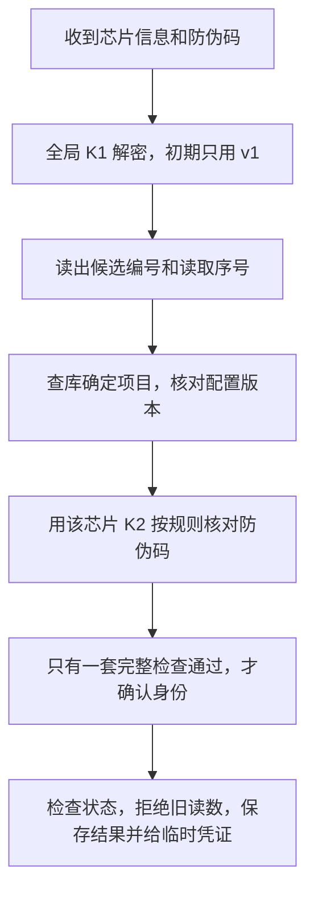

# BUMBUM 怎么运行、怎样保护数据

更新日期：2026-10-24。本文先让 cece 看懂项目怎么运转。精确的加密参数、计算公式和部署配置放在 [技术附录](docs/IMPLEMENTATION_DETAILS.md)，AI 写代码时必须一起读。两份文件共同定义技术规则；产品要求看 [PRD](PRD.md)，接口字段看 [API_CONTRACT](API_CONTRACT.md)，表结构看 [schema](db/schema.sql)。

## 1. 各部分负责什么

| 部分 | 使用的工具 | 大白话解释 |
|---|---|---|
| 用户页和管理页 | React、Vite、TypeScript | 用户和管理员在浏览器里看到、操作的页面 |
| 后端 | Python、Flask | 接收请求，检查身份，执行绑定和查询等业务 |
| 数据库 | MySQL 8.0，至少 8.0.16 | 保存芯片、物品、用户和操作记录，并拦住不合法的数据 |
| 网站入口 | Nginx | 接收浏览器访问，返回页面或转交给后端 |
| 后端运行工具 | Gunicorn | 正式运行 Flask，可同时安排多个进程处理请求 |
| 部署位置 | 阿里云 ECS、RDS | 分别运行程序、保存数据库；实际系统版本部署前核验 |

一个后端、一个数据库、两个网页应用。`core/` 放共同功能；`fashion/` 和 `jewelry/` 放各自业务。当前仓库只有文档和建表文件，没有可启动的应用。不要把建议目录当成已有代码。

## 2. 芯片、物品和所有者怎么关联

### 2.1 绑定必须遵守的规则

一枚芯片最多绑定一个物品，一个物品最多绑定一枚芯片；同一物品同时只能有一个有效所有者。服装芯片只能绑定服装物品，饰品同理。过去的所有权记录要保留。

“解绑旧所有者、绑定新所有者、写流转历史、记录管理员操作”必须一起成功；有一步失败就一起撤销。这叫**数据库事务**，避免出现“旧主人已经解绑，新主人却没绑定上”的半完成状态。同时到达的请求也必须遵守这些规则，不能各自检查后重复绑定。

芯片编号叫 `chip_uid`，物品业务编号叫 `item_uid`；格式、数据库约束和同时处理请求的顺序见 [附录第 1 节](docs/IMPLEMENTATION_DETAILS.md#1-编号与数据库保存规则)。不提供物理删除用户、物品或历史记录的接口。

### 2.2 芯片什么时候可用

| 操作 | 操作前 | 操作后 |
|---|---|---|
| 首次入库 | 没有这枚芯片 | 待绑定 `pending`，没有关联物品 |
| 绑定物品 | 待绑定，物品同项目且没有其他芯片 | 已绑定 `bound` |
| 解除芯片绑定 | 已绑定 | 回到待绑定；物品所有权不随之删除 |
| 停用或标记丢失 | 其他状态 | `disabled` 或 `lost`，保留原绑定，停止用户验证 |
| 恢复使用 | 停用或丢失 | 有物品回到已绑定，没有物品回到待绑定 |
| 重复设置同一合法状态 | 已是该状态 | 返回当前结果，不重复操作 |

停用/丢失时要先恢复，才能绑定或解绑；不能用“改状态”偷偷完成绑定。解绑不删除密钥和读数记录。

物品有草稿 `draft`、启用 `active`、停用 `disabled`、归档 `archived` 四种状态。草稿可转为启用/停用/归档，启用可转为停用/归档，停用可转为启用/归档；归档后不直接恢复。启用前必须有对应业务资料。只有物品启用、芯片已绑定、密钥和写卡配置完成，用户验证才可通过；“绑定好了”不等于“写卡完成了”。写卡完成怎样记录仍需核验。

### 2.3 修改数据库时怎么做

`db/schema.sql` 只用于第一次给空库建表，不能在已有 RDS 上反复执行。以后改表要另写升级步骤，先备份，再升级和验证，并说明失败后怎样恢复。未经授权不操作生产数据库。

## 3. 芯片密钥：先读出编号，再核对真伪

### 3.1 各把钥匙负责什么

已确认：同一版本的 K1 在两个项目中共享，每枚芯片有独立 K2。UID 就是芯片编号；“按 UID 派生”指用项目根密钥、芯片编号和用途，按固定规则算出不同的密钥。

| 槽位 | 用途 | 是否每枚芯片不同 |
|---|---|---|
| K0 | 管理芯片 | 是，按项目根密钥、UID 和用途算出 |
| K1 | 解开链接里的芯片编号和读取序号 | 否，同版本全局共享，独立随机生成 |
| K2 | 核对芯片随读数生成的防伪码 `cmac` | 是，按项目根密钥、UID 和用途算出 |
| K3、K4 | 预留 | 是，按各自用途算出，暂不授予多余权限 |

项目根密钥只在服务器使用；它不是芯片 K0，也不能直接充当 K1 或数据库加密密钥。初期只用 K1 的 v1，先解出编号，再查数据库知道它属于哪个项目，无需先猜项目。

**共享的代价：**K1 泄露会影响该版本所有芯片的编号和读数隐私。在密钥和权限正确分开的前提下，仅知道 K1 仍不应得到其他芯片的 K2，也不能直接生成新的有效防伪码。查看任意一枚芯片的 K1，都要提示这是全局秘密，并检查登录权限、确认操作、留下记录，禁止页面缓存。

方案已经选定，但实际权限、计算规则和写卡参数仍需查资料并用真实测试卡核验。它不是 NXP 强制规定的槽位分配。版本如何保存、怎样换钥匙，见 [附录第 2 节](docs/IMPLEMENTATION_DETAILS.md#2-芯片密钥与版本)。禁止覆盖已有芯片密钥；真正换钥匙要单独设计和授权。

### 3.2 数据库里也不能明文放密钥

保存秘密时，先用一把临时钥匙加密秘密，再用服务器的存储密钥加密这把临时钥匙。这叫**信封加密**。读取时反过来做，两步都检查有没有被改过；检查失败就停止。

根密钥、全局 K1、存储密钥和其他用途的密钥各用各的，不能混用。程序要保存哪些数据、随机数和验证标记，见 [附录第 3 节](docs/IMPLEMENTATION_DETAILS.md#3-秘密如何加密保存)。

## 4. 管理员怎样登录

### 4.1 登录和防止冒用

先验密码，再验验证器 App 生成的短时验证码（TOTP）。还没设置验证器时，只允许进入设置流程，不能操作业务；设置权限最多 5 分钟，完整登录最多 8 小时。

登录后，浏览器自动携带登录凭证 Cookie，服务器据此识别管理员。修改数据还要携带页面取得的额外口令 `X-CSRF-Token`，并检查请求来自允许的管理网页，避免其他网站借用登录状态发起操作。这种防护叫 CSRF 防护。登录凭证不能放进链接或浏览器本地存储，也不在接口返回内容里展示。

首次管理员由以后实现的受控服务器命令创建，没有公开注册入口和默认密码。密码、凭证的保存与检查方式见 [附录第 4 节](docs/IMPLEMENTATION_DETAILS.md#4-登录凭证与防冒用检查)。

### 4.2 验证器丢失、退出和失败重试

设置验证器时生成 10 个备份码，只展示一次，每个只能用一次；使用备份码仍须先通过密码验证。重用同一时段的验证码、同一备份码或同一登录挑战，不能重复获得登录权限。全部恢复方式都丢失时走受控人工恢复。

退出后当前登录凭证立即失效；管理员账号被禁用后，全部登录凭证和未完成的登录挑战失效。连续输错要暂时锁定，并检查账号与 IP 两种来源。精确次数、时长及多进程处理要求见 [附录第 5 节](docs/IMPLEMENTATION_DETAILS.md#5-限制重试与记录操作)。防机器人验证码、陌生 IP 告警和隐藏登录页是后续可选增强，当前不依赖未选定的外部服务。

## 5. 用户触碰芯片后发生什么

### 5.1 验证流程

链接保持 `https://nfc.bumbum.cc/tap?picc_data={picc}&cmac={cmac}`。picc_data 是加密的芯片信息，cmac 是一起生成的防伪码；不额外公开 UID、物品编号、项目或密钥版本，也不启用额外加密内容 enc。网页读取两个参数，再提交给后端；此链接是前端页面，不是后端直接返回 HTML 的接口。

解密出来像编号也不能直接相信，要查库并核对防伪码。任意 7 字节都能写成十六进制，不能用“像十六进制编号”排除错误密钥。K2 要按 SDM 规定算出本次读数核对防伪码用的临时密钥，不能随意计算；精确规则见 [附录第 6 节](docs/IMPLEMENTATION_DETAILS.md#6-芯片验证与临时凭证)。

读取序号叫计数器。只有通过检查的新序号才接受；同一个旧链接不能反复换取新凭证。检查状态、更新读数、记录成功和发凭证必须一起成功，失败不能留下半完成结果。刷新旧链接时提示重新触碰。系统故障要显示为系统故障，不能假装芯片是假货；请求过密也要限制，速度和限制次数以实测为准。

### 5.2 临时凭证能做什么

验证通过后发 5 分钟有效的 `tap_token`。它证明本次读数通过检查，不证明访问者就是登记所有者，也不能阻止尚未使用的链接被转发抢先使用。

| 凭证类型 | 可以做什么 | 什么时候用掉 |
|---|---|---|
| read：物品已绑定 | 多次查看允许展示的详情 | 到期失效 |
| bind：物品未绑定 | 查看详情、发绑定短信、绑定手机号 | 成功绑定时用掉；失败不算用掉 |

发短信不消耗凭证。绑定时手机号、短信码、物品和凭证必须对应；保存新所有者、流转历史以及用掉短信码/凭证要一起完成。每次使用都重查芯片与物品状态，停用或解绑后旧凭证不能继续用。读取请求放 `X-Tap-Token`，写请求放 JSON（按字段组织的文字数据），不放链接，不长期保存在浏览器。

### 5.3 饰品养成暂不实现

是否仅所有者可养成、怎样确认操作者身份、转赠后进度归谁、冷却按用户还是物品计算，仍需 cece 确认。不能把查到的登记所有者当成当前访问者；未确认前不开放 touch 或“当前用户进度”。

## 6. 两个网站怎样分开

| 网站 | 允许访问什么 |
|---|---|
| `nfc.bumbum.cc` | 用户页面；`/api/tap/`、`/api/public/`、`/api/fashion/`、`/api/jewelry/`；另开放准确的扫描回调地址 |
| `admin.bumbum.cc` | 管理页面和 `/api/admin/`，只允许指定管理出口 IP 访问 |

公开用户网站必须拒绝管理接口，否则别人可绕过管理网站的 IP 限制。所有正式访问使用 HTTPS；后端不直接对公网开放，数据库 3306 端口也不开放给所有人。服务器只信任自己的网站入口写入的访问来源信息。

本地开发允许哪些网页访问接口，要逐个列出；管理接口只信任 ADMIN_ORIGIN，不能把用户网页一起放行。浏览器的这项跨网页访问控制叫 CORS。完整配置和上线前检查见 [附录第 7 节](docs/IMPLEMENTATION_DETAILS.md#7-网站入口配置)。

## 7. cece 需要配置什么

名称和空值模板统一看 [.env.example](.env.example)：数据库连接、各用途密钥、域名、证书和允许访问管理端的 IP。秘密只在安全位置填写，不发聊天、不提交 Git。`VITE_` 开头的设置会进入前端，只能放公开信息；API 地址如何拼接看接口文档第 0 节。

目前没有应用、实际启动命令或已验证的部署版本。以后加入代码时再补齐实测步骤。各配置用途见 [附录第 8 节](docs/IMPLEMENTATION_DETAILS.md#8-配置与资料来源)。

## 8. 怎么判断某一步真的完成了

阶段与验收以 PRD 为准：先做后台基础管理，再做用户验证和短信绑定，之后才做运营与养成。全局 K1 方案已定，真实密钥和写卡仍等具体参数与测试完成。

| 要检查什么 | 至少看到什么结果 |
|---|---|
| 数据库 | 重复有效绑定、跨项目绑定和非法状态被拒绝；旧历史能保留，未知 UID 失败能记日志 |
| 管理员登录 | 未设置验证器不能操作业务；退出、禁用后旧凭证失效；验证码和备份码不能重复使用 |
| 同时提交请求 | 同一物品不会出现两个有效主人，同一次读数最多得到一次新授权 |
| 真实测试卡 | 同版本 K1 一致、不同芯片 K2 不同，错误密钥/防伪码不能通过，停用和旧读数被拒绝 |

卡片测试须包含同项目两枚卡和另一项目的测试卡，并用预先知道正确答案的数据核对计算。仅看到 URL 格式正确不算通过。只改文档、跑过建表、启动应用和真实卡验证，是不同的完成状态。

## 9. 还有什么没验证

截至 2026-10-24，已确认方案不等于已完成测试。每项都要记录资料来源、版本、日期和结果；不能沿用旧文档的“已确认”作为证据。

| 待完成事项 | 需要的证据或决定 |
|---|---|
| NFC.cool 写卡、改密钥和 CSV 能力 | App/手机/标签版本、官方说明或实测步骤 |
| 扫描回调格式、身份检查和重试 | 隐去秘密的真实请求、响应测试、失败后可见并可人工重扫 |
| 芯片权限、密钥计算和写卡参数 | NXP 资料、固定实现、正确答案测试、真实单卡结果及写卡完成记录办法 |
| 候选库与服务器环境 | 库版本/许可证/兼容性；实际 ECS 系统和 MySQL 版本 |
| 短信 | 提供商、凭证名称、域名、签名模板、限流和失败处理 |
| 养成 | 谁能操作、如何登录、转赠后的进度和冷却规则 |
| 上线后的记录与恢复 | 日志保留时长、访问权限、备份与恢复演练 |
| 后续优化 | KMS 密钥托管价格/地域/规格/报价日期；Passkey 登录和容量优化按需求评估 |
