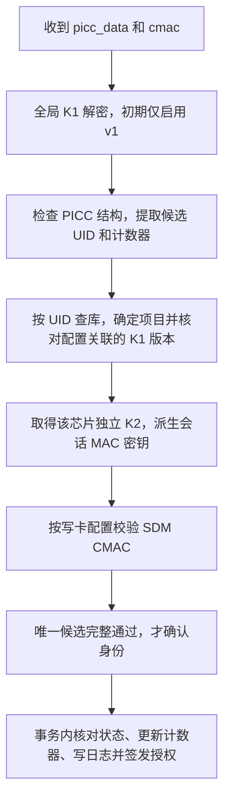

# BUMBUM 技术规格

更新日期：2026-10-24。本文定义架构、安全、事务与部署方案；产品以 [PRD.md](PRD.md)、接口以 [API_CONTRACT.md](API_CONTRACT.md)、字段以 [db/schema.sql](db/schema.sql) 为准。跨领域冲突按 [AGENTS.md](AGENTS.md) 处理。

## 1. 技术栈与模块

固定 Python 3 + Flask、MySQL 8.0、React + Vite + TypeScript、Gunicorn + Nginx。MySQL 最低 8.0.16，表使用 InnoDB，连接使用 utf8mb4，数据库会话时区固定 UTC。

一个 Flask 应用和数据库，两个前端 SPA；`core/` 共享芯片、物品、用户、密钥、所有权和验证逻辑；`fashion/`、`jewelry/` 仅保存对应业务。未来可设 `admin/` 认证与管理模块。以上是建议结构，实际仓库尚无应用代码，不虚构启动命令或依赖版本。阿里云 ECS 的实际系统版本和工具兼容性在部署前核验。

## 2. 数据一致性与状态机

### 2.1 绑定与所有权

- 项目 code 固定为 `fashion` / `jewelry`。`chip_uid` 在应用入口统一规范化为 7 字节、冒号分隔的大写十六进制；`item_uid` 使用 `FASH-YYYY-NNNNNN` / `JEW-YYYY-NNNNNN`，在管理端创建时提供，项目/前缀须一致，创建后不可修改。
- `chip.item_id` 可空且唯一，数据库通过复合外键保证芯片与物品 project 一致；已关联物品不能物理删除。业务 profile 类型由服务层按项目检查，禁止给 jewelry 物品写 fashion profile，反之亦然。
- `ownership` 保留当前及过去记录。生成列 `active_item_id` 只对 `is_active=1` 映射 item_id，唯一索引限制每个物品最多一个有效所有者；历史记录不受此唯一限制。解绑必须同时设置 `is_active=0`、`unbound_at`。
- 绑定、解绑、转赠：先锁定物品行，再锁定相应芯片/有效 ownership 行；检查前置条件，修改绑定记录、写入 history 和管理员审计，在同一事务提交。转赠同时关闭旧记录、创建新记录，仅写一条 `transfer` 历史。不要先删旧记录再跨事务创建新绑定。
- `bind_source` 仅属于 `ownership`；`ownership_history` 记录 from/to 用户、action、note 和时间。用户、物品及审计记录不提供物理删除 API。
- 所有并发冲突必须转换成契约错误，不能将数据库异常原文返回给前端。锁定多个物品时按 id 升序，死锁可进行有界事务重试。

### 2.2 芯片状态

| 操作 | 前置条件 | 结果 |
|---|---|---|
| 入库 | UID 未存在 | `pending`，item_id 为空 |
| bind-item | `pending`、无 item、目标同项目且未关联其他芯片 | `bound`，设置 item_id |
| unbind-item | `bound` 且有 item | `pending`，清空 item_id；不删除物品所有权 |
| status → disabled/lost | 当前为其他状态 | 保留原 item_id；停止用户验证和授权 |
| status → pending | 当前 disabled/lost 且无 item | 恢复待绑定 |
| status → bound | 当前 disabled/lost 且有 item | 恢复已有绑定 |
| 重复设置相同状态 | 状态本身合法 | 幂等返回当前状态 |

不能用 status 接口创建/解除绑定；disabled/lost 状态不能直接 bind/unbind，先显式恢复。数据库 CHECK 限制 pending 无 item、bound 有 item。解绑不清除已经接受的 SDM 计数器，也不删除密钥记录或写卡历史。

物品状态为 `draft` / `active` / `disabled` / `archived`；仅 `active` 且芯片为 `bound`、已配置密钥与写卡完成时允许 Phase 2 验证。`archived` 作为终态，不直接恢复；其余允许 draft→active/disabled/archived、active→disabled/archived、disabled→active/archived。激活前必须有对应 profile；不以物品激活自动完成芯片配置。Phase 1 真实写卡完成记录方式在 SDM 方案核验时一并定稿，不提供虚构的自动写卡接口。

### 2.3 数据库生命周期

`db/schema.sql` 是空库初始化快照，不是升级或可重复执行脚本。新增结构后，已有数据库另加迁移，说明备份、升级、回滚/恢复和验证；未经授权不对真实 RDS 执行。本轮只修订目标 DDL。所有持久连接初始化时设置 `time_zone='+00:00'`，DATETIME/TIMESTAMP 以 UTC 解释，API 输出 ISO 8601 UTC。

## 3. 密钥与信封加密

### 3.1 SDM 密钥架构（已确认，2026-10-24）

cece 已确认采用“同版本全局共享 K1、芯片级独立 K2”。fashion 与 jewelry 使用同一版本的 K1；K0、K2、K3、K4 继续按项目根密钥、UID 和槽位用途独立派生。此决策替代“所有 K0–K4 都按 UID 派生”及“首次解密选钥仍待决定”的旧表述。

| 槽位 | 职责 | 密钥策略 |
|---|---|---|
| K0 | 芯片管理（App Master Key） | 由所属项目根密钥、UID 和槽位用途独立派生 |
| K1 | PICC 元数据解密（SDMMetaRead） | 同版本全局共享，独立安全随机生成 16 字节，不按 UID 派生 |
| K2 | SDM 验签基础密钥（SDMFileRead） | 由所属项目根密钥、UID 和槽位用途独立派生；不同芯片使用不同 K2 |
| K3、K4 | 预留或以后明确的独立用途 | 按 UID 和各槽位用途独立派生，不授予不必要权限 |

K0 是写入芯片的管理密钥，不是服务端项目根密钥。MASTER_KEY_FASHION / MASTER_KEY_JEWELRY 是仅在服务端使用的项目根材料，不直接写入芯片，不充当 K1，也不与存储包装密钥复用。不同项目和槽位的派生必须做用途隔离，具体 KDF 及输入编码仍须锁定实现并通过测试向量确认。

**全局 K1 配置与版本：**

- 初期只支持全局 K1 的 v1：SDM_META_KEY_V1 保存 16 字节密钥的 32 位十六进制表示，SDM_META_KEY_VERSION=v1 指定初始写卡版本。本轮模板值留空，不生成真实密钥。缺失、格式错误、默认全零或未支持版本必须阻止 SDM/密钥功能启用，不能退回默认密钥。
- 不需要客户端提供项目或版本；服务端先用全局 K1 得到候选 UID，再查库确定项目。初期只尝试一把 v1 K1，不遍历项目或全部芯片密钥。
- 服务启动时可预加载只读 K1 配置到受控进程内存；不逐请求查库加载 K1，也不将真实 K1 放进仓库或普通日志。运行中的业务状态仍按原规则持久化。
- 当前 chip_key.key_version 是不可变 SDM 配置版本；初始配置 v1 固定关联全局 K1 v1。master_key_version 只标识 K0/K2/K3/K4 所属项目根密钥的版本，storage_key_version 只标识信封包装密钥版本，不能拿后两者推断 K1。
- encrypted_keys 继续保存 K0–K4 的加密 JSON；其中 K1 是该配置关联的全局密钥加密快照，不是逐卡派生结果。生成时核对统一来源，同配置下 K1 必须一致；读取旧卡密钥不能自动换成最新 K1。
- 将来轮换必须另行定义新的配置版本、服务端配置版本到全局 K1 版本的不可变映射、旧卡更新与恢复流程，并按需提供数据库迁移。禁止更换 v1 的实际密钥后仍沿用 v1 名称。若过渡期允许多个全局 K1 版本，只能尝试明确启用且数量受限的集合；每个候选都须完成结构、记录版本和 CMAC 检查，唯一完整通过后才能接受。

**安全边界：**全局 K1 泄露会影响所有使用该版本芯片的 UID/计数器隐私；在正确的密钥分离和访问权限配置下，仅泄露 K1 不应泄露其他芯片的 K2，也不能据此生成新的有效 CMAC。K1 绝不兼作 K2。查看任何一枚芯片的 K1 都相当于展示该版本全局秘密，沿用 full 会话、确认、审计和 no-store 要求，界面须说明影响范围，不显示在列表中。

这是项目选定的槽位分配，不表述为 NXP 强制槽位用途。实际 SDM 配置应将 SDMMetaRead 指向 K1、SDMFileRead 指向 K2；管理认证、ChangeKey、文件写入和配置修改权限仍要依据 NXP 资料和真实工具核验，不能只因 K1 被称为“元数据密钥”就假定它没有其他权限。

**尚未完成的实现前置验证：**NXP 资料版本及具体访问权限、KDF 与输入编码、NDEF 编码和偏移、MAC 覆盖范围/截断规则、计数器字节序、工具及库版本兼容性、单卡已知答案测试和写卡完成记录流程。旧版 CMAC 输入示例不是可投产协议。架构决策已完成，但不代表上述验证已完成；前置条件未满足时，真实密钥生成、写卡和 SDM 上线仍不可用。

候选社区实现 [sdm-backend](https://github.com/nfc-developer/sdm-backend/blob/37585f0c76eded73798b936b17aa5e187075b78f/app.py#L222-L227) 展示了先用不依赖 UID 的元数据密钥、再按 UID 取得验签密钥的接口顺序，仅作为实现参考，不是本项目已集成或已通过测试的证明。官方核验资料：[NXP AN12196](https://www.nxp.com/docs/en/application-note/AN12196.pdf)；本次研究未直接读取该 PDF，不能声称已按其验证具体参数。pylibsdm 也仍为待评估候选，不直接宣称成熟度或兼容性。

### 3.2 存储加密（已定）

- 每条秘密数据生成独立随机 32 字节 DEK；用 AES-256-GCM 加密，随机生成 12 字节数据 nonce。密文按 `ciphertext || tag` 存储，tag 为 16 字节。
- 用独立的 `STORAGE_ENCRYPTION_KEY`（32 字节）AES-256-GCM 包装 DEK，另生成独立 12 字节 nonce；包装结果也含 16 字节 tag。两个 nonce 不能复用或从固定常量生成。
- 解密顺序：按存储密钥版本找到包装密钥 → 验证并解密 DEK → 验证并解密数据。认证失败即停止，不尝试把损坏密文当成明文。
- `chip_key` 分列保存 `encrypted_keys`、`nonce`、`dek_ciphertext`、`dek_nonce`、`storage_key_version`。key_version 是 SDM 配置版本并按第 3.1 节关联全局 K1 版本；master_key_version 是项目分散根密钥版本；storage_key_version 是包装密钥版本，三者不混用。
- `admin_user.totp_secret_encrypted` 保存完整 UTF-8 JSON 信封字节：`format_version` 固定 1、`algorithm` 固定 `AES-256-GCM`、`storage_key_version`、Base64 编码的 `dek_ciphertext` / `dek_nonce` / `ciphertext` / `nonce`。ciphertext 含 tag。算法与格式版本只接受已支持值。
- 两层 GCM 都设置 AAD：UTF-8 字符串 `bumbum|<entity>|<id>|<field>|<storage_key_version>|<layer>`；entity 为 `chip_key` 或 `admin_user`，id 对 chip_key 使用 chip_id、对 admin_user 使用 admin_id，field 为 `keys` 或 `totp_secret`，layer 为 `data` 或 `dek`。解密时从预期记录构造，防止密文跨记录替换。
- 存储密钥轮换须保留旧版本直到完成重新包装；不覆盖旧版本名称。当前环境只定义 v1，轮换与 KMS 迁移另做版本设计，不声称现有 DDL 可直接容纳任意 KMS Blob。
- Phase 1 不支持 `force=true` 覆盖已有密钥。重复生成返回 already_exists，恢复读取已有记录；真正换钥须另定硬件更新、旧版本保留、恢复流程和计数器处理。

## 4. 管理员认证与持久状态

### 4.1 Cookie 会话与 CSRF

正式认证统一使用随机不透明会话 Cookie，数据库 `admin_session` 仅保存 SHA-256 token 摘要。Cookie 名 `bumbum_admin_session`，生产 `HttpOnly; Secure; SameSite=Strict; Path=/api/admin`，不设置 Domain，完整会话最长 8 小时，首次 TOTP 设置会话 5 分钟。不要把正式会话 token 放响应 JSON、URL 或浏览器本地存储。

所有浏览器认证写请求要求 JSON 和精确 Origin 白名单检查（生产仅管理域名，开发仅 ADMIN_ORIGIN 指定的管理前端来源）。已持有 Cookie 的写请求还要求 `X-CSRF-Token`，与该 session 的服务端摘要核对；登录/MFA 的无 Cookie 请求也必须校验 Origin。只使用 SameSite 不能替代 CSRF 验证。受信任的非浏览器联调请求须显式提供合法 Origin，不能用“无 Origin”跳过验证。

CSRF token 使用独立 CSRF_HMAC_KEY 对 UTF-8 字符串 `bumbum|csrf|<原始session token>` 做 HMAC-SHA256，编码为小写十六进制；签发会话时将其 SHA-256 摘要写入 csrf_token_hash。`GET /api/admin/auth/session` 从当前 Cookie 重建同一 CSRF token，返回 scope/过期时间，不轮换、不修改会话，避免 GET 改状态与多页签失效。响应不缓存，跨域仅放行精确开发来源并设置 credentials，禁止通配来源。轮换 CSRF_HMAC_KEY 必须同时撤销所有会话。

### 4.2 首次开户、TOTP 和恢复

- 没有公开注册 API。首次管理员通过后续受控的服务器初始化命令创建，必须走安全输入/秘密绑定；不预置默认密码、不写 SQL 明文密码。该命令当前未实现。
- 密码使用 Werkzeug 的 scrypt 实现加盐哈希，参数在实现时按部署资源验证；不自己设计密码哈希算法。
- 密码通过且未启用 TOTP，只签发 `scope=enroll` 的短时 Cookie。只能 session、totp/setup、totp/enable、logout；其他管理 API 返回 mfa_required。
- setup 复用服务端加密保存的同一待绑定 TOTP 秘密，授权后解密返回设置材料，不在重复请求中换掉它；enable 验证成功后设置 enabled、原子记录 time step、生成备份码，撤销所有旧 enroll 会话并签发新 full 会话。已启用的管理员不能调用 setup 覆盖现有 TOTP。
- 已启用 TOTP 时密码成功只创建 `admin_mfa_challenge`，返回 5 分钟一次性 mfa_ticket；TOTP 或备份码验证成功后，原子消费挑战并签发 full 会话，不能复用挑战获得多个会话。
- TOTP 用 pyotp 等成熟实现，时间步长与容差在实现时固定并验证；接受的 step 必须严格大于 totp_last_step，并在事务中更新，防止并发重放。
- 备份码生成 10 个，每个至少 128 位随机熵，唯一一次明文展示，只存 SHA-256 摘要；备份码登录先验证密码，再使用 mfa_ticket，成功后同事务标记 used_at。遗失全部恢复因子时走受控人工恢复，不提供绕过认证的公开接口。
- 注销撤销当前 session；禁用管理员时所有 session 和未用挑战即时失效，每次请求均校验账号状态。

### 4.3 限流与审计

- 登录按账号与 IP 两个桶检查；15 分钟计数窗口内失败 5 次锁定 5 分钟，达到 10 次锁定 30 分钟，锁定期拒绝不延长锁期、不新增计数。成功登录重置账号失败桶，IP 桶按窗口自然过期。MFA 挑战最多 5 次失败，另受账号/IP 限流约束。
- `security_rate_limit` 持久保存计数与锁期，桶标识使用 `IP_HASH_KEY` 做 HMAC-SHA256 并包含用途。并发插入桶使用唯一键和事务处理，不依赖单 worker 内存。
- `admin_login_event` 记录成功、失败和锁定；未知账号可使用 username_hash，不必虚构 admin_id。`admin_audit` 记录敏感业务操作，不写密钥、验证码、token 或完整手机号；ip_hash 用相同环境的独立 HMAC 密钥处理规范化 IP。
- 密钥读取先授权、确认，再将审计持久化后返回；数据库故障不能返回“已记录审计”的密钥。响应 `Cache-Control: no-store`，前端不持久保存密钥。
- CAPTCHA、陌生 IP 告警和随机登录页路径是后续可选增强；当前不把未选择的外部服务写成已完成或 Phase 1 前置依赖。

## 5. Phase 2 验证与短时授权

### 5.1 URL 与验证

目标 SUN URL 保持 `https://nfc.bumbum.cc/tap?picc_data={picc}&cmac={cmac}`，不增加项目、版本、UID 或随机查找码，不启用 enc。由 Nginx 返回 SPA，前端 POST picc_data 和 cmac 两个字段给验证 API，不新增后端 HTML 路由。全局 K1 的选钥架构已确认；真实 SDM 参数仍须完成第 3.1 节的前置验证。



未来实现必须遵守：

1. 解密前严格检查请求字段、十六进制编码与长度。AES-CBC 解密后，按实际 SDM 配置检查 PICCDataTag 的 UID 长度、UID/计数器镜像标志和数据布局。任意 7 字节都能转成 14 位十六进制，不能靠“UID 能转成十六进制”过滤错误密钥；错误密钥也可能得到结构似乎合理的字节。结构检查不替代 CMAC。
2. 初期仅使用全局 K1 v1；解密结果始终是候选数据。按规范化 UID 查芯片和密钥记录，由数据库记录确定项目，核对 key_version 所关联的 K1 版本。客户端项目提示或解析出的 UID 不能直接作为可信身份。
3. 按该芯片所属项目及根密钥版本取得独立 K2，按已核验 SDM 规范结合 UID、读取计数器等输入派生会话 MAC 密钥，按配置的 MAC 输入范围和截断规则验证 cmac，并采用恒定时间比较。保留验签所需原始编码；不能简单对 decrypted 明文做一次通用 CMAC 就视为完成。
4. 唯一候选完成结构、数据库版本一致性及 CMAC 验证后才确认身份。未来多版本场景不能只认首个成功解密的候选；多个完整匹配视为服务端配置异常，返回 500 internal_error 并记录内部诊断，不签发授权。解析/验签不匹配可继续下一个已启用候选，配置缺失和数据库故障应按服务错误处理，不能裸 except 吞掉全部异常。
5. 再检查芯片 bound、物品 active、密钥和写卡配置完成等资格。事务内先锁物品后锁芯片，重新核对初读绑定、配置版本及状态，比较并更新 last_verified_counter（仅接受比已接受值更大的计数器），写成功日志并创建 tap_grant。同一计数器最多成功一次；失败候选、错误 CMAC 和未提交事务不能推进计数器或创建授权。
6. 其他失败单独写日志；无法得到 UID 时 scan_log.chip_uid 为 NULL，不伪造。未经 CMAC 验证的候选 UID 不能当作已认证身份。原始 PICC/CMAC 不写普通访问日志；数据库日志限制访问和保留周期，投产前确定具体保留时长。refresh/重试旧 URL 返回 replay_suspect，提示重新触碰；乱序旧计数器也拒绝，不清零计数器绕过防重放。
7. 验证接口实施支持多进程的持久化限流，参数根据负载测试及共享出口 IP 情况确定，不把“每 IP 每秒 5 次”写成已验证指标。性能包括数据库、K2 解密、验签及事务，未实测前不承诺“几乎零开销”或确定的单请求耗时。限流或服务故障按 API 状态返回，不伪装成防伪失败。

### 5.2 tap_token 与短信绑定

随机 tap_token 至少 256 位熵、5 分钟有效，只存摘要到 tap_grant，并绑定芯片、物品和允许操作。Phase 2 未绑定物品签发 bind 授权，已绑定物品仅签发 read 授权。有效授权允许重复读取详情；发送短信不消费授权；只有成功绑定时同事务消费 bind 授权。失败事务不消费；已消费或过期不能用于后续请求，需重新触碰。每次使用重查芯片/物品状态与原绑定，停用或解绑立即失效。

短信验证码绑定 grant、手机号和用途，使用独立 SMS_CODE_HASH_KEY 做 HMAC-SHA256；短信挑战有效期不超过 5 分钟且不超过 grant 到期时间，最多 5 次失败。新码使同 grant 同手机号旧挑战失效。手机号 60 秒一次、IP 每小时最多 10 次，计数持久化；短信提供商及实际凭证要求待选。绑定时在同一事务消费授权、消费短信挑战、创建/复用 user、写 ownership/history；用户创建处理 phone 唯一键并发冲突。

为限制链接传播，读取请求将 tap_token 放 `X-Tap-Token`，写请求放 JSON，均禁止 query token；浏览器不得持久保存。触碰证明不能证明操作者是已登记所有者，也不能阻止尚未使用的链接被转发后抢先使用，不把此机制宣传成所有者登录。

### 5.3 Phase 3 未决权限

是否只允许所有者养成、用户如何登录、转赠后进度归属与冷却按用户还是物品计算，须 cece 明确。现有 jewelry_user_progress 等仅为预留表；不得从有效 ownership 直接推断当前操作者身份。未决前不实现 touch、不签发 touch 权限，不输出“当前用户”进度；保留 API 标为 blocked。

## 6. 域名与代理边界

公网用户域名只能转发 `/api/tap/`、`/api/public/`、`/api/fashion/`、`/api/jewelry/`；管理域名只转发 `/api/admin/`。Webhook 独立开放为精确路径，并使用 HTTPS Basic Auth；不用 query secret。管理域名的 IP 白名单不能替代用户域名的管理路径拒绝规则。阿里云安全组是按网络端口/来源限制，无法在共享 443 端口上按域名单独限制管理站点，应使用 Nginx 站点规则或经过批准的网关。

以下是部署骨架，证书、目录和白名单必须替换，不能直接当成完整可运行配置；生产加载前运行 `nginx -t`。TLS 终止于此 Nginx，应用仅信任这一层代理，客户端 IP 取被 Nginx 覆写的 X-Real-IP，禁止直接信任客户端 X-Forwarded-For。

```nginx
# 置于 http {} 内；真实证书指令在 server 中另配。
server {
    listen 443 ssl;
    server_name nfc.bumbum.cc;
    root /var/www/bumbum-frontend/nfc/dist;

    location = /api/admin { return 404; }
    location ^~ /api/admin/ { return 404; }
    location = /api/webhook/admin/scan {
        proxy_pass http://127.0.0.1:5000;
        proxy_set_header Host $host;
        proxy_set_header X-Real-IP $remote_addr;
        proxy_set_header X-Forwarded-For $remote_addr;
        proxy_set_header X-Forwarded-Proto $scheme;
    }
    location ~ ^/api/(tap|public|fashion|jewelry)/ {
        proxy_pass http://127.0.0.1:5000;
        proxy_set_header Host $host;
        proxy_set_header X-Real-IP $remote_addr;
        proxy_set_header X-Forwarded-For $remote_addr;
        proxy_set_header X-Forwarded-Proto $scheme;
    }
    location /api/ { return 404; }
    location / { try_files $uri $uri/ /index.html; }
}
server {
    listen 443 ssl;
    server_name admin.bumbum.cc;
    root /var/www/bumbum-frontend/admin/dist;
    allow 192.0.2.10; # 文档示例地址，必须改成真实管理出口IP
    deny all;

    location ^~ /api/admin/ {
        proxy_pass http://127.0.0.1:5000;
        proxy_set_header Host $host;
        proxy_set_header X-Real-IP $remote_addr;
        proxy_set_header X-Forwarded-For $remote_addr;
        proxy_set_header X-Forwarded-Proto $scheme;
    }
    location /api/ { return 404; }
    location / { try_files $uri $uri/ /index.html; }
}
```

生产还需默认虚拟主机拒绝未知 Host、HTTP→HTTPS、真实证书和请求体大小限制。NFC 页面/验证 API 不记录含 picc_data、cmac、token 的完整 URL/请求体；前端 Referrer-Policy 使用 no-referrer，避免向第三方泄露动态参数。应用只绑定回环，外部不能直连 Gunicorn 绕过代理；RDS 3306 不对公网开放。生产同域不启用 CORS；本地开发使用精确来源、Cookie credentials，Secure 仅可在明确的 localhost 开发配置关闭。

## 7. 配置与运行前提

配置名称与非敏感示例集中于 `.env.example`。DB_* 为数据库连接；STORAGE_ENCRYPTION_KEY 与 STORAGE_KEY_VERSION 管理存储包装；IP_HASH_KEY 仅用于标识 HMAC；CSRF_HMAC_KEY 用于会话绑定的 CSRF 值；WEBHOOK_SHARED_SECRET 用于 Basic Auth，建议独立的 32 字节随机值以十六进制表示（不含冒号）；MASTER_KEY_* 是 K0/K2/K3/K4 使用的项目根密钥配置；SDM_META_KEY_V1 是与项目根密钥独立的全局 K1，SDM_META_KEY_VERSION 初期固定为 v1，字段与版本规则见第 3.1 节；SMS_CODE_HASH_KEY 仅 Phase 2 需要。所有加密/HMAC 密钥独立生成，不复用数据库密码或彼此替代。ADMIN_TOTP_ISSUER 是公开发行方名称；CORS_ORIGINS 是开发来源总清单，管理认证路由必须再限制到单个 ADMIN_ORIGIN（开发 localhost:5174，生产 https://admin.bumbum.cc），不能把总清单全部用于带 Cookie 的管理 API；VITE_API_BASE_URL 是公开构建配置，禁止放任何秘密到 VITE_ 变量。

当前不存在应用和运行脚本。未来后端启动入口、版本锁定、Gunicorn worker 数和进程托管命令须在代码加入后实测。现场需要 cece 安全填写的是连接信息、独立秘密和真实域名/证书/IP 白名单，不在本轮索取或写入真实值。

## 8. 阶段与验证要求

阶段范围唯一由 PRD 定义：Phase 1 包含管理员登录、TOTP、备份码和基础管理；全局 K1 架构已定，生成真实密钥/写卡仍受第 3.1 节具体参数与单卡验证的前置条件限制。Phase 2 是在线验证、H5 与短信绑定；Phase 3 是运营编辑和养成；Phase 4 评估 KMS、Passkey 和基于实际流量的优化。

DDL 验证要覆盖空库建表、重复有效 ownership/芯片绑定被拒绝、跨项目绑定被拒绝、历史绑定可多条、无 UID 失败日志可保存。未来认证测试还须覆盖 enroll 无业务权限、Cookie/CSRF、注销、禁用账号、TOTP/MFA/备份码并发消费；绑定与计数器测试须验证并发，不以串行演示替代。真实 SDM 测试须用同项目两枚卡和另一个项目的测试卡验证：同版本 K1 一致、不同芯片 K2 独立、跨项目根密钥隔离、项目与配置版本查库一致，错误 K1/K2、修改的 CMAC、结构似乎合法的随机明文均不签发授权；覆盖重复计数器、并发请求、停用与非法配置。未来轮换须额外验证版本对应关系。单卡已知答案和真实 NDEF 参数验证仍为前提，不能仅检查 URL 外观便认定加密配置成功。

## 9. 待验证事项与证据

截至 2026-10-24，全局 K1 架构已由 cece 确认；以下实际参数或测试仍未在仓库提供可复查证据。旧版“已确认”的工具能力表述不能作为测试结果；历史保留在 CHANGELOG 并注明替代。

| 事项 | 当前状态 | 定稿前需记录 |
|---|---|---|
| NFC.cool 改密钥、SDM配置、CSV能力 | 待官方资料/实测核验 | App版本、平台、标签型号、官方链接或手动步骤与结果 |
| Webhook 负载、鉴权、重试行为 | 待实测 | 版本、脱敏负载、响应码试验；失败必须可见并有人工重扫路径 |
| NTAG424 实际访问权限、KDF和写卡参数 | 架构已确认，参数与实测待完成 | 全局K1方案不再待选；仍需NXP资料版本/链接、权限检查、固定实现、测试向量和单卡结果 |
| SDM候选库 | 待评估 | 仓库/包链接、固定版本、许可证、Python兼容性、已知答案结果 |
| ECS系统和MySQL部署版本 | 待目标环境核验 | 实际版本与兼容性结果；不得把目标版本写成已观测版本 |
| 短信提供商 | Phase 2前选择 | 服务、凭证名称、域名、签名模板、限流和失败处理 |
| 养成权限与转赠进度 | Phase 3产品决策 | 用户身份来源、权限、进度归属和冷却维度 |
| 日志保留与备份恢复 | 投产前确定 | 具体保留周期、访问控制、备份与恢复演练结果 |
| KMS价格与迁移 | 后续评估 | 地域、规格、报价日期和官方链接；不引用无来源固定费用 |
