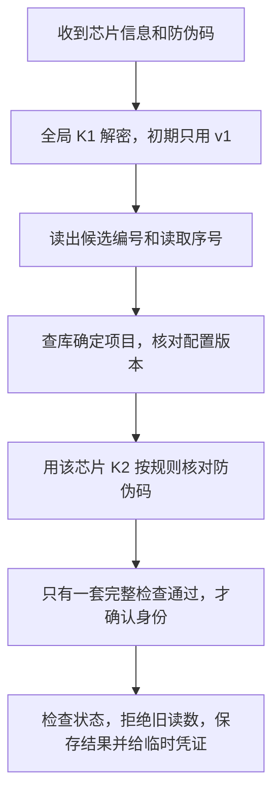

# BUMBUM 怎么运行、怎样保护数据

文档整理：2026-11-03；精确技术规则未因重组改变。本文先让 cece 看懂项目怎么运转。精确的加密参数、计算公式和部署配置放在 [技术附录](docs/IMPLEMENTATION_DETAILS.md)，AI 写代码时必须一起读。两份文件共同定义技术规则；产品要求看 [PRD](PRD.md)，接口字段看 [API_CONTRACT](API_CONTRACT.md)，表结构看 [schema](db/schema.sql)。

## 1. 各部分负责什么

管理后台组件库已确定为Ant Design，采用antd 6官方组件、本次Make展示组合及官方交互模式，原则见[后台设计与交互规范](docs/ADMIN_UI_GUIDELINES.md)；当前任务分支已迁移，人工验收与main/部署状态见TODO。锁定版本、React兼容性及依赖调整见技术方案；正式管理端使用Umi Max/Ant Design Pro，既有认证保留，用户H5独立设计。

组件版本和A完整范围见[后台工程说明](docs/proposals/admin-rebuild-implementation.md)，图片恢复门槛保留，固定React19独立组件矩阵已按cece决定取消；历史验证证据在CHANGELOG。芯片查询、详情和批次维护已按下文及API第3节交付；物品扩展查询、普通资料原子保存、私有图片及升级工具已接入后端，管理端物品列表、同字段详情/编辑、连续创建及Upload已接入；人工验收、合并与部署进度见TODO。

图片配套恢复门槛保留；媒体后端使用005及[离线备份模块](core/media_backup.py)，实现边界见[附录第9节](docs/IMPLEMENTATION_DETAILS.md#9-服装资料与启停实现)，字段/图片契约见[API第4节](API_CONTRACT.md#4-管理物品)。原生SQL还原与文件还原分开，不依赖上传服务在线。生产上传默认关闭，隔离检查不等于真实目标备份或生产启用前提已满足。

现有 `chip.item_id` 唯一，停用或挂失时按状态保留当前关联。测试分支的整套物品接续、历史和验证批次能力见 [接口契约](API_CONTRACT.md#11-数字档案管理与整套物品当前分支)。独立实体、装配和 H5 的增量方案见 [已审核技术方案](docs/proposals/digital-item-assembly-h5-technical.md)。

| 部分 | 使用的工具 | 大白话解释 |
|---|---|---|
| 用户页和管理页 | React、TypeScript；用户端Vite、管理端Umi Max/Ant Design Pro | 用户和管理员在浏览器里看到、操作的页面 |
| 后端 | Python、Flask | 接收请求，检查身份，执行绑定和查询等业务 |
| 数据库 | MySQL 8.0，至少 8.0.16 | 保存芯片、物品、用户和操作记录，并拦住不合法的数据 |
| 网站入口 | Nginx | 接收浏览器访问，返回页面或转交给后端 |
| 后端运行工具 | Gunicorn | 正式运行 Flask，可同时安排多个进程处理请求 |
| 部署位置 | 阿里云 ECS、RDS | 分别运行程序、保存数据库；实际系统版本部署前核验 |

每个环境各有一个后端、一个业务数据库和两个网页应用。当前后端入口为app.py，认证、登记、绑定、密钥、验证和统计模块位于`core/`；两个前端分别位于`frontend/admin`和`frontend/user`。fashion/jewelry是业务分类，不把建议目录当成已经存在的独立服务。逐接口可用范围只维护在[实现概览](API_CONTRACT.md#04-当前能做到哪一步)，当前任务见[TODO](TODO.md)，历史验收见[CHANGELOG](CHANGELOG.md)。服装资料的事务和请求限制见[附录第9节](docs/IMPLEMENTATION_DETAILS.md#9-服装资料与启停实现)；扫描回调和云测试边界见第2.5节。建议的目录和规则不代表已有代码。

## 2. 芯片、物品和所有者怎么关联

### 2.1 绑定必须遵守的规则

适用说明：芯片首次绑定已有实现；首次认领与整套接续见[接口实现概览](API_CONTRACT.md#04-当前能做到哪一步)。管理员直接绑定、解绑或转赠所有权及通用芯片解绑仍是后续设计约束，不能据本节事务要求视为对应入口可用。

一枚芯片最多绑定一个物品，一个物品最多绑定一枚芯片；同一物品同时只能有一个有效所有者。服装芯片只能绑定服装物品，饰品同理。过去的所有权记录要保留。

芯片入库时可以暂不分配项目；后续首次绑定物品时，项目与绑定一起保存，按物品确定。已有项目的芯片不能通过重复登记或跨项目绑定换项目；解绑也保留项目和原密钥。项目未确定前不能生成密钥、写卡或通过用户防伪验证。首次绑定规则见[绑定实现](docs/IMPLEMENTATION_DETAILS.md#13-芯片绑定物品实现)，实际可用范围见接口概览。

“解绑旧所有者、绑定新所有者、写流转历史、记录管理员操作”必须一起成功；有一步失败就一起撤销。这叫**数据库事务**，避免出现“旧主人已经解绑，新主人却没绑定上”的半完成状态。同时到达的请求也必须遵守这些规则，不能各自检查后重复绑定。

芯片编号叫 `chip_uid`，物品业务编号叫 `item_uid`；格式、数据库约束和同时处理请求的顺序见 [附录第 1 节](docs/IMPLEMENTATION_DETAILS.md#1-编号与数据库保存规则)。普通业务不提供物理删除用户、物品或历史记录的接口；已批准的生产验证对象单条删除和test验收批次清理按专用规则执行，保留另一侧档案、必要批次外关系及审计，不授权整库清空。

### 2.2 芯片什么时候可用

| 操作 | 操作前 | 操作后 | 实现边界 |
|---|---|---|---|
| 首次入库 | 没有这枚芯片 | 待绑定 `pending`，没有关联物品 | 已实现 |
| 绑定物品 | 待绑定，项目未分配或与物品一致，物品没有其他芯片 | 未分配时同时确定项目，转为已绑定 `bound` | 已实现 |
| 解除芯片绑定 | 已绑定 | 回到待绑定；物品所有权不随之删除 | 后续规则，非当前可用入口；挂失/退役还须D细分 |
| 普通停用 | 待绑定 `pending` 或已绑定 `bound` | `disabled`，保留原绑定，停止用户验证 | 当前分支通过 `chipState` 接入；挂失、退役及候选芯片拒绝此操作 |
| 普通恢复 | `disabled`，且整套未挂失、不是候选芯片 | 有物品回到 `bound`，没有物品回到 `pending` | 当前分支通过 `chipState` 接入；`lost`、`retired` 不能普通恢复 |
| 整套挂失与接续退役 | 按整套业务条件核对 | 保留原关联或记录历代组合，停止旧卡服务 | 通过整套流程办理，不用普通停用/恢复替代；见[第11节](API_CONTRACT.md#11-数字档案管理与整套物品当前分支) |

普通停用与恢复需填写依据；关联物品已有短许可及持续查看资格会永久撤销，恢复不复活旧资格。重复提交相同命令回执按回执规则处理，重新发起不符合当前状态的操作会被拒绝，不等于任意状态切换都幂等。不能用“改状态”偷偷完成绑定或解除整套挂失；通用解绑仍待独立交付，且不得删除密钥和读数记录。

以下是物品状态集合与长期转换约束；当前接口只开放服装active/disabled，归档与其他动作不据此自动开放。物品有草稿 `draft`、启用 `active`、停用 `disabled`、归档 `archived` 四种状态。草稿可转为启用/停用/归档，启用可转为停用/归档，停用可转为启用/归档；归档后不直接恢复。启用前必须有对应业务资料。只有物品启用、芯片已绑定、密钥和写卡配置完成，用户验证才可通过；“绑定好了”不等于“写卡完成了”。当前通过两条新读数与人工权限确认记录配置完成，见[技术附录第14节](docs/IMPLEMENTATION_DETAILS.md#14-测试卡密钥与配置方案)，不是用户验证接口。

物品草稿创建沿用已有item/project/admin_audit，不改表。编号和页面行为以[PRD草稿规则](docs/product/admin-management.md#2-物品草稿创建与列表)为准；资料通过对应项目profile表关联，接口没有资料时返回null。创建复用lock_admin_session在事务中按账号、会话顺序锁定重查，再保存item与item.create审计；编号唯一索引处理并发重复，返回409且不覆盖。服装资料和状态修改已接入，具体范围见[接口概览](API_CONTRACT.md#04-当前能做到哪一步)；绑定规则见[绑定PRD](docs/product/chip-lifecycle.md#2-首次绑定物品)及[绑定实现](docs/IMPLEMENTATION_DETAILS.md#13-芯片绑定物品实现)。

### 2.3 修改数据库时怎么做

`db/schema.sql` 只用于第一次给空库建表，不能在已有 RDS 上反复执行。以后改表要另写升级步骤，先备份，再升级和验证，并说明失败后怎样恢复。未经授权不操作生产数据库。

远端生产数据库必须设置`DB_SSL_MODE=VERIFY_IDENTITY`及`DB_SSL_CA`公开CA绝对路径，同时校验证书链和连接域名；错误证书、错误域名或不支持TLS的入口必须在认证前失败，不允许自动转明文。仅本机开发及香港回环连接使用`LOCAL`保留既有驱动协商，不提供PREFERRED/REQUIRED等较弱模式。杭州设置`HANGZHOU_SLOT=test/production`，交叉核对固定RDS端点、专用库、账号与TLS；初始化使用另一个限于目标库的专用身份，不能拿业务账号或高权限全实例账号凑通过。具体步骤及隔离边界见[杭州手册](docs/HANGZHOU_DEPLOYMENT.md)，不改变原香港/本机升级保护。

本次项目可空需要已有测试库执行一次升级。命令、自动备份及失败处理集中在 [本地运行说明第7节](docs/LOCAL_DEVELOPMENT.md#7-已有测试库升级允许芯片暂不分配项目)；新建空库直接使用新版schema，已有资料不重建。

### 2.4 当前先手动登记芯片

管理员登录后填写UID，项目和批次可空；项目默认“暂不分配”，新增记录为待绑定。相同UID重复提交返回原记录，不分配、清空或覆盖原项目、批次、状态或绑定。只有原项目非空且本次明确选择另一个项目才拒绝，提示原记录未修改。新登记和操作记录一起保存，有一步失败就撤销。列表能显示和筛选“未分配”。登记不生成密钥、不写卡、不证明芯片真伪；手机入口见第2.5节，手动登记验收步骤见 [芯片登记](docs/CHIP_REGISTRATION.md)。

芯片查询、按ID详情和批次维护使用[API第3节](API_CONTRACT.md#3-管理芯片已实现)契约及[产品规则](docs/product/chip-lifecycle.md#1-芯片登记与首次来源)。读列表使用同一只读一致性快照计数/分页；普通批次写入按管理员→会话→芯片重查并与最小审计原子提交，不反向锁物品、不改变绑定或密钥事务。测试分支的管理端依赖和迁移范围见 [后台工程说明](docs/proposals/admin-rebuild-implementation.md)，正式样式以 [后台设计与交互规范](docs/ADMIN_UI_GUIDELINES.md) 为准。

### 2.5 手机扫描后自动登记

登记回调及来源已有实现，产品流程和验收定义见[芯片规范](docs/product/chip-lifecycle.md#1-芯片登记与首次来源)；既有真实手机证据来自香港测试，不替代杭州环境验证。流程为单台手机用NFC.cool，只开启NFC触发，关闭QR码触发；先批量写固定文本，再批量读取真实UID，App自动保存并回调，无需逐张点保存。回调通过后新增为“未分配、待绑定”，重复扫描保持原资料。管理员须在与回调相同目标环境的后台查询，账号和数据不在环境间自动同步；失败后人工重扫。手机读卡成功不等于后台保存成功，以接口响应及后台查到记录为准。登记接口不绑定、不写卡，不提供离线队列或实时推送。

chip.registration_source表示首次登记来源：manual为网页手工、nfc_cool为手机扫描、unknown为历史未知。由入口决定，不接收客户端指定；重复登记不改来源、内容或时间。content/date只检查合法性、不入库、不写日常日志；固定文本cece是触发方式，不是接口必须匹配的口令。临时请求监听与认证细节诊断已清理，保留访问状态和业务操作记录。新库直接建表，已有库先备份升级；本地步骤见[来源升级](docs/LOCAL_DEVELOPMENT.md#8-已有测试库升级登记来源)，当前云环境按[杭州手册](docs/HANGZHOU_DEPLOYMENT.md)核对，不能将香港旧升级入口用于杭州RDS。

手机使用已有管理员账号名和**独立扫码密码**，不使用管理员登录密码或Authenticator验证码。账号必须启用且已设置验证器；扫码凭证只允许登记，不授予后台登录权限。新登记与管理员操作记录一起保存，记录来源nfc_cool及凭证归属；接口和认证握手见[接口说明第1.1节](API_CONTRACT.md#11-post-apiwebhookadminscan登记芯片第一阶段)。已复用手动入口的UID检查和保存逻辑，保留网页原有登录与防冒用检查。

登记只接受7字节真实UID，不把随机编号当作永久身份，也不从content中的SUN参数解密登记；动态验证另走第5节。既有固定文本预写流程不证明完全空白卡直录可用，空白卡触发能力只按已有App/设备条件下的实测说明，不外推到所有版本或设备。

香港接入背景见[2026-10-24记录](CHANGELOG.md#2026-10-24-nfccool扫描回调与香港测试部署文件)，固定文本及六枚卡实测见[2026-10-25记录](CHANGELOG.md#2026-10-25-调整为固定文本预写后扫描六枚卡真实回调成功)，验收及合入分别见[扫描验收](CHANGELOG.md#2026-10-25-cece通过扫描登记验收批量读卡无需逐张保存)与[收尾合入](CHANGELOG.md#2026-10-25-扫描登记与精简收尾验收后合入main)。当前回调访问边界见第6节，部署及实际验证范围见[杭州接管记录](docs/HANGZHOU_DEPLOYMENT.md#62-杭州基础接管完成范围与后续运维验证)，当前任务只看TODO。

## 3. 芯片密钥：先读出编号，再核对真伪

### 3.1 各把钥匙负责什么

已确认：同一版本的 K1 在两个项目中共享，每枚芯片有独立 K2。UID 就是芯片编号；“按 UID 派生”指用项目根密钥、芯片编号和用途，按固定规则算出不同的密钥。

| 槽位 | 用途 | 是否每枚芯片不同 |
|---|---|---|
| K0 | 管理芯片 | 是，按项目根密钥、UID 和用途算出 |
| K1 | 解开链接里的芯片编号和读取序号 | 否，同版本全局共享，独立随机生成 |
| K2 | 核对芯片随读数生成的防伪码 `cmac` | 是，按项目根密钥、UID 和用途算出 |
| K3、K4 | 预留 | 是，按各自用途算出，暂不授予多余权限 |

项目根密钥只在服务器使用；它不是芯片 K0，也不能直接充当 K1 或数据库加密密钥。初期只用 K1 的 v1，先解出编号，再查数据库知道它属于哪个项目，无需先猜项目。

**共享的代价：**K1 泄露会影响该版本所有芯片的编号和读数隐私。在密钥和权限正确分开的前提下，仅知道 K1 仍不应得到其他芯片的 K2，也不能直接生成新的有效防伪码。查看任意一枚芯片的 K1，都要提示这是全局秘密，并检查登录权限、确认操作、留下记录，禁止页面缓存。

方案已经选定，逐卡派生和配置核验实现规则见[附录第14节](docs/IMPLEMENTATION_DETAILS.md#14-测试卡密钥与配置方案)。现有A/B测试读数独立验签通过，不等于系统新生成密钥及目标权限已经实卡验收。槽位分配不是NXP强制规定。版本与换钥边界见[附录第2节](docs/IMPLEMENTATION_DETAILS.md#2-芯片密钥与版本)；禁止覆盖已有芯片密钥，真正轮换另行设计和授权。

### 3.2 数据库里也不能明文放密钥

保存秘密时，先用一把临时钥匙加密秘密，再用服务器的存储密钥加密这把临时钥匙。这叫**信封加密**。读取时反过来做，两步都检查有没有被改过；检查失败就停止。

根密钥、全局 K1、存储密钥和其他用途的密钥各用各的，不能混用。程序要保存哪些数据、随机数和验证标记，见 [附录第 3 节](docs/IMPLEMENTATION_DETAILS.md#3-秘密如何加密保存)。

## 4. 管理员怎样登录

### 4.1 一个表单完成登录

使用密码方式时，一次提交账号、密码和手机 Authenticator 中的 6 位验证码。验证码通常每 30 秒更新一次，这种方式叫 TOTP。三项通过后签发最长 8 小时的管理会话。

登录后，浏览器自动携带登录凭证 Cookie，后台据此识别管理员。退出、禁用账号或重置验证器后，对应旧登录凭证立即失效。已经成功使用过的同一时段验证码不能再次登录。

修改数据还要由页面自动携带额外的防冒用口令 `X-CSRF-Token`，后台检查它和本次登录是否对应，并检查请求来自允许的管理网页。这叫 CSRF 防护，用来阻止其他网站借用你的登录状态操作。使用成熟组件支持的会话随机令牌机制，不再自己计算 HMAC，也不需要单独的 CSRF 密钥配置。

登录凭证不放链接、接口返回内容或浏览器本地存储。密码、Cookie、随机口令和验证码的精确要求见 [附录第 4 节](docs/IMPLEMENTATION_DETAILS.md#4-登录凭证与防冒用检查)。

### 4.2 首次设置、换手机和失败重试

已提供受控服务器命令创建管理员：设置密码、打开本机临时二维码页面、用手机 Authenticator 扫码并回终端输入验证码确认后，账号才能登录。命令、预期结果和失败排查集中在 [管理员登录步骤](docs/ADMIN_LOGIN.md)。没有默认密码、公开注册、网页设置验证器或备份码；本轮只使用临时合成账号验证，未替 cece 创建真实账号。

换手机前先迁移验证器账号。手机丢失且无法恢复时，由有权限登录服务器的人执行重置：先停用旧验证器并撤销该账号全部登录，再通过新二维码确认；失败时保持不可登录，不提供网页绕过入口。操作要二次确认并留记录，不在日志或聊天里保存二维码和验证器秘密。

登录失败用 MySQL 记录账号次数，连续 5 次失败暂锁 15 分钟；Nginx 限制同一 IP 的登录频率。密码错、验证码错或重复使用旧验证码都算失败，不加 Redis。账号限制已在后端实现；IP 限制仍是部署时的 Nginx 配置，直接启动本地 Flask 不含此限制。详细计数规则、关键操作记录和 Nginx 示例见 [附录第 5、7 节](docs/IMPLEMENTATION_DETAILS.md#5-限制重试与记录操作)。

### 4.3 杭州 test 通行密钥

通行密钥的站点标识和请求来源限定为杭州测试后台域名。服务端用 WebAuthn 验证设备签名和用户验证标记，验证通过后沿用八小时管理会话。登录挑战两分钟内有效且只用一次。登记挑战还绑定当前会话，登记与撤销均须在登录后十分钟内完成。

011 迁移新增公钥凭据与短时挑战两张表，保存凭据指纹、公钥及签名计数。撤销会使该管理员的全部管理会话失效。重置验证器或停用账号也会撤销已登记的通行密钥。接口见[管理员认证契约](API_CONTRACT.md#24-杭州-test-通行密钥)，操作见[管理员登录手册](docs/ADMIN_LOGIN.md#杭州-test-的通行密钥)。

## 5. 用户触碰芯片后发生什么

### 5.1 验证流程

本小步PRD及交互规则已确认；事务、改表及全项目统计记录见[附录第15节](docs/IMPLEMENTATION_DETAILS.md#15-触碰验证后端技术方案待审核)，技术方案已确认；代码、人工验收及部署状态分别查看接口概览和TODO。

生产使用 `https://nfc.bumbum.cc/tap?picc_data={picc}&cmac={cmac}`，杭州 test 使用 `https://nfc-test.bumbum.cc/tap?picc_data={picc}&cmac={cmac}`。链接参数限定为加密芯片信息 `picc_data` 和防伪码 `cmac`。网页读取这两个参数并提交给对应环境的后端。

解密出来像编号也不能直接相信，要查库并核对防伪码。任意 7 字节都能写成十六进制，不能用“像十六进制编号”排除错误密钥。K2 要按 SDM 规定算出本次读数核对防伪码用的临时密钥，不能随意计算；精确规则见 [附录第 6 节](docs/IMPLEMENTATION_DETAILS.md#6-芯片验证与临时凭证)。

读取序号叫计数器。只有通过检查的新序号才接受；同一个旧链接不能反复换取新凭证。检查状态、更新读数、记录成功和发凭证必须一起成功，失败不能留下半完成结果。刷新旧链接时提示重新触碰。系统故障要显示为系统故障，不能假装芯片是假货；请求过密也要限制，速度和限制次数以实测为准。

### 5.2 临时凭证能做什么

验证通过后发 5 分钟有效的 `tap_token`。它证明本次读数通过检查，不证明访问者就是登记所有者，也不能阻止尚未使用的链接被转发抢先使用。

| 凭证类型 | 可以做什么 | 什么时候用掉 |
|---|---|---|
| read：物品已有持有人 | 多次查看允许展示的详情 | 到期失效 |
| bind：物品尚无持有人 | 查看详情；结合已登录手机号账户和交付认领码完成首次认领 | 成功认领时用掉；失败不算用掉 |

短信验证先建立独立用户会话，不消耗碰卡凭证。首次认领检查用户会话、同一物品及当前芯片的有效 `bind` 资格、交付认领码和当前装配；建立持有关系、记录历史、核销交付码及碰卡凭证在同一事务内完成。每次使用都重查芯片与物品状态；普通停用或接续撤销的旧资格不能因恢复而继续用。兼容详情读取把凭证放 `X-Tap-Token`，认领写请求把 `tap_token` 和 `claim_code` 放 JSON，不放链接或长期保存在浏览器。现行入口见[用户账户及认领](API_CONTRACT.md#用户账户及认领)，不沿用早期短信码直接绑定的预留接口。

### 5.3 饰品养成暂不实现

是否仅所有者可养成、怎样确认操作者身份、转赠后进度归谁、冷却按用户还是物品计算，仍需 cece 确认。不能把查到的登记所有者当成当前访问者；未确认前不开放 touch 或“当前用户进度”。

### 5.4 管理工作台的有效触碰统计

统计读取已接受的成功触碰事件，覆盖两个项目；不使用芯片计数差值，不表示独立用户或售后使用。产品和交互已确认，只读接口/同一快照聚合与页面实现见[附录第16节](docs/IMPLEMENTATION_DETAILS.md#16-工作台有效触碰统计技术方案待审核)，技术方案已获批准，实际交付与验收状态见TODO。它依赖触碰日志003升级，统计本身不新增表或迁移，不改变验证、密钥或认领权限。

### 5.5 手机页持续查看与自动更新

产品及技术方案已确认：前台每60秒读取最新资料、返回立即读取、后台暂停；刷新和查询不重新验签或计数，不因原五分钟凭证到期强制重碰。复用tap_grant新增view类型、同源HttpOnly Cookie及只读查询，read/bind五分钟规则保留；连续24小时无成功查询失效、成功查询续期。浏览器清理Cookie时可更早失去资格；持续查询能继续续期，不据此证明持有实物。字段升级004、本机与公网边界见[附录第17节](docs/IMPLEMENTATION_DETAILS.md#17-手机触碰资料页与公网链路技术方案待审核)，接口见[API第9节](API_CONTRACT.md#9-手机页持续查看接口提案待审核)，代码、人工验收和部署分别看TODO。

### 5.6 用户动态与账户资料

工作台和物品详情从现有业务表分页读取已通过验签的触碰、用户自行认领形成的持有记录，以及已生效的换新和转售交付。触碰保持匿名。认领与交付使用当时关联账户的对外 UUIDv4，后台查询沿用业务数据与模拟批次的范围过滤。账户卡只读取 UID、昵称和脱敏手机号，管理员主动查看完整号码时先提交审计。接口见[数字档案管理契约](API_CONTRACT.md#11-数字档案管理与整套物品当前分支)，界面规则见[后台设计规范](docs/ADMIN_UI_GUIDELINES.md#21-内容与展示统一规则)。

## 6. 两个网站怎样分开

| 网站 | 允许访问什么 |
|---|---|
| `nfc.bumbum.cc` | 用户页面及当前网关明确列出的验证、持续查看接口；不按API前缀整段开放，不开放扫描回调、管理接口或内部运行检查 |
| `admin.bumbum.cc` | 管理页面、管理API及内部运行检查受管理出口IP限制；仅准确的 `/api/webhook/admin/scan` 路径允许手机公网来源，仍检查独立扫码凭证及限流 |

公开用户网站必须拒绝管理接口，否则别人可绕过管理网站的 IP 限制。所有正式访问使用 HTTPS；后端不直接对公网开放，数据库 3306 端口也不开放给所有人。服务器只信任自己的网站入口写入的访问来源信息。

本地开发允许哪些网页访问接口，要逐个列出；管理接口只信任 ADMIN_ORIGIN，不能把用户网页一起放行。浏览器的这项跨网页访问控制叫 CORS。当前网关规则由[杭州生成工具](scripts/hangzhou.py)复用[管理站点模板](deploy/cloud_test/nginx-https.conf.template)与[用户站点模板](deploy/cloud_test/nginx-user-https.conf.template)，部署及上线前核对见[杭州手册](docs/HANGZHOU_DEPLOYMENT.md)；[附录第7节](docs/IMPLEMENTATION_DETAILS.md#7-网站入口配置)仅作配置原理与骨架参考，不据其前缀示例扩大公开范围。

## 7. cece 需要配置什么

名称和空值模板统一看 [.env.example](.env.example)：数据库连接、各用途密钥、域名、证书和允许访问管理端的 IP。秘密只在安全位置填写，不发聊天、不提交 Git。`VITE_` 开头的设置会进入前端，只能放公开信息；API 地址如何拼接看接口文档第 0 节。

本机步骤统一见[本地运行说明](docs/LOCAL_DEVELOPMENT.md)，页面接入方式见[Figma协作说明](docs/FRONTEND_COLLABORATION.md)，配置用途见[附录第8节](docs/IMPLEMENTATION_DETAILS.md#8-配置与资料来源)。云环境配置与最后已知接管、验证范围统一见[杭州手册第6.2节](docs/HANGZHOU_DEPLOYMENT.md#62-杭州基础接管完成范围与后续运维验证)，不以本地启动或旧实卡结果推定当前生产部署状态。

Windows本机准备、启动和停止工具已由cece验收并合入main。工具只接受默认本机测试配置；固定管理网页来源，保留已有秘密和数据，只停止自己管理的服务，不替代生产部署或数据库升级。

## 8. 怎么判断某一步真的完成了

模块规范与整体完成条件从PRD进入，当前交付顺序按[两档目标](PRD.md#2-共用边界与整体完成条件)，不要求先完成所有后台流转界面再做用户查看。配置核验、用户触碰、跨项目实卡及轮换分别取证，不以其中一项替代其他项目。

| 要检查什么 | 至少看到什么结果 |
|---|---|
| 数据库 | 重复有效绑定、跨项目绑定和非法状态被拒绝；旧历史能保留，未知 UID 失败能记日志 |
| 管理员登录 | 一个表单验证密码和 Authenticator 验证码；未完成服务器设置不能登录；旧验证码被拒绝；退出、禁用或重置后旧凭证失效；失败次数限制和防冒用检查有效 |
| 同时提交请求 | 同一物品不会出现两个有效主人，同一次读数最多得到一次新授权 |
| 真实测试卡 | 同版本 K1 一致、不同芯片 K2 不同，错误密钥/防伪码不能通过，停用和旧读数被拒绝 |

卡片测试须包含同项目两枚卡和另一项目的测试卡，并用预先知道正确答案的数据核对计算。仅看到 URL 格式正确不算通过。只改文档、跑过建表、启动应用和真实卡验证，是不同的完成状态。

## 9. 验证边界与证据维护

已确认方案不等于已完成测试。下表说明各主题需要什么证据，不维护另一套当前待办；已验证结果与来源见[CHANGELOG](CHANGELOG.md)，任务优先级、进度和待cece反馈只维护在[TODO](TODO.md)。

| 验证主题 | 需要的证据或决定 |
|---|---|
| 实卡扩展对照与恢复 | 已有工具版本、固定派生及两枚服装卡依据见附录第14节；另一项目实卡对照、未能读回的底层权限/参数、换钥和恢复仍各自取证，不声称App能展示全部SDM设置 |
| 用户手机页面与公网真实流程 | 本机接口、手机页面、真实卡与公开入口分别有对应证据；后续迭代按影响范围回归，不能用后端或统计通过代替公网检查 |
| 运行环境 | 每次更新核对实际版本、数据库及配置就绪状态；只报告状态、不输出秘密。Compose配置解析不代替服务器实测，过去通过不保证另一环境或后续版本已验证 |
| 短信与认领开放边界 | 杭州 test 已有指定号码及实卡认领证据；生产开放前仍须核对服务商配置、签名模板、真实可达性、限流与失败恢复，不以测试号码通过代替生产验收 |
| 后续用户身份与养成 | 首版已有独立手机号用户会话和「我的数字物品」；更广收藏、养成、转赠后进度与冷却归属仍须独立确认，触碰凭证不能替代用户登录 |
| 试用与上线记录/恢复 | 当前更新步骤见杭州手册，香港云测试手册仅供历史追溯；记录日志权限、备份校验、隔离恢复及重启保留证据，依赖有效配置的恢复与整机/密钥全部丢失后的恢复区分，不用仓库测试代替服务器证据 |
| 按需优化 | 杭州 test 已接入通行密钥，其他环境开放另行评估；KMS价格/地域/规格/日期及容量优化按实际需要核对，不提前采购或改栈 |

已有设备/工具信息不重复收集；新型号或新工具可沿用[真实卡核验准备第1节](docs/NFC_CARD_VERIFICATION.md#1-cece先回复这一批信息)模板。参数与测试方案由AI整理，不要求cece自行计算；新写卡、轮换及部署仍单独确认。

## 10. 数字档案后台重构的正式实现边界

本分支按已认可原型在frontend/admin迁入Umi Max/Ant Design Pro，用户端继续独立Vite；实际新增接口与状态规则以[API第11节](API_CONTRACT.md#11-数字档案管理与整套物品当前分支)为准，产品原则与字段由[重构主方案](docs/proposals/admin-make-rebuild.md)承接。技术适配、升级/回退与共用图片存储选择见[实施第8节](docs/proposals/admin-rebuild-implementation.md#8-正式构建的实际技术范围)。此变更不替换密钥算法、会话、CSRF或触碰重放机制，不接入演示认领。

所有新业务状态放MySQL持久化并在事务内核对，整套物品挂失/交付时永久撤销既有tap_grant。chip.item_id仅当前物品，退役卡置空并保持retired、密钥及计数；whole_item保留历代关联。新旧物品对应固定于办理记录，不从最新chip.item_id猜历史。准备中的新配套芯片可真实核验，但尚不授予触碰或持有资格。现有库先备份升级006；不以启动时自动建表替代迁移。

### 10.1 验收数据与历史图片退役

007及来源/筛选/清理接口见[接口约定第11.4节](API_CONTRACT.md#114-验收批次与数据范围)，批准范围见[实施方案第9节](docs/proposals/admin-rebuild-implementation.md#9-验收数据重建与图片收口已批准)。来源独立于验证开关；正常业务不接受跨来源关系。清理采用事务与关系锁，审计和写回执不随测试对象删除。测试命令在连接前验证目标，不向真实卡写密钥或重置计数。

旧图片在线映射/外链/上传/读取已退役，新款式图及H5两类资格读取保持。旧media_asset结构和离线备份工具保留到清理完成，以核对旧文件配套备份；不再为其保留在线上传或图片兼容。旧SQL升级不自动删数据；先备份、明确清单、冻结写入，再执行测试清理。
