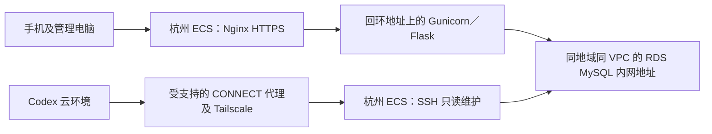

# 杭州 ECS＋RDS：连接检查与部署方案

cece已于2026-10-29批准第5—7节的杭州适配方案，并决定生产和测试先共用现有杭州ECS、分别隔离。目标是将审核时最新的代码部署到杭州 ECS，应用通过内网连接 RDS。先验证连接，再适配部署工具、验证新环境，最后单独确认数据迁移及域名切换。本文不是已经执行部署的证明。

当前安排与待反馈只看 [TODO](../TODO.md)，实际检查、批准与执行证据写入 [CHANGELOG](../CHANGELOG.md)。香港现有环境、数据和域名解析在新环境验收前保持原样；香港手册仍只用于香港，不将其命令直接用于 RDS。

## 1. 推荐架构及连接判定



Codex 优先经杭州 ECS 检查 RDS，不要求 RDS 对公网开放，也不把香港 ECS 默认当作杭州 VPC 的跳板。同地域不等于同 VPC；实例、网络及 RDS 白名单必须实际核对。

| 检查层 | 通过时才能说明什么 |
|---|---|
| Codex 的 CONNECT 返回 200 | 代理接受了这次目标 TCP 连接；不代表已经登录 ECS |
| ECS 主机指纹匹配，SSH 执行身份和系统查询成功 | Codex 已连接到经过核验的杭州 ECS |
| 杭州 ECS 解析 RDS 内网域名、TCP 建连成功 | ECS 到 RDS 的网络路径可用；不代表数据库认证成功 |
| 校验 RDS 证书和主机名后完成认证、SELECT 1 及版本检查 | 已有账号能安全访问该 RDS；不证明应用表结构及业务全部就绪 |
| 新应用 /api/ready 和代表性业务验收通过 | 新部署及其所连接数据库符合本次验证范围 |

当前云环境即使显示 VPN 已配置，也必须对杭州目标重新实测。不能复用香港 ECS 的主机指纹，不能关闭 SSH 或 TLS 身份验证。若 CONNECT 被策略拒绝，只申请实际目标的授权；不通过反复修改 ECS 安全组或公开 RDS 来绕过。

## 2. cece 提供的资源信息

以下是非秘密信息，可以按表回复；暂不知道就保留未知。不要发送真实 .env、私钥、密码、验证码、芯片密钥或数据库备份。

| 资源 | 所需信息 | 谁核对 |
|---|---|---|
| 杭州 ECS | 公网 IP、系统及版本、CPU／内存／磁盘、SSH 用户，是否已有服务或项目 | cece 从阿里云控制台确认，Codex 登录后复核 |
| SSH 身份 | 已验证的 ED25519 主机指纹；专用公钥是否已经添加 | cece 在阿里云控制台终端核对 |
| Tailscale | 是否已安装、ECS 的 Tailscale IPv4／设备名，普通 OpenSSH 还是 Tailscale SSH | cece 提供状态，不提供登录密钥 |
| RDS | 数据库引擎、主版本与内核版本、内网域名、端口、实例地域及 VPC | cece 从 RDS 控制台确认 |
| RDS 数据 | 目标库名称、空库还是已有数据、备份/PITR状态、连接账号是否已创建 | cece 只说明状态；不发送账号密码或业务记录 |
| 域名 | 备案与阿里云接入状态；杭州验证域名，以及是否计划迁移 nfc/admin/test 子域名 | cece 决定；本轮不改根域名或 DNS |
| 数据范围 | 新环境独立初始化，还是迁移香港账号、样品、资料及事件 | cece 决定后才生成对应执行步骤 |

cece于2026-10-29提供的本次输入参数如下；这些是资源与身份核对参数，不代替实际连接证据：

| 参数 | 本次值 |
|---|---|
| 杭州ECS公网地址 | 47.98.19.79 |
| 系统与登录用户 | 已核对Ubuntu 26.04.1、root、2核及约1.7GiB内存；现场证据见CHANGELOG |
| 已由cece在控制台取得的ED25519主机指纹 | SHA256:h62A/DKvJNUEfg453gUR/d427aSUsPmNVRUQtAhIexQ |
| RDS内网端点 | rm-cn-ofv50a5zs00014.rwlb.rds.aliyuncs.com:3306 |
| RDS引擎及网络 | MySQL 8.0.36，与杭州ECS同VPC；Serverless规格基线见第6.1节 |
| 数据与域名路径 | cece选择先独立验证，保留香港和现有解析；说明RDS无须保留的数据，但仍须只读确认目标库状态；专用账号和权限按第5.2节准备 |

若还没有可用维护身份，先由 Codex 在本任务内准备杭州专用公钥，再由 cece 加入服务器；不要求 cece 交出已有私钥。采用普通 OpenSSH 时可使用带 restrict 的专用公钥，只执行命令，不要求 PTY 或端口转发。若实际启用了 Tailscale SSH，按其已有策略完成验证，不擅自切换认证模式。

## 3. cece 操作手册：先核对杭州 ECS

### 3.1 在阿里云控制台进入杭州实例终端

先确认实例名称、地域和实例 ID 确为杭州目标，不在香港窗口执行。本节全为只读检查；某条失败就保留具体步骤，不据此重装或重启。

```bash
id -un
hostname
cat /etc/os-release
free -h
df -h /
ss -lnt
command -v python3
command -v docker
command -v nginx
command -v mysql
```

预期：能够识别系统与资源，知道 22、80、443 和应用相关端口是否已有服务。工具不存在只说明尚未安装，不要求现在安装。不输出进程环境、真实配置或容器完整 inspect。

在同一控制台终端查询服务器的公开主机指纹：

```bash
ssh-keygen -lf /etc/ssh/ssh_host_ed25519_key.pub
```

仅将 SHA256 指纹交给 Codex。若没有该文件或无法访问，先反馈错误，不自动生成、替换 SSH 主机密钥。

### 3.2 检查已有 Tailscale

先执行 `command -v tailscale`。若已安装，执行：

```bash
tailscale ip -4
systemctl is-active tailscaled
```

将本机 Tailscale IPv4 和服务状态交给 Codex，不需要导出整个 Tailnet 的设备信息。如果未安装，先确认实际系统和已有远程入口，再按 [Tailscale 官方安装说明](https://tailscale.com/kb/1017/install)选择对应系统；安装和接入属于下一步另行明确的操作，不在未知系统上照抄 Ubuntu 安装命令。不发送认证密钥，也不为接入而重启或清空现有网络配置。

Codex 随后使用本任务受支持的 CONNECT 代理访问该 Tailscale IP 的 22 端口，严格匹配 cece 提供的主机指纹。成功后只查询身份、系统、端口、版本和项目元数据，不安装应用或读取秘密。本任务已实测公网47.98.19.79:22被该代理返回403 vpn_protected_destination，不能用调整ECS安全组解决这项平台路径限制。

### 3.3 本次杭州首次安装 Tailscale

操作位置：保持阿里云控制台的杭州实例终端打开，确认`id -un`为root，且`cat /etc/os-release`确为Ubuntu 26.04、VERSION_CODENAME=resolute；否则先停下，不套用以下软件源。如果不是root，先在这个实例终端执行`sudo -i`。本步骤只接入维护网络，不安装应用、接管RDS、改业务DNS或启用Tailscale SSH。

本次cece控制台预检已确认：单网卡eth0、仅默认策略路由，阿里云DNS为100.100.2.136/138并经eth0访问；RDS解析172.23.211.160且TCP3306通过；UFW inactive、INPUT默认ACCEPT、nft未列出表；all/default/eth0的rp_filter均为0。本次采用nodivert接入，并先对eth0临时启用严格反向路径校验，保持all/default不变、不写永久配置。该决定基于杭州本次实际路由，不是要求其他多网卡或不对称路由服务器照搬。

先在杭州root控制台执行以下块；失败会将本次eth0设置恢复到预检值0，停止后续接入：

```bash
bash <<'BASH'
set -euo pipefail
trap 'sysctl -q -w net.ipv4.conf.eth0.rp_filter=0; echo "临时检查失败，eth0已恢复预检值0；停止后续步骤。"' ERR
sysctl -w net.ipv4.conf.eth0.rp_filter=1
getent ahostsv4 rm-cn-ofv50a5zs00014.rwlb.rds.aliyuncs.com
timeout 5 bash -c 'exec 3<>/dev/tcp/rm-cn-ofv50a5zs00014.rwlb.rds.aliyuncs.com/3306'
echo '通过：临时eth0反向路径校验已启用，DNS与RDS TCP正常；尚未验证账号。'
trap - ERR
BASH
```

只有看到这行“通过”并且原控制台仍正常，才继续下面的安装。若其他命令失败或入口异常，保留输出先反馈，不直接重跑；临时保护不代替后续完整防火墙审查。

已在Tailscale官方域名核验resolute公钥、软件源清单及签名InRelease均返回200。下面保留APT包签名和HTTPS校验；若已有同名软件源或密钥文件，会停下而不是覆盖。

```bash
bash <<'BASH'
set -euo pipefail
if [ -e /etc/apt/sources.list.d/tailscale.list ] || [ -e /usr/share/keyrings/tailscale-archive-keyring.gpg ]; then
  echo '已有Tailscale软件源或密钥文件，请先反馈，由Codex核对，不覆盖。'
  exit 1
fi
apt-get update
apt-get install -y ca-certificates curl
curl -fsSL --proto '=https' --proto-redir '=https' \
  https://pkgs.tailscale.com/stable/ubuntu/resolute.noarmor.gpg \
  -o /usr/share/keyrings/tailscale-archive-keyring.gpg
curl -fsSL --proto '=https' --proto-redir '=https' \
  https://pkgs.tailscale.com/stable/ubuntu/resolute.tailscale-keyring.list \
  -o /etc/apt/sources.list.d/tailscale.list
chmod 644 /usr/share/keyrings/tailscale-archive-keyring.gpg /etc/apt/sources.list.d/tailscale.list
apt-get update
apt-get install -y tailscale
BASH
```

安装成功后，按本次杭州预检选择的模式接入，不使用--reset：

```bash
tailscale up --netfilter-mode=nodivert --accept-dns=false --accept-routes=false
tailscale ip -4
```

按终端显示的官方登录链接，用与当前Codex环境相同的Tailnet账号/组织授权。不接受系统DNS或子网路由，不开启--ssh或广告路由。nodivert创建规则但不自动挂接，不会自动提供完整放行/反欺骗保护；本步eth0保护也不等于整个主机防火墙已验收。获得100.x地址后重复第3.5节DNS/路由及第4节TCP检查；原控制台和RDS仍正常，再按第3.4节添加专用公钥并交Codex核验SSH。

若接入后出现原控制台/SSH、DNS或RDS异常，在保留的阿里云控制台停止新接入并恢复本步临时参数：

```bash
tailscale down
sysctl -w net.ipv4.conf.eth0.rp_filter=0
```

仅在异常时执行恢复；不重置客户端、不清空防火墙、不重启ECS、不反复修改安全组。确认操作与错误后再继续。正常完成时暂不写永久sysctl，待Codex从Tailnet验证SSH及RDS并核对实际Tailscale路由后，再确定持久化和后续防火墙维护；不默认为重启后已经保留。

### 3.4 添加本次杭州专用公钥

在同一杭州root终端执行。提示时粘贴本次会话给出的`restrict ssh-ed25519 ... bumbum-codex-hangzhou`完整公钥行；这不是私钥。以下只追加，不覆盖已有authorized_keys，正常只运行一次。

```bash
read -r -p '粘贴以restrict开头的杭州专用公钥整行：' HZ_SSH_PUBKEY
if [[ "$HZ_SSH_PUBKEY" == 'restrict ssh-ed25519 '* ]]; then
  install -d -m 700 /root/.ssh
  touch /root/.ssh/authorized_keys
  chmod 600 /root/.ssh/authorized_keys
  printf '\n%s\n' "$HZ_SSH_PUBKEY" >> /root/.ssh/authorized_keys
  echo '公钥已追加，原有条目保留。'
else
  echo '格式不符，未修改authorized_keys；不要粘贴私钥。'
fi
unset HZ_SSH_PUBKEY
```

完成后只反馈Tailscale IP和“公钥已添加”。若普通OpenSSH仍拒绝登录，再由cece从控制台核对ssh服务及root公钥登录策略；不开放密码登录、不关闭主机校验、不替换现有私钥。

### 3.5 阿里云CGNAT兼容性预检与接入后验证

**已确认的香港现场证据：**cece提供阿里云售后工程师2026-10-28回复截图，并确认此前失联原因属于Tailscale防火墙兼容性问题。工程师说明没有修改root密码，执行`tailscale up --reset --netfilter-mode=off`后问题解决，并表示另一台后续安装也可参考处理。该命令在此作为香港历史证据，不是要求现在在香港或杭州重跑；`--reset`会将未显式指定的设置重置为默认，不加入杭州首次接入命令。

**香港后续变更（cece确认）：**工程师用off恢复之后，cece又手动执行命令改为nodivert。因此“工程师恢复时为off”与“cece最新说明香港后来改为nodivert”同时成立，不把off记录成香港一直沿用的当前模式。Codex本轮未重新读取香港配置或检查改动后的规则，不据此追加“nodivert完整防火墙策略已验证”的结论；杭州模式仍在预检后确定。

阿里云使用的100.100.2.136等DNS地址及100.100.100.200元数据地址处于Tailscale所用100.64.0.0/10范围内。Tailscale默认的Linux规则会丢弃从非tailscale0接口进入的该范围源地址流量，可能误伤云内网服务响应。`--accept-dns=false`与`--accept-routes=false`不关闭这条规则；此前手册只列这两个参数不够完整。杭州仍须核对实际DNS、路由、Tailscale版本和防火墙后端，不能将香港处置结果当作杭州已验证。

| 方式 | 准确含义与使用边界 |
|---|---|
| off | Tailscale不创建或管理防火墙规则；是香港工程师恢复时使用的方式，为杭州候选之一，不代表香港最新模式。已有防火墙仍生效，必须自行维护必要放行及反欺骗保护；不等于直接丢失子网路由/出口节点功能，但若需要这些功能，其转发/NAT规则也由管理员负责。本项目不启用这些功能 |
| nodivert | 创建Tailscale规则但不自动挂接；同样需要管理员维护调用、顺序和放行，是cece在工程师处置后手动改用的香港模式；不能因此称作杭州天然更安全的默认方案 |
| 默认on＋定向兼容设置 | 最新官方文档提供节点属性disable-linux-cgnat-drop-rule，可保留其他自动规则；需要核对版本支持、限定目标节点及RPF/其他反欺骗保护。不是本轮已批准的Tailnet策略变更，不对全部设备自动启用 |

不将nodivert简单描述为“带有CVE-2019-14899漏洞”。这里明确记录的风险是取消默认CGNAT反欺骗保护后，需由管理员补足相应保护；不把off说成更安全的替代，也不凭“受信任内网”省略评估。模式选择以实际规则及维护方案为准，原始漏洞归因需有适用版本和权威证据。

接入前，在杭州控制台先只读核对：

```bash
resolvectl dns
ip -4 route get 100.100.2.136
getent ahostsv4 rm-cn-ofv50a5zs00014.rwlb.rds.aliyuncs.com
sysctl net.ipv4.conf.all.rp_filter
command -v ufw
command -v nft
command -v iptables
```

命令或工具不存在时只记录缺失，不为检查立即安装或重置网络。确认现有安全组、UFW及实际iptables/nftables入站策略：维护SSH/必要Tailscale流量是否允许、80/443是否按业务范围开放、数据库和应用端口是否仍受限。完整防火墙规则仅在本机审查，只反馈必要摘要；工具存在、单个rp_filter值或一条默认ACCEPT都不能代替整体核对，不盲目写入全局sysctl或放宽安全组。不要访问元数据服务正文，它可能涉及实例凭证；只核对必要路由。

接入后重复同一组DNS/路由及第4节RDS的DNS、TCP、TLS/SELECT 1检查，并验证阿里云原控制台/维护入口仍可用、Codex能严格校验主机身份后SSH执行只读命令。保持控制台窗口，不关闭既有入口。`ping 100.100.2.136`成功不能证明DNS/RDS正常，失败也不自动证明内网断开；实际协议检查才是结论依据。

若核对Tailscale配置，只报告NetfilterMode、CorpDNS、RouteAll等必要字段，不贴完整debug prefs或整个设备列表；配置值仅说明意图，仍须核对实际防火墙挂接及连通性。官方枚举off=0、nodivert=1、on=2；tailscale status不要求所有空闲对端都显示Connected，最终以所需SSH/RDS操作成功为准。失败时保留步骤及脱敏错误，不执行--reset、重启或清空规则作为默认补救。

依据：[Tailscale netfilter模式](https://tailscale.com/docs/reference/netfilter-modes)、[CGNAT互操作说明](https://tailscale.com/docs/reference/cgnat-interoperability)及cece提供的工程师截图。这里的ECS防火墙兼容性与Codex代理拒绝公网IP是两层问题；修改ECS的netfilter模式不会解除代理的vpn_protected_destination限制。

## 4. cece 操作手册：检查 ECS 到 RDS

### 4.1 在 RDS 控制台核对网络与权限

确认 RDS 是应用支持的 MySQL；当前代码与迁移主要验证过 MySQL 8.0，现有香港镜像为 8.0.46。5.7、8.4 或其他引擎不能直接认为兼容；表结构依赖真正生效的 CHECK，至少要求 MySQL 8.0.16。实际 RDS 内核及结构检查仍需实测。

优先让杭州 ECS 与 RDS 位于同 VPC，使用内网域名和实际端口。RDS 白名单/受支持的安全组授权只放行需要的 ECS 内网来源，不填 0.0.0.0/0，不为了 Codex 检查申请数据库公网入口；如不同 VPC，先列出已有互联方式及成本再决定，不临时扩大网段。

连接检查优先使用仅具备必要查询权限的专用账号；没有此账号时，cece 在控制台安全创建或授权，密码只在受控服务器终端或安全配置位置输入。正式应用使用专用、仅目标库所需权限的业务账号，初始化/迁移账号分开；不默认应用拥有 RDS 高权限账号。

### 4.1.1 准备普通检查账号和SSL的控制台步骤

仅在缺少相应前置条件时执行；已经准备好的账号、SSL及CA不重复创建或重置。以下由cece在阿里云RDS控制台操作，先核对实例和内网端点确为本手册目标，不执行数据库初始化。当前进度查TODO，早期未准备时的证据查CHANGELOG。

1. 打开“账号管理”，创建专用**普通账号**，建议名bumbum_probe。密码由cece按控制台要求生成并保管，不发聊天，不复用ECS root密码；本轮只做连接、SELECT 1、版本和SSL状态检查，不授予建库、建表或全实例管理权限。
2. 如果页面允许暂不授权业务数据库，就保持未授权；若强制要求已有库或必须先建立高权限账号，先反馈页面要求，不为了探测随意创建业务库或让应用使用高权限账号。后续正式业务账号与初始化/迁移身份分别设计。
3. 在实例“数据安全性/SSL加密”等对应页面开启SSL，具体菜单以实际控制台为准；如果要求指定保护连接地址，选择实际使用的内网端点rm-cn-ofv50a5zs00014.rwlb.rds.aliyuncs.com。不要申请公网地址，不同时改白名单、参数模板或其他实例。
4. 若提交前出现重启、连接中断、费用或其他资源变更提示，先将提示内容反馈，明确影响后再继续；不预先假定启用过程无中断。等待控制台明确显示SSL已开启，并下载该实例提供的官方CA证书。
5. 只反馈“普通账号是否创建、密码是否安全保管、SSL是否已开启、CA是否取得”。CA公钥证书可以交给Codex处理；不要上传密码、私钥、真实.env或含私钥的PFX/P12文件。证书格式/文件名不明时先确认，不将不明文件当作可信CA。

准备完成后，Codex先复测服务器是否声明TLS能力，再以官方CA及实际内网主机名验证TLS。账号密码只在cece服务器终端的隐藏提示或另行明确的受保护服务器端认证入口使用；没有安全认证入口时不要求把密码发给Codex。第4.3节的只读SQL成功后才讨论建库/应用部署，不因创建账号或SSL开启就标记数据库已验收。

### 4.2 在杭州 ECS 终端检查 DNS 和 TCP

以下输入的域名和端口不是密码。把提示中的值换成控制台实际内网连接信息，不填公网 IP 或香港地址。

```bash
read -r -p 'RDS 内网域名：' RDS_HOST
read -r -p 'RDS 端口：' RDS_PORT
getent ahostsv4 "$RDS_HOST"
python3 - "$RDS_HOST" "$RDS_PORT" <<'PY'
import socket
import sys

try:
    with socket.create_connection((sys.argv[1], int(sys.argv[2])), timeout=5):
        print('通过：杭州 ECS 到 RDS 的 TCP 连接可用；尚未验证数据库认证。')
except (OSError, ValueError) as error:
    print('未通过：' + type(error).__name__ + '；请核对域名、VPC、白名单和端口。')
    sys.exit(1)
PY
```

预期：域名解析出实际 RDS 内网地址，连接在 5 秒内成功。失败时先区分域名、VPC、白名单或端口问题，不调整数据库数据、不改香港环境。

### 4.3 检查 TLS 与只读 SQL

若当前RDS入口的MySQL初始握手未声明TLS支持，先在实例控制台核对SSL开关、正确端点及官方CA；不要发送明文密码尝试认证，也不将内网TCP通过当作TLS或账号已验证。

先运行 `mysql --version`。以下命令要求支持这些参数的 MySQL 8 客户端；若未安装或实际是其他客户端，先告知 Codex，不直接替换系统软件或删配置。CA 应从该 RDS 实例的官方控制台/文档取得，证书是公开材料，不需要私钥。

```bash
read -r -p 'RDS 检查账号名：' RDS_CHECK_USER
read -r -p 'RDS 官方 CA 文件绝对路径：' RDS_CA
mysql --no-defaults --no-login-paths --protocol=TCP --connect-timeout=5 \
  --host="$RDS_HOST" --port="$RDS_PORT" --user="$RDS_CHECK_USER" --password \
  --ssl-mode=VERIFY_IDENTITY --ssl-ca="$RDS_CA" \
  --execute="status
SELECT 1 AS connection_ok, VERSION() AS mysql_version; SHOW SESSION STATUS LIKE 'Ssl_cipher';"
```

密码在客户端提示时输入，不写在命令中、不发到聊天。`--no-defaults --no-login-paths`避免自动载入既有客户端配置或登录凭证；保持在其他连接选项之前。预期connection_ok=1、版本符合要求、客户端status的SSL行显示Cipher in use且无证书/主机名错误。SHOW SESSION STATUS的Ssl_cipher作为服务端补充证据；若其为空，不能单凭该值认定客户端明文或TLS通过，须核对同一连接的客户端SSL行。TLS 失败时核对官方 CA、实例域名及控制台 SSL 设置，不改成不验证或允许明文回退。Codex 已能登录 ECS 且已有服务器端安全配置的检查身份时，可由 Codex 执行同等只读检查，cece 不必逐条代跑。

Codex 的原始 TCP 通道不做凭证注入，HTTP 代理中的秘密占位值不能作为 SSH/MySQL 的实际密码。没有现成服务器端认证入口时，先由 cece 在控制台完成上述密码提示检查；后续需要自动维护时另行准备限权、受保护的服务器端入口，不要求将密码或真实配置复制给 Codex。

这三层通过后，还须核对目标库是否存在、是否为空及结构版本；不执行 INSERT/UPDATE/CREATE/ALTER，不读取秘密字段或完整业务表。原库有数据时不得重跑 schema.sql。

### 4.3.1 本次杭州目标的只读账号检查

在杭州实例的root控制台执行以下命令。专用客户端与公开CA准备的实际版本、哈希和验证结果见CHANGELOG；这里的CA路径不代表其他服务器已有同名文件，不将证书加入系统全局信任。命令不依赖上一节的临时变量，只检查连接、版本及本次会话TLS，不建库、不读取业务表。

```bash
mysql --no-defaults --no-login-paths \
  --protocol=TCP --connect-timeout=5 \
  --host=rm-cn-ofv50a5zs00014.rwlb.rds.aliyuncs.com --port=3306 \
  --user=bumbum_probe --password \
  --ssl-mode=VERIFY_IDENTITY \
  --ssl-ca=/root/.local/share/bumbum/rds-ca/ApsaraDB-CA-Chain-2dc6de20.pem \
  --execute="status
SELECT 1 AS connection_ok, VERSION() AS mysql_version; SHOW SESSION STATUS LIKE 'Ssl_cipher';"
```

出现`Enter password:`后，仅在该终端输入bumbum_probe的密码并回车；输入不回显是正常情况。只反馈客户端SSL行、查询结果或脱敏错误，不发送密码。connection_ok=1、保持VERIFY_IDENTITY且同一客户端连接显示SSL: Cipher in use is ...，才记录该账号的安全只读连接通过。服务端Ssl_cipher为空时保留该差异，代理/TLS终止只是待核对原因，不当作已确认事实；若客户端显示SSL: Not in use或出现证书/主机名错误，暂停验收，保留错误，不换高权限账号、不去掉验证或尝试明文连接。客户端SSL行取自mysql_get_ssl_cipher，见[MySQL 8.4.11官方源码](https://github.com/mysql/mysql-server/blob/mysql-8.4.11/client/mysql.cc#L5274)。

## 5. 最新代码在杭州运行前的最小适配

以下范围已获cece批准；实现、技术检查、杭州部署及人工验收分别记录，不能把批准当作已部署。构建阶段以当时最新、已审核的 main 完整提交 SHA 为候选，锁定不可变镜像摘要及回退版本；部署中不反复 git pull 或直接跟随移动的 main。

| 现有依据 | 杭州部署需要的改动 | 验证标准 |
|---|---|---|
| 香港 Compose 固定 DB_HOST=127.0.0.1、DB_PORT=33307，并依赖本机 db 服务 | 独立的杭州部署配置，只运行后端，改连 RDS 内网；保留回环监听、非 root、只读根文件系统及日志权限；不创建或误用本机 MySQL 卷 | 生效配置确为目标 RDS，应用没有依赖本机 db；不输出秘密 |
| core/db.py 已支持地址/账号，但未传 TLS 验证参数 | 增加可配置官方 CA、证书验证和域名验证；生产 RDS 配置不允许静默降级，保留现有本机开发与香港路径 | 正确 CA/域名连接通过；错误 CA/域名失败；原测试环境回归通过 |
| 香港迁移入口校验固定测试账号、来源和端口 | 建立明确目标、先只读识别、备份、再授权执行的 RDS 初始化/迁移入口；保留原香港保护，不删校验来“凑通过” | 空库只初始化一次；已有库先识别状态和备份；错误目标拒绝 |
| schema.sql 自带 CREATE DATABASE 和 USE bumbum_digital | 先确认 RDS 目标库与权限；非默认库名须设计显式初始化方案，不能只给 mysql 传另一个库名 | 24张表、初始项目及001—004相关结构通过现有 ready检查，不覆盖已有表 |
| 香港 Nginx 与 Compose 固定 test/nfc 域名及来源 | 新环境独立站点、来源配置、证书和静态发布目录；管理域名继续 IP 限制、登录与CSRF，用户域名只开放精确用户路径 | 用户域名无法访问管理、扫描回调或内部运行检查；真实登录和资料查询正常 |
| 已有 Dockerfile 固定 Python/Node 和依赖 | 复用已验证版本，先检查杭州拉取依赖/镜像能力；必要时在构建环境产出镜像，经受控传输或已有仓库交付并校验摘要 | 不因下载失败关闭签名、校验和或TLS验证，不擅自采购新服务 |

TLS配置由core/db.py统一处理；core/rds_database.py提供只读识别及双重确认的空库初始化，已有或部分初始化的库一律停止，不自动重建。scripts/hangzhou.py准备公开Compose/Nginx配置及测试私有配置，按镜像内容ID、固定清单路径与项目归属检查后启停。不能将香港cloud_test.sh的start、backup、upgrade-view直接套在RDS上；本工具不提供香港数据导入或现有RDS升级的通用后门。

资源与费用先以现有杭州实例为准，不因为本稿自动购买或升配。需核对 ECS 运行与构建余量、RDS 规格/存储/备份保留额度、带宽及已有镜像仓库；若本机构建资源不足，优先评估在构建环境产出镜像再交付，不能把香港2核4GiB视为杭州实际配置。新增镜像仓库、跨VPC互联、扩容或付费证书均单独说明成本并由 cece 决定；目标信息不足时不报未经核实的月费或交付时长。

### 5.1 杭州两个环境的固定隔离约定

以下是实施约定，不表示账号或库已创建。APP_ENV两者均为production以启用HTTPS/Cookie保护；HANGZHOU_SLOT区分运行用途。

| 项目 | 测试 | 生产 |
|---|---|---|
| HANGZHOU_SLOT | test | production |
| RDS库 / 应用账号 | bumbum_hz_test / bumbum_hz_test | bumbum_hz_production / bumbum_hz_production |
| 初始化账号 | bumbum_hz_test_init | bumbum_hz_production_init |
| ECS根目录 | /opt/bumbum-hangzhou/test | /opt/bumbum-hangzhou/production |
| 回环后端端口 | 15001 | 15000 |
| Compose项目 | bumbum-hangzhou-test | bumbum-hangzhou-production |
| 后端进程 / 容器内存上限 / CPU上限 | 1 / 256MiB / 0.5核 | 2 / 512MiB / 1.25核 |

同一RDS实例内不同库只提供逻辑隔离，不隔离实例故障、维护或CPU/内存争用；同一ECS上的进程/容器隔离也不能隔离宿主机故障。测试不开第二个本机MySQL，不在杭州执行完整pytest、镜像构建、压测或恢复演练；日常开发和回归用Codex临时数据库，镜像在构建环境产出后校验并传入。上述容器限额是初始保护，不是容量通过证明；保留系统/Nginx余量并实际观察内存、延迟与RDS负载，再决定是否升配。生产与测试使用不同密码、存储/指纹/回调秘密、样品根密钥、域名、静态目录及日志卷，不能将生产卡与密钥复制到长期测试库。

RDS应用账号只授权目标库的SELECT/INSERT/UPDATE/DELETE（控制台若提供“仅DML”选该项）；初始化账号是单独普通账号，限目标库的建表、索引、外键、必要读写权限。不要给应用账号全实例管理或DDL权限；控制台选项不符先反馈，不扩大授权。bumbum_probe继续只用于连接检查，不作为业务账号。

### 5.2 cece准备RDS测试库及身份

1. 在目标RDS控制台核对内网端点后创建空库bumbum_hz_test，字符集utf8mb4、排序规则utf8mb4_unicode_ci；若名字已存在先反馈并只读检查，不删库、不导入旧备份。
2. 创建上一节的两个测试普通账号，权限只作用于该库，密码分别保管，不发送聊天；无法选精确权限先反馈。生产库/账号及香港数据迁移在生产步骤明确后另行准备，不能拿测试库当未来生产库。
3. 核对备份保留天数、日志备份/PITR、Serverless自动暂停/恢复设置及释放保护；反馈状态即可，不发送配置正文。备份用量不等于PITR已启用、最新备份完整或恢复已通过。生产接管前准备独立恢复验证，不能直接算作香港演练已覆盖RDS。

### 5.3 构建、准备公开部署配置与后端启停

Codex先完成本地技术检查，再从工作区干净的、已交付完整提交构建镜像。复用固定Python/Node依赖和现有Dockerfile，不在杭州换系统Python或安装Node；在受管云环境构建须保留代理并通过BuildKit secret传入组合CA，不将CA复制到镜像层。示例在仓库根目录执行，实际镜像提交与内容ID写入CHANGELOG，不把示例当已构建证据：

```bash
task_revision="$(git rev-parse HEAD)"
test -z "$(git status --porcelain)" || { echo '工作区有修改，停止构建，先核对交付版本。'; exit 1; }
env -u DOCKER_HOST -u DOCKER_CONTEXT -u DOCKER_TLS -u DOCKER_TLS_VERIFY -u DOCKER_CERT_PATH   docker --host=unix:///var/run/docker.sock build   --secret id=proxy_ca,src=/etc/ssl/certs/ca-certificates.crt   --label "org.opencontainers.image.revision=$task_revision"   -f deploy/cloud_test/Dockerfile -t "bumbum-hangzhou-backend:$task_revision" .
```

镜像通过受控传输导入杭州后，Codex核对归档SHA256、镜像配置内容及来源提交，固定目标机实际镜像ID；不为了下载绕过网络策略。Docker classic与containerd镜像存储可能报告不同ID，此时保持未启动，核对导入清单所引用配置的内容哈希与构建端相同后再记录目标ID，不能只改预期值来跳过验证。下面准备公开配置，按提示输入实际非秘密值；cece已确认测试管理test.bumbum.cc、测试用户nfc-test.bumbum.cc，生产admin.bumbum.cc/nfc.bumbum.cc；生成不改DNS、不启用Nginx。清单路径固定保存，镜像更新先审查新版本再更新明确清单，不接管其他路径的同名项目。

```bash
read -r -p '已交付完整Git提交：' HZ_REVISION
read -r -p '已验证镜像内容ID（sha256:开头）：' HZ_IMAGE_ID
read -r -p '已确认测试管理域名（不带https）：' HZ_ADMIN_HOST
read -r -p '已确认测试用户域名（不带https）：' HZ_USER_HOST
read -r -p '已核对管理出口IP：' HZ_ADMIN_IP
python3 scripts/hangzhou.py prepare --slot test   --manifest /opt/bumbum-hangzhou/test/compose.json   --image "bumbum-hangzhou-backend:$HZ_REVISION" --image-id "$HZ_IMAGE_ID"   --admin-host "$HZ_ADMIN_HOST" --user-host "$HZ_USER_HOST" --admin-ip "$HZ_ADMIN_IP"
```

公开配置生成器不读取真实.env，不生成密码。独立Compose只有后端，使用raw env_file防止密码中的$被模板插值（需Docker Compose>=2.30）；只监听回环地址、非root、只读根目录、独立日志卷与限额。脚本固定本机Docker socket，启动前核对镜像内容ID、已有项目归属、首次端口占用、秘密文件权限及安静的Compose解析；不执行config输出秘密，也不自动拉取、重建镜像或修改数据库。

cece随后在杭州root控制台执行，按隐藏提示输入bumbum_hz_test密码（不发聊天）：

```bash
python3 scripts/hangzhou.py prepare-runtime --slot test
```

该命令仅创建test的secrets/runtime.env，权限600，不读取或覆盖已有文件；独立生成新测试环境的存储/指纹/回调及样品密钥，不写卡、不修改香港。生产配置禁止从这个入口随机重建，迁移时须按批准方案安全保留原数据所需密钥。手工准备时模板为deploy/hangzhou/runtime.env.example，不提交真实值。

Codex将已验证的公开CA放到该环境public/rds-ca.pem，不加入系统全局信任。库完成下一节初始化后才执行：

```bash
python3 scripts/hangzhou.py check --slot test --manifest /opt/bumbum-hangzhou/test/compose.json
python3 scripts/hangzhou.py start --slot test --manifest /opt/bumbum-hangzhou/test/compose.json
python3 scripts/hangzhou.py status --slot test --manifest /opt/bumbum-hangzhou/test/compose.json
```

stop仅停止该环境后端、不删卷、不停另一环境或数据库；生产启停还需显式--confirm-production并遵守批准窗口。日后更新时先将新公开清单生成到另一个审核目录，与固定清单对比，保留旧清单和镜像；在批准发布范围内原子替换原固定路径的清单后，再从原路径启动。不直接从新审核目录接管已运行项目；跨路径拒绝属于归属保护。代码回退只使用已验证RDS适配且与当前表结构兼容的旧镜像，香港原镜像不能直接充当RDS回退版本。网页从已验证镜像导出至对应/var/www/bumbum-hangzhou-test-admin及-user；生成的admin.conf/user.conf/proxy.conf先检查两个域名、证书及来源IP，再nginx -t和受控启用，不能复制生成文件后立即认为HTTPS或公网业务通过。尚无证书时不安装启用引用不存在证书的站点；未确认DNS前用受控定向请求验证。

### 5.4 只读识别后，明确确认空库初始化

以下由cece在杭州控制台交互执行，因为初始化身份密码仍由cece自持。镜像内容由Codex按上一节锁定；只读检查显示server_uuid、实际账号、对象数量及客户端加密套件，不显示密码或业务行。非交互入口拒绝读取环境、配置或管道密码。

```bash
read -r -p 'Codex已核验的完整Git提交：' HZ_REVISION
docker run --rm -it --network host --read-only --memory=256m --cpus=0.5   --mount type=bind,src=/opt/bumbum-hangzhou/test/public/rds-ca.pem,dst=/run/rds-ca.pem,readonly   "bumbum-hangzhou-backend:$HZ_REVISION"   python -m core.rds_database --slot test --ca /run/rds-ca.pem
```

只有实际账号、目标库、版本、排序规则正确、empty=true且server_uuid与目标一致，才执行以下显式初始化；控制台建库及初始化属于本次已批准的独立测试范围，不适用于已有生产/香港库。脚本会再次核对并加初始化锁：

```bash
read -r -p '上一步只读检查返回的server_uuid：' HZ_SERVER_UUID
docker run --rm -it --network host --read-only --memory=256m --cpus=0.5   --mount type=bind,src=/opt/bumbum-hangzhou/test/public/rds-ca.pem,dst=/run/rds-ca.pem,readonly   "bumbum-hangzhou-backend:$HZ_REVISION"   python -m core.rds_database --slot test --ca /run/rds-ca.pem   --initialize-empty --confirm-database bumbum_hz_test --confirm-server-uuid "$HZ_SERVER_UUID"
```

唯一schema.sql中的CREATE DATABASE/USE只按已知精确语句移除，所有建表和种子数据都作用于已选连接库，不复制另一套DDL、不通用替换SQL。空库没有既有业务数据可备份；已有任何表/视图/过程/触发器/事件均拒绝。DDL中途失败可能保留部分结构，停止排查，不重跑、不自动删除/恢复。验收包含24表、完整ready及两个初始项目；初始化后收回或限制专用初始化身份，应用只用自己的DML账号。

## 6. 数据与域名：两种路径分开决定

| 路径 | 适用情况 | 关键边界 |
|---|---|---|
| 先独立验证杭州环境（本轮已选择） | 先证明新 ECS＋RDS 能运行，保留香港可用站点 | 使用独立、确认空的目标库和待确认验证域名，账号与配置按新环境安全准备；不默认继承香港样品或密钥，不动现有 nfc/test DNS |
| 迁移香港资料并切换站点 | 要保留原账号、实卡、样品、资料和事件，最终由杭州接管原域名 | 单独批准迁移窗口、数据范围、秘密安全转移、停写、切换及失败处理；新建库和只迁代码不等于既有实卡仍能验证 |

现有真实卡链接使用 nfc.bumbum.cc，未切换前仍会访问香港；不能看到手机成功就当作杭州验收。可在预验证阶段用受控测试域名、合成样品或本机域名定向请求检查新站点；不为换服务器重新写卡。正式域名切换后再做真实手机验收。

若选迁移：

1. 核对源库及目标库、现有样品实际编号和最大读数；确认需要保留的账号、事件、资格与加密资料，不能只导出物品表。
2. 在批准窗口停止香港**所有业务写入入口**，包括后台、手机验证、查看资格续期和扫描回调；保留最后一致性备份及校验。RDS先启用适用备份/PITR并确认可恢复，恢复只作用于已明确的目标。
3. 受控转移需要保留的存储密钥、项目根密钥和全局K1等配置；由cece安全注入或经已批准通道传递，不发聊天，不改成新生成值。备份含原库名，不能只换导入参数就认为目标已隔离。
4. 校验全表结构/内容、两枚卡与物品关系、已推进计数、加密资料可读性和后台登录；旧读数不能在新环境重新有效。管理来源变更后要按新来源重新登录，不保证旧会话跨域复用。
5. 只有新站点就绪、证书已就位、双方写入隔离后，才切换已批准的子域名；DNS生效期间旧环境保持维护或只读，不能让同一卡读数被两个独立数据库分别接受。
6. 切换后持续核对新连接、有效事件、HTTPS与管理隔离。新库尚无写入时可按批准方案撤回；新库已产生写入后，不能仅将DNS切回旧库就宣称无损回退，须先停写、保留增量并确定数据处理方案。

根域名 bumbum.cc 的品牌页、正式 admin 子域名和现有 test/nfc 的用途分别确认；不把所有DNS记录一次覆盖。证书可采用已批准的DNS验证方式提前准备，不为签证书提前把业务流量切到未就绪站点。

### 6.1 香港计划停用与杭州长期生产/测试

cece说明香港是按量计费试用实例，实际到期日尚不明确、至少还能使用一个月；“下个月不用”是迁移目标，不编造固定到期日或已关闭计费。先核对阿里云试用权益、实例释放和实际计费状态，停机不一定停止所有资源费用；本工具不自动释放实例或删除数据。

杭州先验证测试环境，再按单独批准窗口迁移香港现有账号、样品、历史、计数器及必要加密资料到生产库，完成域名切换与真实手机验收。长期生产和测试分库分身份，不能把两套后台指向同一库，也不能让同一实卡在两个独立库同时接受读数。测试使用独立合成样品/专用卡；现有服装卡迁入生产所需原密钥和读数要保留，不为搬服务器重新写卡。

香港退出前至少取得：杭州生产及测试隔离和容量证据、HTTPS及续期、重启后服务/网络保留、RDS备份/PITR状态及独立恢复证据；核对阿里云接入备案、必要主体/接入信息与域名证书的实际控制台状态，不把ICP备案通过等同所有接入步骤自动完成。保存可用的备份、秘密及恢复手册到不依赖香港实例的受保护位置，不能只留在即将停用的磁盘。切换观察期与回退边界按第6节另行批准；香港停用后回退依赖杭州旧版镜像和受控数据恢复，不再把香港在线当永久前提。仅代码回退不解决新写入后的数据倒退。

本次RDS规格由cece提供：mysql.n2.serverless.1c、RCU0.5—2、CPU0.5—2、内存1—4GiB，存储20G、已用3.97G，数据备份5.85G及日志备份34.81M，维护窗口北京时间02:00—06:00，提供小版本rds_20260620、释放保护未开启，小版本自动升级的具体策略待确认。资源范围不代表长期占有2核4GiB；自动暂停、备份策略、PITR及恢复仍须核对。建议生产前开启释放保护，并评估维护/小版本更新对两个环境的共同影响；没有在控制台替cece修改这些设置，也不凭“40G以内免费”估算全部费用。

## 7. 分步交付与 cece／Codex 分工

| 阶段 | Codex负责 | cece必要操作 | 继续条件 |
|---|---|---|---|
| A：连接与现状 | 检查代理、主机指纹、SSH、ECS到RDS网络与只读SQL；输出脱敏结论 | 提供第2节信息；必要时控制台接入Tailscale、添加专用公钥、准备数据库账号和CA | 明确已连接或具体缺失项，不凭VPN配置认定成功 |
| B：方案审核 | 按实际资源补齐配置、数据路径、域名、成本与回退范围 | 确认独立验证路径及具体实施范围 | cece明确批准后才改业务代码、安装业务运行环境、初始化或部署 |
| C：构建与新环境部署 | 完成第5节适配和测试，固定提交/镜像，执行被批准的安装、数据库与静态发布步骤 | 在安全位置准备必要配置及账号；涉及付费或资源变更时操作控制台 | 完成RDS TLS、结构、运行及代表性业务验证 |
| D：上线或切换 | 执行批准的停写、最终同步、切换及监测；补录证据 | 批准维护窗口及DNS变化，做手机实卡与管理端验收 | 无双写、资料/计数正确，管理域名隔离有效 |
| E：收尾 | 核对恢复、续期、启动保留和告警/日志入口，更新TODO与CHANGELOG | 确认最终验收范围；旧环境清理另行批准 | 不因新站点上线自动删除香港数据、卷或秘密 |

## 8. 新环境验收清单

执行时将实际结果及版本写入CHANGELOG，不在这里维护第二份进度表。

- 基础：目标确为杭州ECS，应用只监听本机；RDS内网、TLS、权限、24表及结构检查通过；/api/health与/api/ready在受控入口正常。
- 安全隔离：HTTP转HTTPS；用户页面no-store/no-referrer/nosniff；用户域名的管理接口、真实扫描回调/api/webhook/admin/scan与内部ready均不可用；管理入口IP限制、密码/验证器和CSRF有效。
- 业务：正确触碰、刷新/自动更新、物品停用/恢复、断网恢复、旧读数重放、无资格访问、成功事件不重复计数；按所选数据路径分别取证。
- 保留与恢复：ECS服务恢复后能重连RDS；备份/PITR和独立恢复有实际验证，秘密配置安全保留；不能将香港恢复演练直接算作RDS恢复通过。
- 交付：记录实际提交及镜像摘要、目标库、证书续期和下一维护步骤；未执行项明确列出。跨项目实卡继续保持已批准的P2后置，不混入本轮杭州部署验收。

## 9. 本轮操作边界

方案审核已授权按范围构建、技术验证和准备杭州独立测试部署；连接验收已取得证据，实际构建/部署状态仍只看TODO及CHANGELOG。生产初始化、香港数据与秘密迁移、正式域名切换、关闭/释放香港实例仍需对应具体范围与窗口，不因本方案通过自动执行。不同资源或权限需求只暂停依赖部分；不输出现有秘密，不把技术检查、ICP备案或生成配置当作应用上线证据。
