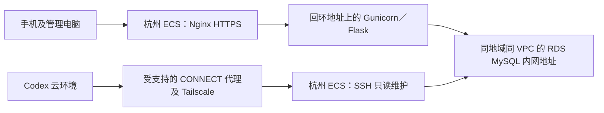

# 杭州 ECS＋RDS：连接检查与部署方案

本稿供 cece 审核，目标是将审核时最新的代码部署到杭州 ECS，应用通过内网连接 RDS。先验证连接，再适配部署工具、验证新环境，最后单独确认数据迁移及域名切换。本文不是已经执行部署的证明。

当前安排与待反馈只看 [TODO](../TODO.md)，实际检查、批准与执行证据写入 [CHANGELOG](../CHANGELOG.md)。香港现有环境、数据和域名解析在新环境验收前保持原样；香港手册仍只用于香港，不将其命令直接用于 RDS。

## 1. 推荐架构及连接判定



Codex 优先经杭州 ECS 检查 RDS，不要求 RDS 对公网开放，也不把香港 ECS 默认当作杭州 VPC 的跳板。同地域不等于同 VPC；实例、网络及 RDS 白名单必须实际核对。

| 检查层 | 通过时才能说明什么 |
|---|---|
| Codex 的 CONNECT 返回 200 | 代理接受了这次目标 TCP 连接；不代表已经登录 ECS |
| ECS 主机指纹匹配，SSH 执行身份和系统查询成功 | Codex 已连接到经过核验的杭州 ECS |
| 杭州 ECS 解析 RDS 内网域名、TCP 建连成功 | ECS 到 RDS 的网络路径可用；不代表数据库认证成功 |
| 校验 RDS 证书和主机名后完成认证、SELECT 1 及版本检查 | 已有账号能安全访问该 RDS；不证明应用表结构及业务全部就绪 |
| 新应用 /api/ready 和代表性业务验收通过 | 新部署及其所连接数据库符合本次验证范围 |

当前云环境即使显示 VPN 已配置，也必须对杭州目标重新实测。不能复用香港 ECS 的主机指纹，不能关闭 SSH 或 TLS 身份验证。若 CONNECT 被策略拒绝，只申请实际目标的授权；不通过反复修改 ECS 安全组或公开 RDS 来绕过。

## 2. cece 提供的资源信息

以下是非秘密信息，可以按表回复；暂不知道就保留未知。不要发送真实 .env、私钥、密码、验证码、芯片密钥或数据库备份。

| 资源 | 所需信息 | 谁核对 |
|---|---|---|
| 杭州 ECS | 公网 IP、系统及版本、CPU／内存／磁盘、SSH 用户，是否已有服务或项目 | cece 从阿里云控制台确认，Codex 登录后复核 |
| SSH 身份 | 已验证的 ED25519 主机指纹；专用公钥是否已经添加 | cece 在阿里云控制台终端核对 |
| Tailscale | 是否已安装、ECS 的 Tailscale IPv4／设备名，普通 OpenSSH 还是 Tailscale SSH | cece 提供状态，不提供登录密钥 |
| RDS | 数据库引擎、主版本与内核版本、内网域名、端口、实例地域及 VPC | cece 从 RDS 控制台确认 |
| RDS 数据 | 目标库名称、空库还是已有数据、备份/PITR状态、连接账号是否已创建 | cece 只说明状态；不发送账号密码或业务记录 |
| 域名 | 备案与阿里云接入状态；杭州验证域名，以及是否计划迁移 nfc/admin/test 子域名 | cece 决定；本轮不改根域名或 DNS |
| 数据范围 | 新环境独立初始化，还是迁移香港账号、样品、资料及事件 | cece 决定后才生成对应执行步骤 |

cece于2026-10-29提供的本次输入参数如下；这些是资源与身份核对参数，不代替实际连接证据：

| 参数 | 本次值 |
|---|---|
| 杭州ECS公网地址 | 47.98.19.79 |
| 系统与登录用户 | cece说明Ubuntu 26.04 64位，拟用root；实际资源及SSH配置待现场核对 |
| 已由cece在控制台取得的ED25519主机指纹 | SHA256:h62A/DKvJNUEfg453gUR/d427aSUsPmNVRUQtAhIexQ |
| RDS内网端点 | rm-cn-ofv50a5zs00014.rwlb.rds.aliyuncs.com:3306 |
| RDS引擎及网络 | cece说明MySQL 8.0，与杭州ECS同VPC；具体内核版本待SQL核对 |
| 数据与域名路径 | cece选择先独立验证，保留香港和现有解析；说明RDS无须保留的数据，但仍须连接后确认目标库状态；账号准备情况未知 |

若还没有可用维护身份，先由 Codex 在本任务内准备杭州专用公钥，再由 cece 加入服务器；不要求 cece 交出已有私钥。采用普通 OpenSSH 时可使用带 restrict 的专用公钥，只执行命令，不要求 PTY 或端口转发。若实际启用了 Tailscale SSH，按其已有策略完成验证，不擅自切换认证模式。

## 3. cece 操作手册：先核对杭州 ECS

### 3.1 在阿里云控制台进入杭州实例终端

先确认实例名称、地域和实例 ID 确为杭州目标，不在香港窗口执行。本节全为只读检查；某条失败就保留具体步骤，不据此重装或重启。

```bash
id -un
hostname
cat /etc/os-release
free -h
df -h /
ss -lnt
command -v python3
command -v docker
command -v nginx
command -v mysql
```

预期：能够识别系统与资源，知道 22、80、443 和应用相关端口是否已有服务。工具不存在只说明尚未安装，不要求现在安装。不输出进程环境、真实配置或容器完整 inspect。

在同一控制台终端查询服务器的公开主机指纹：

```bash
ssh-keygen -lf /etc/ssh/ssh_host_ed25519_key.pub
```

仅将 SHA256 指纹交给 Codex。若没有该文件或无法访问，先反馈错误，不自动生成、替换 SSH 主机密钥。

### 3.2 检查已有 Tailscale

先执行 `command -v tailscale`。若已安装，执行：

```bash
tailscale ip -4
systemctl is-active tailscaled
```

将本机 Tailscale IPv4 和服务状态交给 Codex，不需要导出整个 Tailnet 的设备信息。如果未安装，先确认实际系统和已有远程入口，再按 [Tailscale 官方安装说明](https://tailscale.com/kb/1017/install)选择对应系统；安装和接入属于下一步另行明确的操作，不在未知系统上照抄 Ubuntu 安装命令。不发送认证密钥，也不为接入而重启或清空现有网络配置。

Codex 随后使用本任务受支持的 CONNECT 代理访问该 Tailscale IP 的 22 端口，严格匹配 cece 提供的主机指纹。成功后只查询身份、系统、端口、版本和项目元数据，不安装应用或读取秘密。本任务已实测公网47.98.19.79:22被该代理返回403 vpn_protected_destination，不能用调整ECS安全组解决这项平台路径限制。

### 3.3 本次杭州首次安装 Tailscale

操作位置：保持阿里云控制台的杭州实例终端打开，确认`id -un`为root，且`cat /etc/os-release`确为Ubuntu 26.04、VERSION_CODENAME=resolute；否则先停下，不套用以下软件源。如果不是root，先在这个实例终端执行`sudo -i`。本步骤只接入维护网络，不安装应用、接管RDS、改业务DNS或启用Tailscale SSH。

已在Tailscale官方域名核验resolute公钥、软件源清单及签名InRelease均返回200。下面保留APT包签名和HTTPS校验；若已有同名软件源或密钥文件，会停下而不是覆盖。

```bash
bash <<'BASH'
set -euo pipefail
if [ -e /etc/apt/sources.list.d/tailscale.list ] || [ -e /usr/share/keyrings/tailscale-archive-keyring.gpg ]; then
  echo '已有Tailscale软件源或密钥文件，请先反馈，由Codex核对，不覆盖。'
  exit 1
fi
apt-get update
apt-get install -y ca-certificates curl
curl -fsSL --proto '=https' --proto-redir '=https' \
  https://pkgs.tailscale.com/stable/ubuntu/resolute.noarmor.gpg \
  -o /usr/share/keyrings/tailscale-archive-keyring.gpg
curl -fsSL --proto '=https' --proto-redir '=https' \
  https://pkgs.tailscale.com/stable/ubuntu/resolute.tailscale-keyring.list \
  -o /etc/apt/sources.list.d/tailscale.list
chmod 644 /usr/share/keyrings/tailscale-archive-keyring.gpg /etc/apt/sources.list.d/tailscale.list
apt-get update
apt-get install -y tailscale
BASH
```

成功后，在同一终端执行：

```bash
tailscale up --accept-dns=false --accept-routes=false
tailscale ip -4
```

按终端显示的官方登录链接，用与当前Codex环境相同的Tailnet账号/组织授权。保留系统DNS，不接受子网路由，不开启`--ssh`或广告路由。预期得到本机100.x地址；将这个地址交给Codex，不发送认证密钥。若提示已有配置、需要额外批准或安装失败，保留步骤和固定错误，不重置客户端、不重启ECS、不反复修改安全组。

### 3.4 添加本次杭州专用公钥

在同一杭州root终端执行。提示时粘贴本次会话给出的`restrict ssh-ed25519 ... bumbum-codex-hangzhou`完整公钥行；这不是私钥。以下只追加，不覆盖已有authorized_keys，正常只运行一次。

```bash
read -r -p '粘贴以restrict开头的杭州专用公钥整行：' HZ_SSH_PUBKEY
if [[ "$HZ_SSH_PUBKEY" == 'restrict ssh-ed25519 '* ]]; then
  install -d -m 700 /root/.ssh
  touch /root/.ssh/authorized_keys
  chmod 600 /root/.ssh/authorized_keys
  printf '\n%s\n' "$HZ_SSH_PUBKEY" >> /root/.ssh/authorized_keys
  echo '公钥已追加，原有条目保留。'
else
  echo '格式不符，未修改authorized_keys；不要粘贴私钥。'
fi
unset HZ_SSH_PUBKEY
```

完成后只反馈Tailscale IP和“公钥已添加”。若普通OpenSSH仍拒绝登录，再由cece从控制台核对ssh服务及root公钥登录策略；不开放密码登录、不关闭主机校验、不替换现有私钥。

## 4. cece 操作手册：检查 ECS 到 RDS

### 4.1 在 RDS 控制台核对网络与权限

确认 RDS 是应用支持的 MySQL；当前代码与迁移主要验证过 MySQL 8.0，现有香港镜像为 8.0.46。5.7、8.4 或其他引擎不能直接认为兼容；表结构依赖真正生效的 CHECK，至少要求 MySQL 8.0.16。实际 RDS 内核及结构检查仍需实测。

优先让杭州 ECS 与 RDS 位于同 VPC，使用内网域名和实际端口。RDS 白名单/受支持的安全组授权只放行需要的 ECS 内网来源，不填 0.0.0.0/0，不为了 Codex 检查申请数据库公网入口；如不同 VPC，先列出已有互联方式及成本再决定，不临时扩大网段。

连接检查优先使用仅具备必要查询权限的专用账号；没有此账号时，cece 在控制台安全创建或授权，密码只在受控服务器终端或安全配置位置输入。正式应用使用专用、仅目标库所需权限的业务账号，初始化/迁移账号分开；不默认应用拥有 RDS 高权限账号。

### 4.2 在杭州 ECS 终端检查 DNS 和 TCP

以下输入的域名和端口不是密码。把提示中的值换成控制台实际内网连接信息，不填公网 IP 或香港地址。

```bash
read -r -p 'RDS 内网域名：' RDS_HOST
read -r -p 'RDS 端口：' RDS_PORT
getent ahostsv4 "$RDS_HOST"
python3 - "$RDS_HOST" "$RDS_PORT" <<'PY'
import socket
import sys

try:
    with socket.create_connection((sys.argv[1], int(sys.argv[2])), timeout=5):
        print('通过：杭州 ECS 到 RDS 的 TCP 连接可用；尚未验证数据库认证。')
except (OSError, ValueError) as error:
    print('未通过：' + type(error).__name__ + '；请核对域名、VPC、白名单和端口。')
    sys.exit(1)
PY
```

预期：域名解析出实际 RDS 内网地址，连接在 5 秒内成功。失败时先区分域名、VPC、白名单或端口问题，不调整数据库数据、不改香港环境。

### 4.3 检查 TLS 与只读 SQL

先运行 `mysql --version`。以下命令要求支持这些参数的 MySQL 8 客户端；若未安装或实际是其他客户端，先告知 Codex，不直接替换系统软件或删配置。CA 应从该 RDS 实例的官方控制台/文档取得，证书是公开材料，不需要私钥。

```bash
read -r -p 'RDS 检查账号名：' RDS_CHECK_USER
read -r -p 'RDS 官方 CA 文件绝对路径：' RDS_CA
mysql --protocol=TCP --connect-timeout=5 \
  --host="$RDS_HOST" --port="$RDS_PORT" --user="$RDS_CHECK_USER" --password \
  --ssl-mode=VERIFY_IDENTITY --ssl-ca="$RDS_CA" \
  --execute="SELECT 1 AS connection_ok, VERSION() AS mysql_version; SHOW SESSION STATUS LIKE 'Ssl_cipher';"
```

密码在客户端提示时输入，不写在命令中、不发到聊天。预期 connection_ok=1、版本符合要求、Ssl_cipher 非空且无证书/主机名错误。TLS 失败时核对官方 CA、实例域名及控制台 SSL 设置，不改成不验证或允许明文回退。Codex 已能登录 ECS 且已有服务器端安全配置的检查身份时，可由 Codex 执行同等只读检查，cece 不必逐条代跑。

Codex 的原始 TCP 通道不做凭证注入，HTTP 代理中的秘密占位值不能作为 SSH/MySQL 的实际密码。没有现成服务器端认证入口时，先由 cece 在控制台完成上述密码提示检查；后续需要自动维护时另行准备限权、受保护的服务器端入口，不要求将密码或真实配置复制给 Codex。

这三层通过后，还须核对目标库是否存在、是否为空及结构版本；不执行 INSERT/UPDATE/CREATE/ALTER，不读取秘密字段或完整业务表。原库有数据时不得重跑 schema.sql。

## 5. 最新代码在杭州运行前的最小适配

这里是待审核的实现范围，不表示相关文件已经写好。构建阶段以当时最新、已审核的 main 完整提交 SHA 为候选，锁定不可变镜像摘要及回退版本；部署中不反复 git pull 或直接跟随移动的 main。

| 现有依据 | 杭州部署需要的改动 | 验证标准 |
|---|---|---|
| 香港 Compose 固定 DB_HOST=127.0.0.1、DB_PORT=33307，并依赖本机 db 服务 | 独立的杭州部署配置，只运行后端，改连 RDS 内网；保留回环监听、非 root、只读根文件系统及日志权限；不创建或误用本机 MySQL 卷 | 生效配置确为目标 RDS，应用没有依赖本机 db；不输出秘密 |
| core/db.py 已支持地址/账号，但未传 TLS 验证参数 | 增加可配置官方 CA、证书验证和域名验证；生产 RDS 配置不允许静默降级，保留现有本机开发与香港路径 | 正确 CA/域名连接通过；错误 CA/域名失败；原测试环境回归通过 |
| 香港迁移入口校验固定测试账号、来源和端口 | 建立明确目标、先只读识别、备份、再授权执行的 RDS 初始化/迁移入口；保留原香港保护，不删校验来“凑通过” | 空库只初始化一次；已有库先识别状态和备份；错误目标拒绝 |
| schema.sql 自带 CREATE DATABASE 和 USE bumbum_digital | 先确认 RDS 目标库与权限；非默认库名须设计显式初始化方案，不能只给 mysql 传另一个库名 | 24张表、初始项目及001—004相关结构通过现有 ready检查，不覆盖已有表 |
| 香港 Nginx 与 Compose 固定 test/nfc 域名及来源 | 新环境独立站点、来源配置、证书和静态发布目录；管理域名继续 IP 限制、登录与CSRF，用户域名只开放精确用户路径 | 用户域名无法访问管理、扫描回调或内部运行检查；真实登录和资料查询正常 |
| 已有 Dockerfile 固定 Python/Node 和依赖 | 复用已验证版本，先检查杭州拉取依赖/镜像能力；必要时在构建环境产出镜像，经受控传输或已有仓库交付并校验摘要 | 不因下载失败关闭签名、校验和或TLS验证，不擅自采购新服务 |

TLS、RDS初始化及配置支持属于后续代码任务；本轮只交方案，不修改应用。拟新增的杭州部署入口必须在实现、测试后写入正式执行命令，不能将香港 cloud_test.sh 的 start、backup、upgrade-view直接套在 RDS 上。

资源与费用先以现有杭州实例为准，不因为本稿自动购买或升配。需核对 ECS 运行与构建余量、RDS 规格/存储/备份保留额度、带宽及已有镜像仓库；若本机构建资源不足，优先评估在构建环境产出镜像再交付，不能把香港2核4GiB视为杭州实际配置。新增镜像仓库、跨VPC互联、扩容或付费证书均单独说明成本并由 cece 决定；目标信息不足时不报未经核实的月费或交付时长。

## 6. 数据与域名：两种路径分开决定

| 路径 | 适用情况 | 关键边界 |
|---|---|---|
| 先独立验证杭州环境（默认建议） | 先证明新 ECS＋RDS 能运行，保留香港可用站点 | 使用独立、确认空的目标库和待确认验证域名，账号与配置按新环境安全准备；不默认继承香港样品或密钥，不动现有 nfc/test DNS |
| 迁移香港资料并切换站点 | 要保留原账号、实卡、样品、资料和事件，最终由杭州接管原域名 | 单独批准迁移窗口、数据范围、秘密安全转移、停写、切换及失败处理；新建库和只迁代码不等于既有实卡仍能验证 |

现有真实卡链接使用 nfc.bumbum.cc，未切换前仍会访问香港；不能看到手机成功就当作杭州验收。可在预验证阶段用受控测试域名、合成样品或本机域名定向请求检查新站点；不为换服务器重新写卡。正式域名切换后再做真实手机验收。

若选迁移：

1. 核对源库及目标库、现有样品实际编号和最大读数；确认需要保留的账号、事件、资格与加密资料，不能只导出物品表。
2. 在批准窗口停止香港**所有业务写入入口**，包括后台、手机验证、查看资格续期和扫描回调；保留最后一致性备份及校验。RDS先启用适用备份/PITR并确认可恢复，恢复只作用于已明确的目标。
3. 受控转移需要保留的存储密钥、项目根密钥和全局K1等配置；由cece安全注入或经已批准通道传递，不发聊天，不改成新生成值。备份含原库名，不能只换导入参数就认为目标已隔离。
4. 校验全表结构/内容、两枚卡与物品关系、已推进计数、加密资料可读性和后台登录；旧读数不能在新环境重新有效。管理来源变更后要按新来源重新登录，不保证旧会话跨域复用。
5. 只有新站点就绪、证书已就位、双方写入隔离后，才切换已批准的子域名；DNS生效期间旧环境保持维护或只读，不能让同一卡读数被两个独立数据库分别接受。
6. 切换后持续核对新连接、有效事件、HTTPS与管理隔离。新库尚无写入时可按批准方案撤回；新库已产生写入后，不能仅将DNS切回旧库就宣称无损回退，须先停写、保留增量并确定数据处理方案。

根域名 bumbum.cc 的品牌页、正式 admin 子域名和现有 test/nfc 的用途分别确认；不把所有DNS记录一次覆盖。证书可采用已批准的DNS验证方式提前准备，不为签证书提前把业务流量切到未就绪站点。

## 7. 分步交付与 cece／Codex 分工

| 阶段 | Codex负责 | cece必要操作 | 继续条件 |
|---|---|---|---|
| A：连接与现状 | 检查代理、主机指纹、SSH、ECS到RDS网络与只读SQL；输出脱敏结论 | 提供第2节信息；必要时控制台接入Tailscale、添加专用公钥、准备数据库账号和CA | 明确已连接或具体缺失项，不凭VPN配置认定成功 |
| B：方案审核 | 按实际资源补齐配置、数据路径、域名、成本与回退范围 | 确认独立验证路径及具体实施范围 | cece明确批准后才改业务代码、安装业务运行环境、初始化或部署 |
| C：构建与新环境部署 | 完成第5节适配和测试，固定提交/镜像，执行被批准的安装、数据库与静态发布步骤 | 在安全位置准备必要配置及账号；涉及付费或资源变更时操作控制台 | 完成RDS TLS、结构、运行及代表性业务验证 |
| D：上线或切换 | 执行批准的停写、最终同步、切换及监测；补录证据 | 批准维护窗口及DNS变化，做手机实卡与管理端验收 | 无双写、资料/计数正确，管理域名隔离有效 |
| E：收尾 | 核对恢复、续期、启动保留和告警/日志入口，更新TODO与CHANGELOG | 确认最终验收范围；旧环境清理另行批准 | 不因新站点上线自动删除香港数据、卷或秘密 |

## 8. 新环境验收清单

执行时将实际结果及版本写入CHANGELOG，不在这里维护第二份进度表。

- 基础：目标确为杭州ECS，应用只监听本机；RDS内网、TLS、权限、24表及结构检查通过；/api/health与/api/ready在受控入口正常。
- 安全隔离：HTTP转HTTPS；用户页面no-store/no-referrer/nosniff；用户域名的管理接口、真实扫描回调/api/webhook/admin/scan与内部ready均不可用；管理入口IP限制、密码/验证器和CSRF有效。
- 业务：正确触碰、刷新/自动更新、物品停用/恢复、断网恢复、旧读数重放、无资格访问、成功事件不重复计数；按所选数据路径分别取证。
- 保留与恢复：ECS服务恢复后能重连RDS；备份/PITR和独立恢复有实际验证，秘密配置安全保留；不能将香港恢复演练直接算作RDS恢复通过。
- 交付：记录实际提交及镜像摘要、目标库、证书续期和下一维护步骤；未执行项明确列出。跨项目实卡继续保持已批准的P2后置，不混入本轮杭州部署验收。

## 9. 本轮操作边界

本文只提供方案、cece可执行的连接检查和后续实施门槛。杭州ECS/RDS的实际地址、认证及只读检查没有取得结果前，不写“已连通”；适配代码没有完成前，不写“可直接部署”。不输出现有秘密，不执行建表/导入/升级、不迁移香港数据、不切换域名，也不因ICP备案通过就认为网络、证书、权限和应用部署已经就绪。
