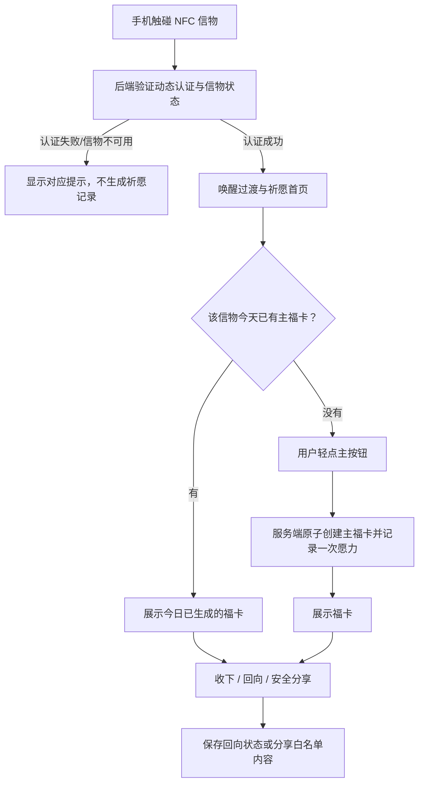

# NFC 文创祈愿 H5 产品需求文档（PRD）V1.0

 > 状态：第一版产品方案，待产品评审；不是已实现功能的声明。
>
> 适用产品：植入 NFC 芯片的手串、佛牌及其他文创信物。
> 
> 产品主线：BUMBUM 基础功能闭环稳定后，下一阶段重点投入 NFC 文创祈愿系统。服装业务的现有需求和验收标准仍由根目录 `PRD.md` 维护，本文件只定义祈愿体验的独立业务规则。

## 0. 阅读导航与文档职责

本文件只维护祈愿产品的定位、用户流程、业务规则、范围和验收标准。当前任务优先级看 [TODO.md](../TODO.md)，重要决策与验收证据看 [CHANGELOG.md](../CHANGELOG.md)，芯片认证和系统技术机制看 [TECH_SPEC.md](../TECH_SPEC.md)、[技术附录](IMPLEMENTATION_DETAILS.md) 与 [接口契约](../API_CONTRACT.md)。操作步骤统一从 [操作手册入口](OP_GUIDE.md) 查找。

### 0.1 一句话定义

**碰一碰，唤醒信物；轻点一下，接住今天的第一念；福卡留下这一念，愿力记录信物与使用者共同经历的痕迹。**

这不是一个把抽签、签到和积分堆在一起的工具，而是围绕实体信物建立的轻量、可持续的数字仪式。

### 0.2 核心叙事

- **触碰不是打开网页，而是唤醒信物。** NFC 是入口，认证通过后才进入祈愿体验。
- **福卡不是抽奖结果，而是今天这一念的容器。** 文案提供鼓励、安定和陪伴，不承诺现实结果。
- **愿力不是积分，而是信物与使用者共同留下的痕迹。** 它反映使用经历，不作为竞争、付费或惩罚工具。

### 0.3 核心原则

1. 触碰即仪式：入口轻、反馈快，不让动画成为等待。
2. 一碰一签：默认轻点，一件信物每天最多生成一张主福卡。
3. 信物专属记录：V1 采用模式 A，记录属于信物，不默认属于某个个人账户。
4. 服务端可信：芯片认证、每日状态、福卡生成、愿力变更和回向状态以服务端为准。
5. 愿力不惩罚：不因漏掉某天而清空历史或扣减已积累记录。
6. 回向可见：用户能清楚找到“回向”入口并看到状态，不依赖隐藏手势。
7. 可选增强：音效、振动、摇一摇等能力不能成为完成祈愿的前提。
8. 分享安全：分享内容默认仅包含福卡本身及明确允许的公开信息。
9. 渐进扩展：首版验证主闭环，不提前开发复杂养成、个人中心或付费机制。

## 1. 产品目标与成功标准

### 1.1 产品目标

- 将 NFC 实体信物转化为可重复体验的数字仪式入口。
- 让用户在无需安装 App、无需注册登录的情况下，完成一次完整祈愿。
- 通过每日福卡和信物记录建立温和的再次触碰理由。
- 为后续福卡收藏、分享、主题内容、信物成长及个人收藏体系打下可验证的业务基础。
- 复用 BUMBUM 已有的芯片登记、动态认证和藏品资料能力，不另起一套认证体系。

### 1.2 首版成功指标

首轮小范围试用关注以下指标，不预设未经验证的目标值：

- 首次用户在无需人工指导的情况下，能否完成从触碰到福卡的完整流程。
- 从页面打开到显示主操作的时间是否足够短；认证和网络失败是否给出可理解反馈。
- 同一信物同一天重复触碰、刷新或重复请求时，是否返回同一张主福卡且不重复增加愿力。
- 用户是否愿意保存或分享福卡。
- 用户是否在后续日期主动再次触碰同一件信物。
- 用户是否理解祈愿记录属于信物，而非默认属于个人账号。

先观察真实行为和反馈，再决定留存目标、内容更新频率及是否扩展玩法。

## 2. 用户与使用场景

### 2.1 主要用户

- **信物持有者/使用者：** 购买、收到或暂时使用手串、佛牌等文创产品的人。
- **礼赠接收者：** 通过礼物获得信物，希望快速了解寓意并完成一次祈愿的人。
- **线下体验者：** 在文创店、景区或活动现场体验 NFC 祈愿的人。
- **运营管理员：** 维护信物资料、可用状态及福卡内容的人；首版不要求新增完整内容运营后台。

### 2.2 典型场景

1. 用户第一次用手机触碰信物，完成芯片验证，进入祈愿首页。
2. 用户轻点主按钮，生成今日主福卡，查看一句温和的祝愿。
3. 用户当天再次触碰信物，系统展示已生成的福卡，不重新抽取、不重复计愿力。
4. 用户选择“收下”或“回向”，系统记录相应状态。
5. 用户通过分享功能分享福卡时，只公开卡片内容，不带出芯片凭证和私人记录。
6. 用户隔几天再次触碰，原有记录仍在；漏掉的日期不补扣、不清零。

## 3. V1 用户主流程

### 3.1 完整流程

1. **实体触碰：** 手机读取芯片内的动态 NFC 链接并打开 H5。
2. **服务端认证：** 后端验证动态认证数据、读数状态、信物与物品关联及物品可用状态。
3. **唤醒过渡：** 在认证期间可展示轻量光晕或光点动画；认证成功后立即进入体验，不强制等待固定 1.5 秒。
4. **祈愿首页：** 展示信物视觉、简短引导及唯一主操作。
5. **生成主福卡：** 用户轻点“接住今天的第一念”，服务端原子地创建或返回该信物当日的主福卡，并按规则增加一次愿力记录。
6. **福卡呈现：** 展示福卡文案、日期、信物主题及“收下”“回向”等操作。
7. **记录延续：** 用户再次触碰或刷新时，返回当天已生成的主福卡和当前状态。
8. **可选分享：** 用户主动发起分享，只输出经过白名单筛选的卡片内容。
9. **次日再次使用：** 服务端进入新一天的状态；旧福卡与历史记录保留。

### 3.2 核心流程图

### 3.3 首屏信息

首屏只展示完成当前任务所需的信息：

- 信物的名称或主题，以及与实物一致的视觉标识。
- 一句简短提示，例如“把今天的第一念，轻轻安放”。
- 唯一主按钮：**“接住今天的第一念”**。
- 当天已有福卡时，改为展示“今日这一念，已安放”，并提供查看福卡的入口。
- 一处简短、易找到的说明：**“祈愿记录保存在这件信物中，能触碰它的人可能继续这段记录。”**

首屏不展示排行榜、积分排名、连续签到惩罚、复杂导航、登录表单或必需的权限申请。

## 4. 业务规则

### 4.1 信物身份与使用者身份分离

V1 采用**信物专属记录模式 A**：

- 每件信物有独立的业务身份和祈愿记录。
- 首版不要求个人账户、手机号登录或个人收藏页。
- 芯片动态认证成功，只表示这次触碰通过系统规定的芯片验证；不证明当前触碰者是物品所有者。
- 祈愿记录归属于信物，不宣称是某个人的私密日记或已认证的个人资产。
- 同一件信物被其他人触碰时，对方可能看到当日福卡并继续使用这条信物记录；界面需在首次体验或适当位置明确说明。
- 福卡的“收下”与“回向”状态同样归属于该信物关联的福卡，不归属于某个已验证的个人；其他触碰者可能看到该状态。
- 不把芯片 UID、动态链接、认证数据或内部物品标识展示给普通用户。
- 未来如要支持个人专属记录、个人收藏、转赠或多信物账户，必须另行设计身份认证、所有权证明、历史归属与转移规则，不在 V1 自动扩展。

### 4.2 每日主福卡

- 每件信物在一个业务日期内最多生成一张主福卡。
- 只有用户明确点击主按钮，才触发主福卡生成；仅触碰、打开页面或刷新不自动生成。
- 首次生成成功后，服务端保存福卡内容、日期、信物关联及愿力变更记录。
- 同一信物同一天重复点击、重复提交、刷新页面或网络重试，必须返回同一张主福卡，不能生成第二张，也不能重复增加愿力。
- 同一天再次触碰，直接展示当天已生成的福卡；不能因重新打开页面而重新抽签。
- 跨日后可以生成新福卡，之前的福卡和记录保留。
- 业务日期由服务端统一计算，不依赖手机本地时钟或浏览器缓存。V1 产品规则已确认采用中国标准时间（Asia/Shanghai），每日于北京时间 00:00 切换；技术方案阶段仍需验证服务端、数据库和任务配置的一致性。
- 生成福卡和增加愿力必须在服务端按一致的事务规则完成；任何一步失败都不能留下“有福卡但未计愿力”或“计了愿力但没有福卡”的半完成状态。

### 4.3 愿力记录与视觉成长

- 每次成功生成当日主福卡，产生一次愿力记录；V1 不把愿力作为可消费积分，也不展示排行榜。
- 重复打开当天福卡、刷新、分享、收下或回向，不额外增加愿力。
- 不连续使用不会扣减愿力，不清空历史，不要求补签。
- V1 可以展示轻量视觉变化（如光点、细纹、光晕逐渐丰富），但不应为了视觉效果提前实现复杂等级、任务奖励或数值养成。
- 成长阶段的阈值与视觉稿可以在原型评审时确认；在阈值未定前，不能把第 3、7、21、49 天写成已确认的硬规则。

### 4.4 福卡内容与抽取规则

- 福卡由服务端从经过审核的内容集合中选取；客户端不能自行决定并提交一个伪造结果。
- 每张福卡至少包含文案和主题；日期、信物名称或款式等公开字段可按视觉设计展示。
- 文案应温和、尊重用户，不以恐惧、羞辱、损失或“错过就不灵”等方式制造压力。
- 不声称福卡可以保证财富、健康、学业、感情或其他现实结果；不以祈愿结果替代专业医疗、财务或法律建议。
- V1 不设计可付费提高福卡品质、改变概率或购买额外愿力的机制。
- 内容池规模、重复周期、内容审核流程和节日主题更新方式在原型/技术方案阶段确定；首版可以使用随版本发布的受控文案集合，不要求完整内容管理后台。

### 4.5 “收下”与“回向”

- “收下”表示用户愿意保留或确认查看这张福卡；不能增加愿力，也不能改变已经生成的福卡。
- “回向”是一个明确可见的可选操作，不要求长按或其他隐藏手势。
- 用户点击“回向”后可以直接确认；若设计长按动画，也必须提供普通点击可完成的替代方式。
- 回向状态和时间由服务端保存；重复提交应幂等。
- 回向不删除福卡、不增加愿力、不宣称心愿已经实现。
- 用户未执行回向不影响后续使用，也不出现惩罚性提醒。
- 后续可在下一次触碰时显示“上一念，已收到回响”等温和提示，但仅在确有回向记录时展示。

### 4.6 分享与隐私

- 分享必须由用户主动触发，不自动公开或上传祈愿记录。
- 轻量分享的白名单仅包括福卡文案、卡片视觉、主题及可选日期。
- 默认不包含芯片 UID、动态 NFC URL、认证参数、内部物品 ID、会话 Cookie、私人历史或用户联系方式。
- 分享图片/文件不能携带可直接重新消费的触碰凭证。
- V1 轻量分享优先采用静态福卡图片导出；在移动浏览器支持时，可调用系统分享能力。若系统分享不可用，仍应允许用户保存图片或正常查看福卡。
- V1 不开发公开分享链接、社交平台 SDK 集成、分享奖励、邀请返利或分享排行榜。若未来另行引入公开链接，必须使用独立的公开卡片视图，不得借此获得信物认证权限或查看整条信物历史。
- 分享能力是祈愿核心闭环之外的可选增强，不得成为生成、查看、收下或回向福卡的前提。
- V1 不收集与体验无关的个人敏感信息；日志不记录完整动态认证 URL、Cookie 或认证秘密。

## 5. 状态与异常处理

| 场景 | 系统行为 | 禁止行为 |
|---|---|---|
| 芯片认证成功且信物可用 | 进入祈愿首页或展示今日福卡 | 不宣称当前用户已被确认是所有者 |
| 动态读数过期或重复消费 | 提示重新触碰，并按现有认证规则处理 | 不重复签发成功认证或祈愿记录 |
| 芯片认证失败 | 说明暂时无法确认信物，提供重新触碰提示 | 不把所有错误都断言为假货 |
| 信物或关联物品已停用 | 显示信物暂时不可用 | 不生成福卡、不增加愿力 |
| 网络不可用 | 明确提示未能完成本次操作，提供重试 | 不伪造成功结果、不在本地先计愿力 |
| 福卡生成成功但客户端未收到响应 | 重试后返回同一张已保存福卡 | 不生成第二张福卡 |
| 同日并发点击/多设备请求 | 只有一张主福卡、一笔对应的愿力记录 | 不因并发产生多张卡或多次计愿力 |
| 当天已生成福卡 | 展示原卡与状态 | 不重新抽取、不清空记录 |
| 回向重复提交 | 返回已记录状态 | 不重复产生副作用 |
| 音效、振动或传感器不支持 | 继续使用点击主流程 | 不阻断祈愿、不强制申请权限 |

错误提示应区分芯片认证、信物状态、网络故障与业务操作失败，避免让用户把技术问题理解为信物失效或自身做错了什么。

## 6. V1 范围与明确不做的内容

### 6.1 V1 必须实现

- 复用现有 NFC 动态认证和信物/物品映射能力。
- 移动端 H5 祈愿首页和轻量唤醒过渡。
- 服务端管理的每日状态与主福卡生成。
- 每件信物每天最多一张主福卡的幂等与并发保护。
- 愿力记录与最小可见的视觉反馈。
- “收下”与“回向”操作及状态持久化。
- 同日重复触碰、刷新、网络重试时恢复当天福卡。
- 芯片认证失败、信物停用、网络失败等明确状态。
- 不要求个人账户；明确告知记录属于信物。
- 核心闭环验收通过后、首轮公开试用前，目标是增加轻量福卡分享；分享不得阻塞核心闭环验收，若技术兼容性或时间不允许，应明确记录原因并可独立后置。
- 轻量分享必须执行第 4.6 节的白名单和隐私约束。
- 最基本的文案配置和内容审核流程。

### 6.2 V1 明确不做

- 公开分享链接、社交平台 SDK 集成、分享奖励、邀请返利或分享排行榜；它们不属于轻量分享卡范围。
- 原生 App、链上资产或区块链凭证。
- 强制登录、手机号绑定、个人收藏中心。
- 个人专属祈愿历史、跨信物的个人愿力总览。
- 摇一摇作为唯一入口、必须使用陀螺仪、必须播放声音或振动。
- 连点 7 次、随机切换操作模式、复杂抽签概率与福卡品质等级。
- 连续签到惩罚、愿力扣除、排行榜、社交竞赛。
- 付费供奉、付费抽卡、付费提高结果概率或保证现实结果。
- 完整运营后台、复杂活动系统、智能推荐和复杂任务奖励。
- 用户自行转赠信物或把祈愿记录自动转移到个人账户。

## 7. 页面与交互需求

| 页面/状态 | 必要内容 | 验收要点 |
|---|---|---|
| 唤醒/认证过渡 | 信物视觉、轻量动画、必要的等待反馈 | 不固定延迟 1.5 秒；认证失败时不展示成功光效 |
| 祈愿首页（当日未生成） | 信物名称/主题、主按钮、记录归属说明 | 首屏只有一个主动作；无登录表单和权限前置 |
| 今日福卡 | 文案、主题、日期、收下、回向 | 结果可再次查看；状态与服务端一致 |
| 今日已安放 | 当日状态和查看福卡入口 | 再次触碰不重新抽签、不重复计愿力 |
| 回向已记录 | 清楚的完成反馈 | 重复操作不增加愿力或生成新卡 |
| 认证/网络/停用异常 | 按原因显示提示与重试方式 | 不混淆假货、停用、过期和网络故障 |
| 轻量分享卡（核心闭环后的增强项） | 静态图片导出；支持时调用系统分享 | 不带出动态链接、内部 ID 或私人历史；分享不可用不影响祈愿 |

### 7.1 视觉与动效原则

- 视觉语言安静、克制、温暖，避免游戏化数值面板和强刺激闪烁。
- 光点/纹路是信物记忆的视觉表达，不代表真实宗教效果或可量化的现实运势。
- 动画应可缩短、跳过或在系统减少动态效果设置下弱化；不影响核心结果。
- 音效默认低调且可关闭；振动只在浏览器支持且用户操作允许时尝试。
- 触觉、音效、摇一摇都属于渐进增强；点击路径始终可用。

## 8. 非功能要求

- **性能：** H5 首屏和主操作尽量轻量，认证完成后快速显示内容；具体首屏性能预算在原型和技术方案阶段结合现有包体确定，不先把“1 MB”写成未经测量的硬指标。
- **安全：** 复用现有芯片认证，不把 UID 当作秘密或独立防伪依据；服务端校验认证状态和信物可用状态。
- **一致性：** 每日主福卡、愿力和回向状态必须在服务端持久化，并正确处理重复请求和并发。
- **隐私：** 不要求收集姓名、手机号等与首版无关的个人信息；分享和日志遵守第 4.6 节。
- **可访问性：** 核心操作有清晰文字、足够的对比度和可点击区域；不依赖颜色、声音、振动或手势才能理解状态。
- **兼容性：** 支持常见移动端浏览器访问；传感器和振动差异不影响点击主流程。具体设备矩阵由验收计划确定。
- **可维护性：** 祈愿业务与服装业务体验分开；芯片登记、认证和信物档案等共用能力应复用，不复制第二套安全逻辑。

## 9. 验收标准

V1 进入小范围试用前，至少完成以下验收。自动化测试、模拟环境和真实 NFC 验收分别记录，不互相替代。

### 9.1 正常流程

- 使用已核验且启用的真实测试信物，手机触碰后完成现有动态认证并进入祈愿 H5。
- 未登录用户可完成一次主祈愿并看到福卡。
- 福卡展示的信物主题、文案和日期正确。
- 用户可以执行“收下”和“回向”；回向状态在刷新和再次触碰后仍然存在。

### 9.2 每日幂等与并发

- 同一信物同一天第一次主祈愿只创建一张福卡，并产生一次愿力记录。
- 连续点击、刷新、重复请求和网络超时重试均返回同一张福卡。
- 两个浏览器或设备同时请求同一信物的当日祈愿，最终只有一张主福卡和一笔愿力记录。
- 同日重复触碰不增加愿力；跨日后可创建新的主福卡，历史保留。
- 回向重复提交不产生重复副作用。

### 9.3 安全与异常

- 无效、过期或重复消费的动态读数不能绕过现有认证规则。
- 停用信物不生成福卡、不增加愿力。
- 网络失败时不伪装成功；恢复后重试可以得到一致结果。
- 核心闭环验收不依赖分享功能；核心闭环通过后，首轮公开试用前应验证轻量分享是否可交付，若未交付需明确记录，不得将其视为祈愿核心闭环失败。
- 启用轻量分享时，分享产物不包含芯片凭证、动态 URL、内部 ID、Cookie 或私人历史；系统分享不可用时仍能正常完成祈愿。
- 音效被阻止、振动不支持、传感器权限拒绝时，点击路径仍然可以完成。

### 9.4 可理解性与情感体验

- 新用户无需说明即可理解如何开始一次祈愿。
- 用户能理解记录归属于信物，其他触碰者可能继续这条记录。
- 用户漏掉一天后，既有记录仍保留，不显示惩罚或损失提示。
- 福卡文案没有保证现实结果或制造恐惧/压力的表达。
- 在真实手机上完成一次体验的步骤、耗时和失败原因有记录，供下一轮迭代使用。

## 10. 交付阶段建议

| 阶段 | 交付内容 | 进入下一阶段的条件 |
|---|---|---|
| A. 产品与交互确认 | 关键页面草图、福卡示例、状态文案、记录归属提示 | 主要流程与文案通过评审 |
| B. 技术方案 | 现有认证复用方式、数据模型、幂等/并发、时区、分享安全设计 | 关键数据规则与接口契约明确 |
| C. 核心构建 | 首页、每日福卡、愿力记录、回向和异常处理 | 核心自动化检查通过 |
| D. 真实设备验收 | 真实芯片、手机浏览器、网络失败/恢复、重复触碰及多端并发 | 核心必测项通过并有证据 |
| E. 轻量分享增强 | 静态福卡图片导出；支持时调用系统分享，并提供兼容性降级 | 分享白名单与凭证隔离通过；不阻塞核心闭环 |
| F. 小范围试用 | 观察首次完成、福卡接受度、再次触碰、隐私理解及分享意愿 | 基于真实反馈决定后续扩展 |

本 PRD 不代表技术方案、数据库变更、代码开发、部署或真实芯片操作已经获准执行。后续开发前应先完成产品/交互评审与技术方案，并按项目现有授权规则推进。

## 11. 待产品评审事项

以下事项不阻断第一版 PRD 成立，但应在相应阶段明确：

1. **每日切换时区：** 产品规则已确认采用 Asia/Shanghai；技术方案阶段验证服务端、数据库和任务配置一致性。
2. **福卡内容池：** 首版卡片数量、主题比例、文案审核人、重复周期和节日内容更新机制。
3. **愿力视觉阈值：** 哪些累计阶段触发纹路变化；先以轻量视觉方案验证，不提前定义复杂等级。
4. **轻量分享的具体实现与工期：** 产品方向已确认：核心闭环优先，轻量分享作为核心闭环验收通过后的增强项，目标是在首轮公开试用前实现；不开发公开分享链接或社交平台 SDK。若技术兼容性或工期不允许，需单独说明并评估，不得拖延核心闭环。
5. **回向文案：** 选择“回向”后是否立即记录，还是增加一次确认；无论采用哪种交互，都不能隐藏入口或重复计愿力。
6. **真实产品文案与文化审阅：** 确认不同信物款式的用词边界，避免把数字体验表达为现实效果保证。

## 12. V1 范围总结

V1 只验证一件事：**用户通过真实 NFC 触碰进入一件信物的数字空间，轻点一次获得当天唯一的主福卡，系统可靠地记住这次经历，并允许用户温和地收下或回向。**

如果这条体验稳定、易懂，用户愿意再次触碰，才继续投资个人账户、收藏册、摇一摇、复杂养成和运营系统。