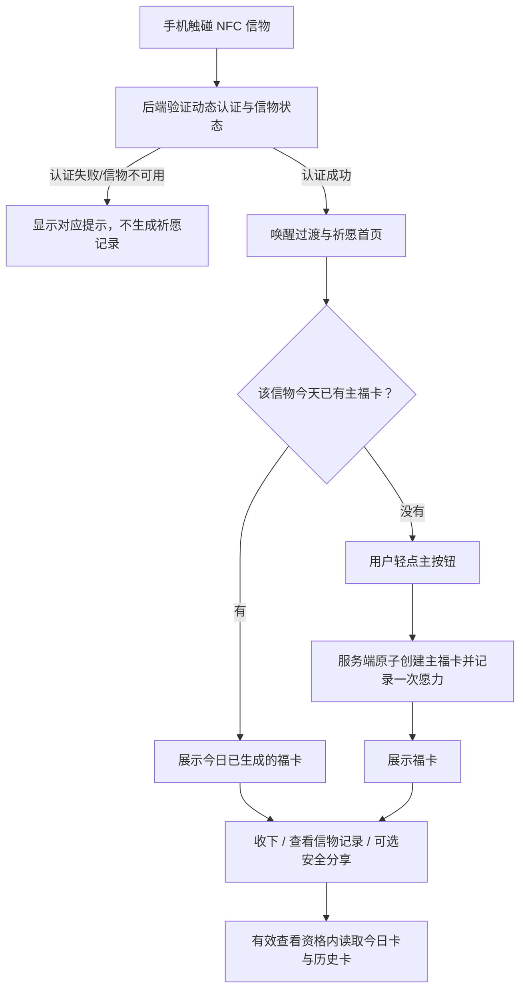

# NFC 文创祈愿 H5 产品需求文档（PRD）V1.1

> 状态：产品范围评审已通过；具体交互设计待确认；技术方案尚未审核。本文不代表功能已实现或已获准开发。
>
> 适用产品：植入 NFC 芯片的手串、佛牌及其他文创信物。
>
> 产品角色：本祈愿 H5 是 BUMBUM 长期数字收藏愿景的第一个业务试金石，而不是品牌长期愿景本身。基础服装触碰查看闭环及小范围试用必需准备完成后，以手串、佛牌等文创饰品先验证持续数字体验；服装业务的现有需求和验收标准仍由根目录 `PRD.md` 维护，本文件只定义祈愿体验的独立业务规则。
>
> 首版范围原则：有意识地收敛到“一碰一签”核心闭环，先验证用户是否愿意完成祈愿并再次触碰；不因长期数字收藏愿景而提前实现完整收藏、个人账户或流转平台。

## 0. 阅读导航与文档职责

本文件只维护祈愿产品的定位、用户流程、业务规则、范围和验收标准。当前任务优先级看 [TODO.md](../TODO.md)，重要决策与验收证据看 [CHANGELOG.md](../CHANGELOG.md)，芯片认证和系统技术机制看 [TECH_SPEC.md](../TECH_SPEC.md)、[技术附录](IMPLEMENTATION_DETAILS.md) 与 [接口契约](../API_CONTRACT.md)。操作步骤统一从 [操作手册入口](OP_GUIDE.md) 查找。

### 0.1 一句话定义

**碰一碰，唤醒信物；轻点一下，接住今天的第一念；福卡留下这一念，愿力记录信物与使用者共同经历的痕迹。**

这不是一个把抽签、签到和积分堆在一起的工具，而是围绕实体信物建立的轻量、可持续的数字仪式。

### 0.2 核心叙事

- **触碰不是打开网页，而是唤醒信物。** NFC 是入口，认证通过后才进入祈愿体验。
- **福卡不是抽奖结果，而是今天这一念的容器。** 文案提供鼓励、安定和陪伴，不承诺现实结果。
- **愿力不是积分，而是信物与使用者共同留下的痕迹。** 它反映使用经历，不作为竞争、付费或惩罚工具。

### 0.3 核心原则

1. 触碰即仪式：入口轻、反馈快，不让动画成为等待。
2. 一碰一签：默认轻点，一件信物每天最多生成一张主福卡。
3. 信物专属记录：V1 采用模式 A，记录属于信物，不默认属于某个个人账户。
4. 服务端可信：芯片认证、每日状态、福卡生成、愿力变更和信物记录以服务端为准。
5. 愿力不惩罚：不因漏掉某天而清空历史或扣减已积累记录。
6. 自动留存：福卡生成成功即保存并累计一次愿力，不以点击“收下”为前提。
7. 可选增强：音效、振动、摇一摇等能力不能成为完成祈愿的前提。
8. 分享安全：分享内容默认仅包含福卡本身及明确允许的公开信息。
9. 渐进扩展：首版验证主闭环，不提前开发复杂养成、个人中心或付费机制。

## 1. 产品目标与成功标准

### 1.1 产品目标

- 将 NFC 实体信物转化为可重复体验的数字仪式入口。
- 让用户在无需安装 App、无需注册登录的情况下，完成一次完整祈愿。
- 通过每日福卡和信物记录建立温和的再次触碰理由。
- 为后续福卡收藏、分享、主题内容、信物成长及个人收藏体系打下可验证的业务基础。
- 复用 BUMBUM 已有的芯片登记、动态认证和藏品资料能力，不另起一套认证体系。
- 通过小范围真实使用验证“实体信物可以承载持续数字体验”这一假设；不把祈愿功能本身误认为 BUMBUM 的长期产品愿景。

### 1.2 首版成功指标

首轮小范围试用关注以下指标，不预设未经验证的目标值：

- 首次用户在无需人工指导的情况下，能否完成从触碰到福卡的完整流程。
- 从页面打开到显示主操作的时间是否足够短；认证和网络失败是否给出可理解反馈。
- 同一信物同一天重复触碰、刷新或重复请求时，是否返回同一张主福卡且不重复增加愿力。
- 若首轮试用已交付轻量分享，观察用户是否愿意保存或分享福卡。
- 用户是否在后续日期主动再次触碰同一件信物。
- 用户是否理解祈愿记录属于信物，而非默认属于个人账号。

先观察真实行为和反馈，再决定留存目标、内容更新频率及是否扩展玩法。

## 2. 用户与使用场景

### 2.1 主要用户

- **信物持有者/使用者：** 购买、收到或暂时使用手串、佛牌等文创产品的人。
- **礼赠接收者：** 通过礼物获得信物，希望快速了解寓意并完成一次祈愿的人。
- **线下体验者：** 在文创店、景区或活动现场体验 NFC 祈愿的人。
- **运营管理员：** 维护信物资料、可用状态及福卡内容的人；首版不要求新增完整内容运营后台。

### 2.2 典型场景

1. 用户第一次用手机触碰信物，完成芯片验证，进入祈愿首页。
2. 用户轻点主按钮，生成今日主福卡，查看一句温和的祝愿。
3. 用户当天再次触碰信物，系统展示已生成的福卡，不重新抽取、不重复计愿力。
4. 用户心中默念，不输入心愿、不选择祈愿类别；福卡生成后可点击“收下”，也可直接离开，记录不会丢失。
5. 若轻量分享功能已交付，用户可主动分享福卡；分享内容只包含允许公开的卡片信息，不带出芯片凭证和私人记录。
6. 用户隔几天再次触碰，原有记录仍在；漏掉的日期不补扣、不清零。

## 3. V1 用户主流程

### 3.1 完整流程

1. **实体触碰：** 手机读取芯片内的动态 NFC 链接并打开 H5。
2. **服务端认证：** 后端验证动态认证数据、读数状态、信物与物品关联及物品可用状态。
3. **唤醒过渡：** 在认证期间可展示轻量光晕或光点动画；认证成功后立即进入体验，不强制等待固定 1.5 秒。
4. **祈愿首页：** 展示信物视觉、简短引导及唯一主操作。
5. **生成主福卡：** 用户轻点“接住今天的第一念”，服务端原子地创建或返回该信物当日的主福卡，并按规则增加一次愿力记录。
6. **福卡呈现：** 展示福卡文案、日期、信物主题及“收下”操作；生成成功时已自动保存并累计一次愿力。
7. **记录延续：** 用户再次触碰或刷新时，返回当天已生成的主福卡；通过简单的“信物记录”入口查看历史福卡。
8. **可选分享：** 用户主动发起分享，只输出经过白名单筛选的卡片内容。
9. **次日再次使用：** 生成新一天的福卡前，必须有当天成功的 NFC 认证；旧福卡与历史记录保留。

### 3.2 核心流程图

### 3.3 首屏信息

首屏只展示完成当前任务所需的信息：

- 信物的名称或主题，以及与实物一致的视觉标识。
- 一句简短提示，例如“把今天的第一念，轻轻安放”。
- 唯一主按钮：**“接住今天的第一念”**。
- 当天已有福卡时，改为展示“今日这一念，已安放”，并提供查看福卡的入口。
- 一处简短、易找到的说明：**“记录保存在这件信物的数字空间中。其他触碰它的人，也可能看到并延续这些记录。”**

首屏不展示排行榜、积分排名、连续签到惩罚、复杂导航、登录表单或必需的权限申请。

## 4. 业务规则

### 4.1 信物身份与使用者身份分离

V1 采用**信物专属记录模式 A**：

- 每件信物有独立的业务身份和祈愿记录。
- 首版不要求个人账户、手机号登录或个人收藏页。
- 芯片动态认证成功，只表示这次触碰通过系统规定的芯片验证；不证明当前触碰者是物品所有者。
- 祈愿记录归属于信物，不宣称是某个人的私密日记或已认证的个人资产。
- 同一件信物被其他人触碰时，对方可能看到当日福卡并继续使用这条信物记录；界面需在首次体验或适当位置明确说明。
- 福卡和愿力记录归属于信物，不归属于某个已验证的个人；信物记录不应被理解为个人私密日记。
- 不把芯片 UID、动态链接、认证数据或内部物品标识展示给普通用户。
- 未来如要支持个人专属记录、个人收藏、转赠或多信物账户，必须另行设计身份认证、所有权证明、历史归属与转移规则，不在 V1 自动扩展。

### 4.2 每日主福卡

- 每件信物在一个业务日期内最多生成一张主福卡。
- 只有用户明确点击主按钮，才触发主福卡生成；仅触碰、打开页面或刷新不自动生成。
- 首次生成成功后，服务端保存福卡内容、日期、信物关联及愿力变更记录。
- 同一信物同一天重复点击、重复提交、刷新页面或网络重试，必须返回同一张主福卡，不能生成第二张，也不能重复增加愿力。
- 同一天再次触碰，直接展示当天已生成的福卡；不能因重新打开页面而重新抽签。
- 跨日后可以生成新福卡，之前的福卡和记录保留。
- 生成当天新卡前，必须有当天成功的 NFC 认证；已有查看资格不能代替当天触碰。
- 查看今日卡和历史记录可以沿用仍有效的查看资格，刷新、切换卡片不要求反复碰卡；资格失效后提示重新触碰。
- 新卡生成须同时满足当前浏览器当天成功认证、本次生成资格仍在30分钟内，以及信物和关联物品仍可用。生成资格自本次成功认证起计时，查看和刷新不续期；跨过北京时间00:00后，昨日认证不能用于新一天生成，即使30分钟尚未结束。
- 每台设备、每个浏览器分别认证，不因其他设备碰过而获得权限；不同设备共享该信物当天唯一福卡。
- 查看资格有效期仍待单独确认，不直接套用服装业务期限；五分钟短凭证也不等于祈愿查看期限。
- NFC认证超时且结果不明时，提示重新触碰，不自动重复提交旧动态读数；福卡生成超时则重试同一次生成操作，返回原结果，不重复抽取或计愿力。
- 23:59生成成功但响应丢失，00:01重试返回昨日已生成福卡，不自动创建今日卡。原操作未成功而重试时已跨日或生成资格过期，不补生成昨日卡，提示重新触碰并开始当前日期祈愿。
- 午夜后新发起生成而无当天认证时，提示“请重新触碰信物，开启今天的祈愿”。查询原操作结果不重新授予生成权限，结果恢复仍须符合相应访问权限及信物可用状态检查。
- 业务日期由服务端统一计算，不依赖手机本地时钟或浏览器缓存。V1 产品规则已确认采用中国标准时间（Asia/Shanghai），每日于北京时间 00:00 切换；技术方案阶段仍需验证服务端、数据库和任务配置的一致性。
- 生成福卡和增加愿力必须在服务端按一致的事务规则完成；任何一步失败都不能留下“有福卡但未计愿力”或“计了愿力但没有福卡”的半完成状态。

### 4.3 愿力记录与视觉成长

- 每次成功生成当日主福卡，产生一次愿力记录；V1 不把愿力作为可消费积分，也不展示排行榜。
- 重复打开当天福卡、查看历史、刷新、分享或收下，不额外增加愿力。
- 不连续使用不会扣减愿力，不清空历史，不要求补签。
- V1 可以展示轻量视觉变化（如光点、细纹、光晕逐渐丰富），但不应为了视觉效果提前实现复杂等级、任务奖励或数值养成。
- 成长阶段的阈值与视觉稿可以在原型评审时确认；在阈值未定前，不能把第 3、7、21、49 天写成已确认的硬规则。

### 4.4 福卡内容与抽取规则

- 福卡由服务端从经过审核的内容集合中选取；客户端不能自行决定并提交一个伪造结果。
- 每张福卡由祝福文案、卡面视觉、主题及适用日期共同组成，统一设计、审核和随版本发布；日期、信物名称或款式等公开字段可按视觉设计展示。
- 系统选取完整福卡，不分别随机拼接文案、样式与节日。多张卡可以复用视觉模板，但最终文案与视觉搭配须经过确认。节日卡与日常卡使用同一套内容机制。
- 文案应温和、尊重用户，不以恐惧、羞辱、损失或“错过就不灵”等方式制造压力。
- 不声称福卡可以保证财富、健康、学业、感情或其他现实结果；不以祈愿结果替代专业医疗、财务或法律建议。
- V1 不设计可付费提高福卡品质、改变概率或购买额外愿力的机制。
- 不同信物可以获得相同福卡。同一信物按文案判断重复，相同文案更换颜色、图案或排版仍算重复；日常与节日卡共同去重。
- 新卡优先排除此前六个北京时间自然日出现过的文案，使连续使用时任意连续七天尽量不重复，不承诺永不重复。
- 在符合去重规则的候选中，优先选当天适用节日卡；节日池无符合条件内容时，回退日常卡池。节日池只有一张且近期已出现时，不为节日直接绕过去重。
- 两个池都没有符合条件的内容时，逐步放宽去重窗口，优先选择距离上次出现最久的文案；所有可用内容均与上一张相同时，最终允许重复，保证祈愿可完成，仍只生成当天一张卡并累计一次愿力。
- 同优先级候选选取方式、窗口放宽的具体步骤须在相关接口方案定稿前明确。
- 历史卡保留生成时的文案与视觉版本，后续内容更新不改写旧卡。
- 未配置或无适用节日内容时，正常使用日常卡池。
- V1 采用随版本发布的日常/节日内容清单，不新增运营后台，不要求 cece 手动编辑配置或操作数据库。
- ChatGPT/Codex 准备候选节日、当年公历对应日期、文案与配置并核验日期来源；cece 确认节日选择、品牌表达及卡面内容；Codex 在获准开发和发布时随版本交付。
- 首版优先覆盖试用期及婚礼交付期内已确认的少量节日，按北京时间配置；农历节日的公历对应日期逐年核对，不默认未来年份已支持。
- 上线前记录清单覆盖日期及后续更新责任；内容文件位置、格式和校验方式在技术方案确定。
- 首版卡片数量、主题比例及已发布内容的异常修正方式仍需明确；不要求完整内容管理后台。

### 4.5 “收下”与信物记录

- 福卡生成成功时自动保存并累计一次愿力；“收下”只表示确认接住这份祝福，不是保存开关。
- 不点击“收下”、直接关闭页面或重复点击，都不丢失福卡、不重复计愿力。
- V1 移除回向，不提供其入口、状态或记录。
- 提供简单的“信物记录”入口，按日期倒序展示已生成福卡，点击可查看完整卡面。
- 今日卡生成成功后自动进入记录；未使用的日期不生成空记录，不显示缺签或损失提示。
- 历史卡只读，不重新抽取、不补签、不重复增加愿力。
- V1 不提供分类、筛选、删除、清空或个人收藏中心。

### 4.6 分享与隐私

- 分享必须由用户主动触发，不自动公开或上传祈愿记录。
- 轻量分享的白名单仅包括福卡文案、卡片视觉、主题及可选日期。
- 默认不包含芯片 UID、动态 NFC URL、认证参数、内部物品 ID、会话 Cookie、私人历史或用户联系方式。
- 分享图片/文件不能携带可直接重新消费的触碰凭证。
- V1 轻量分享优先采用静态福卡图片导出；在移动浏览器支持时，可调用系统分享能力。若系统分享不可用，仍应允许用户保存图片或正常查看福卡。
- V1 不开发公开分享链接、社交平台 SDK 集成、分享奖励、邀请返利或分享排行榜。若未来另行引入公开链接，必须使用独立的公开卡片视图，不得借此获得信物认证权限或查看整条信物历史。
- 分享能力是祈愿核心闭环之外的可选增强，不得成为生成、查看或收下福卡的前提。
- V1 不收集与体验无关的个人敏感信息；日志不记录完整动态认证 URL、Cookie 或认证秘密。

### 4.7 公开入口、停用恢复与实物交接

- 静态二维码只提供公开介绍、帮助或明确标注的演示，不读取真实信物历史，也不生成真实福卡。
- 信物停用后，服务端拒绝已有资格继续读取历史或执行操作；原福卡与愿力保留，已下载图片无法追回。
- 恢复启用后须重新认证才能继续访问原记录，不自动恢复旧资格。
- 实物交给他人后，既有记录仍属于信物，新触碰者可查看和延续；V1不提供删除、清空或重新开始。
- 原浏览器已有查看资格按既定期限失效，实物交付不自动撤销它，不承诺原使用者立即失去访问。
- 上述权限行为须落实到相关接口方案及第9节验收，不以账户或转赠系统作为V1前置。

## 5. 状态与异常处理

| 场景 | 系统行为 | 禁止行为 |
|---|---|---|
| 芯片认证成功且信物可用 | 进入祈愿首页或展示今日福卡 | 不宣称当前用户已被确认是所有者 |
| 动态读数过期或重复消费 | 提示重新触碰，并按现有认证规则处理 | 不重复签发成功认证或祈愿记录 |
| 芯片认证失败 | 说明暂时无法确认信物，提供重新触碰提示 | 不把所有错误都断言为假货 |
| 信物或关联物品已停用 | 显示暂时不可用，拒绝旧资格读取历史或操作 | 不生成福卡、不增加愿力，不删除原记录 |
| 网络不可用 | 明确提示未能完成本次操作，提供重试 | 不伪造成功结果、不在本地先计愿力 |
| 福卡生成成功但客户端未收到响应 | 重试同次操作返回原卡，跨日也返回原日期结果 | 不生成第二张或自动生成今日卡 |
| NFC认证超时且结果不明 | 提示重新触碰 | 不自动重交旧动态读数 |
| 生成资格已过期或不属于今日 | 新生成前提示重新触碰；原成功结果按权限恢复 | 不把当天认证解释为全天写权限 |
| 恢复启用 | 重新认证后访问原记录 | 不自动恢复旧资格 |
| 同日并发点击/多设备请求 | 只有一张主福卡、一笔对应的愿力记录 | 不因并发产生多张卡或多次计愿力 |
| 当天已生成福卡 | 展示原卡与状态 | 不重新抽取、不清空记录 |
| 查看资格有效但当天未认证 | 可查看记录；生成当天新卡前提示触碰 | 不把查看资格当作当天触碰 |
| 查看资格失效 | 提示重新触碰，再按认证结果恢复访问 | 不绕过认证公开信物记录 |
| 音效、振动或传感器不支持 | 继续使用点击主流程 | 不阻断祈愿、不强制申请权限 |

错误提示应区分芯片认证、信物状态、网络故障与业务操作失败，避免让用户把技术问题理解为信物失效或自身做错了什么。

## 6. V1 范围与明确不做的内容

### 6.1 V1 必须实现

- 复用现有 NFC 动态认证和信物/物品映射能力。
- 移动端 H5 祈愿首页和轻量唤醒过渡。
- 服务端管理的每日状态与主福卡生成。
- 每件信物每天最多一张主福卡的幂等与并发保护。
- 愿力记录与最小可见的视觉反馈。
- “收下”确认反馈；福卡自动保存，不依赖收下操作。
- 简单的“信物记录”入口，按日期倒序查看完整历史卡面。
- 当天认证作为新卡生成条件；有效查看资格支持今日卡及历史卡读取。
- 同日重复触碰、刷新、网络重试时恢复当天福卡。
- 芯片认证失败、信物停用、网络失败等明确状态。
- 不要求个人账户；明确告知记录属于信物。
- 最基本的日常/节日文案配置和内容审核流程，内容清单随版本发布。

### 6.2 V1 明确不做

- 公开分享链接、社交平台 SDK 集成、分享奖励、邀请返利或分享排行榜；它们不属于轻量分享卡范围。
- 原生 App、链上资产或区块链凭证。
- 强制登录、手机号绑定、个人收藏中心。
- 个人专属祈愿历史、跨信物的个人愿力总览。
- 摇一摇作为唯一入口、必须使用陀螺仪、必须播放声音或振动。
- 连点 7 次、随机切换操作模式、复杂抽签概率、福卡品质/SSR 稀有度等级及系列收集机制。
- 连续签到惩罚、愿力扣除、排行榜、社交竞赛。
- 付费供奉、付费抽卡、付费提高结果概率或保证现实结果。
- 完整运营后台、复杂活动系统、智能推荐和复杂任务奖励。
- 用户自行转赠信物或把祈愿记录自动转移到个人账户。
- 回向入口、状态、记录及相关验收；输入心愿、选择祈愿类别。

### 6.3 核心闭环后的轻量增强项

以下不是祈愿核心闭环的验收前置条件，应在核心闭环验收通过后再安排：

- 目标是在首轮公开试用前增加轻量福卡分享：静态图片导出；在移动浏览器支持时调用系统分享能力。
- 若技术兼容性或时间不允许，记录原因并单独评估，不得因此阻塞核心闭环验收。
- 轻量分享必须执行第 4.6 节的白名单和隐私约束；分享不可用时仍可正常完成祈愿。

## 7. 页面与交互需求

| 页面/状态 | 必要内容 | 验收要点 |
|---|---|---|
| 唤醒/认证过渡 | 信物视觉、轻量动画、必要的等待反馈 | 不固定延迟 1.5 秒；认证失败时不展示成功光效 |
| 祈愿首页（当日未生成） | 信物名称/主题、主按钮、记录归属说明 | 首屏只有一个主动作；无登录表单和权限前置 |
| 今日福卡 | 文案、主题、日期、收下、信物记录入口 | 自动保存；不点收下也不丢失 |
| 今日已安放 | 当日状态和查看福卡入口 | 再次触碰不重新抽签、不重复计愿力 |
| 信物记录 | 按日期倒序排列的福卡；可查看完整卡面 | 历史只读，不补签、不重复计愿力；无记录时明确提示 |
| 认证/网络/停用异常 | 按原因显示提示与重试方式 | 不混淆假货、停用、过期和网络故障 |
| 轻量分享卡（核心闭环后的增强项） | 静态图片导出；支持时调用系统分享 | 不带出动态链接、内部 ID 或私人历史；分享不可用不影响祈愿 |

### 7.1 视觉与动效原则

- 视觉语言安静、克制、温暖，避免游戏化数值面板和强刺激闪烁。
- 光点/纹路是信物记忆的视觉表达，不代表真实宗教效果或可量化的现实运势。
- 动画应可缩短、跳过或在系统减少动态效果设置下弱化；不影响核心结果。
- 音效默认低调且可关闭；振动只在浏览器支持且用户操作允许时尝试。
- 触觉、音效、摇一摇都属于渐进增强；点击路径始终可用。

## 8. 非功能要求

- **性能：** H5 首屏和主操作尽量轻量，认证完成后快速显示内容；具体首屏性能预算在原型和技术方案阶段结合现有包体确定，不先把“1 MB”写成未经测量的硬指标。
- **安全：** 复用现有芯片认证，不把 UID 当作秘密或独立防伪依据；服务端校验认证状态和信物可用状态。
- **一致性：** 每日主福卡与愿力必须在服务端持久化，并正确处理重复请求和并发。
- **隐私：** 不要求收集姓名、手机号等与首版无关的个人信息；分享和日志遵守第 4.6 节。
- **可访问性：** 核心操作有清晰文字、足够的对比度和可点击区域；不依赖颜色、声音、振动或手势才能理解状态。
- **兼容性：** 支持常见移动端浏览器访问；传感器和振动差异不影响点击主流程。具体设备矩阵由验收计划确定。
- **可维护性：** 祈愿业务与服装业务体验分开；芯片登记、认证和信物档案等共用能力应复用，不复制第二套安全逻辑。

## 9. 验收标准

V1 进入小范围试用前，至少完成以下验收。自动化测试、模拟环境和真实 NFC 验收分别记录，不互相替代。

### 9.1 正常流程

- 使用已核验且启用的真实测试信物，手机触碰后完成现有动态认证并进入祈愿 H5。
- 未登录用户可完成一次主祈愿并看到福卡。
- 福卡展示的信物主题、文案和日期正确。
- 用户心中默念并点击，不输入心愿或选择祈愿类别。
- 生成成功后不点击“收下”直接关闭，再次进入仍能看到原卡和已累计愿力。
- 信物记录按日期倒序展示，历史卡可查看完整卡面，不提供补签或重新抽取。

### 9.2 每日幂等与并发

- 同一信物同一天第一次主祈愿只创建一张福卡，并产生一次愿力记录。
- 连续点击、刷新、重复请求和网络超时重试均返回同一张福卡。
- 两个浏览器或设备同时请求同一信物的当日祈愿，最终只有一张主福卡和一笔愿力记录。
- 同日重复触碰不增加愿力；跨日后可创建新的主福卡，历史保留。
- 重复点击“收下”和查看历史不产生新卡或额外愿力。
- 查看资格仍有效但无当天认证时，不能生成当天新卡；完成当天认证后才可生成。
- 有效查看资格下查看今日卡、历史卡及刷新不要求反复碰卡；资格失效时提示重新触碰。

### 9.3 安全与异常

- 无效、过期或重复消费的动态读数不能绕过现有认证规则。
- 停用信物不生成福卡、不增加愿力。
- 网络失败时不伪装成功；恢复后重试可以得到一致结果。
- 核心闭环验收不依赖分享功能；核心闭环通过后，首轮公开试用前应验证轻量分享是否可交付，若未交付需明确记录，不得将其视为祈愿核心闭环失败。
- 启用轻量分享时，分享产物不包含芯片凭证、动态 URL、内部 ID、Cookie 或私人历史；系统分享不可用时仍能正常完成祈愿。
- 音效被阻止、振动不支持、传感器权限拒绝时，点击路径仍然可以完成。

### 9.4 可理解性与情感体验

- 新用户无需说明即可理解如何开始一次祈愿。
- 用户能理解记录归属于信物，其他触碰者可能继续这条记录。
- 用户漏掉一天后，既有记录仍保留，不显示惩罚或损失提示。
- 福卡文案没有保证现实结果或制造恐惧/压力的表达。
- 节日当天在符合去重规则的候选中优先节日主题卡，没有适用或符合条件的内容时回退日常卡；历史内容不随卡池更新改变。
- 按第4.4节验证节日可用、节日仅有近期重复卡、回退日常、逐步放宽窗口及最终重复兜底；同文案换卡面仍算重复，历史保留生成时的文案和视觉版本。
- 在真实手机上完成一次体验的步骤、耗时和失败原因有记录，供下一轮迭代使用。

### 9.5 生成资格、跨日恢复与访问权限

- 分别验证30分钟内、到期、刷新不续期、跨午夜失效和不同浏览器权限隔离；重复及并发仍只有一张卡、一笔愿力。
- 认证超时要求重碰，不重交旧读数；生成超时可重试同次操作，不重复计数。
- 验证23:59成功但响应丢失、00:01重试返回昨日结果；今日新生成须今日认证。
- 原操作未成功且重试已跨日或资格过期时，不补生成昨日卡、不自动生成今日卡。
- 静态二维码不能获取真实信物权限；停用后旧资格不能读取历史或操作，恢复后须重新认证，原记录保留。
- 实物交接不清空记录，也不自动撤销原查看资格；新触碰者看到同一信物既有记录。
- 更新内容版本后，历史卡文案与视觉不变；没有适用节日内容时使用日常卡池。
- 查看期限及抽取细节在相关接口方案定稿前补齐精确验收值，不将待决项视为已实现或已验收。

## 10. 交付阶段建议

| 阶段 | 交付内容 | 进入下一阶段的条件 |
|---|---|---|
| A. 产品与交互确认 | 关键页面草图、福卡示例、状态文案、记录归属提示 | 主要流程与文案通过评审 |
| B. 技术方案 | 现有认证复用方式、数据模型、幂等/并发、时区、分享安全设计 | 关键数据规则与接口契约明确 |
| C. 核心构建 | 首页、每日福卡、愿力、信物记录和异常处理 | 核心自动化检查通过 |
| D. 真实设备验收 | 真实芯片、手机浏览器、网络失败/恢复、重复触碰及多端并发 | 核心必测项通过并有证据 |
| E. 轻量分享增强 | 静态福卡图片导出；支持时调用系统分享，并提供兼容性降级 | 分享白名单与凭证隔离通过；不阻塞核心闭环 |
| F. 小范围试用 | 观察首次完成、福卡接受度、再次触碰、隐私理解及分享意愿 | 基于真实反馈决定后续扩展 |

产品范围评审已通过，但具体交互设计仍待确认，技术方案尚未审核。本 PRD 不代表技术方案、数据库变更、代码开发、部署或真实芯片操作已经获准执行。后续开发前应先完成具体交互评审与技术方案审核，并按项目现有授权规则推进。

## 11. 交互设计与内容细节待确认

产品范围及本轮补充规则已确认，关键页面和具体交互仍待确认，技术方案尚未审核；以下不能因本次文档提交而视为已通过。

1. **接口方案定稿前：** cece确认查看资格有效期；明确同优先级候选选取方式、去重窗口逐步放宽的具体步骤，补齐第9节精确验收值。
2. **已确认、应落实到技术方案：** 当前浏览器当天认证加30分钟生成资格、跨日重试、去重优先及节日回退、静态二维码只公开介绍/帮助/演示、停用拒绝旧资格、恢复重新认证、实物交接不清空且旧查看资格按期限有效；不再作为业务待决项。
3. **交互与视觉：** 主按钮、收下反馈、今日卡和信物记录入口、空状态、失效提示、记录归属、愿力数值及视觉阈值，可以继续页面草图，不预设复杂等级。
4. **内容发布前：** 确认首版完整福卡样例、数量、主题比例、少量节日清单、覆盖日期、审核和更新责任；AI准备日期来源及配置，cece审核表达，技术方案明确版本内清单及视觉版本的保存和检查方式。
5. **轻量分享：** 核心闭环验收后安排，目标首轮公开试用前交付；兼容性和排期单独核验，不阻塞核心闭环。
6. **已发布内容异常修正：** 另行明确处理方式，不借内容修正默认改写历史卡或开放清空。

## 12. V1 范围总结

V1 只验证一件事：**用户通过真实 NFC 触碰进入一件信物的数字空间，轻点一次获得当天唯一的主福卡，系统可靠地记住这次经历，并允许用户温和地收下、查看信物记录。**

这是验证长期数字收藏愿景的第一步，不是要把祈愿系统建设成 BUMBUM 的全部产品。若核心体验稳定、易懂，用户愿意再次触碰，再根据真实反馈决定是否投资稀有度、系列收藏、个人账户、收藏册、复杂养成和权益流转；这些能力不因愿景存在而自动进入 V1。
