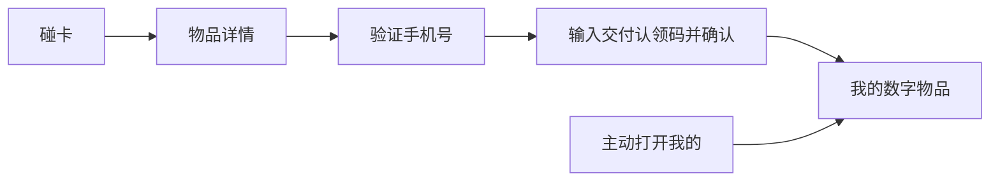

> 本文是本次整理前的方案快照。“当前分支”“拟用”“后续”等描述属于原方案语境，不代表最新实现或部署状态。现行规则见上方承接文档，任务与验收仍以 TODO 和 CHANGELOG 为准。

# 数字物品 H5 首版：查看、认领与我的物品

cece 已确认本稿的首版范围、一次性认领码和预览交互。本稿是产品规格，交付状态见 [TODO](../../TODO.md)，实施细节见 [已审核技术方案](digital-item-assembly-h5-technical-2026-11-17.md)。管理端的实体、芯片和装配流程见 [后台重构方案](admin-make-rebuild-2026-11-17.md#assembly)，字段见 [后台字段表](admin-rebuild-fields-2026-11-17.md)。

## 1. 首版目标与入口

顾客碰卡后能看懂物品及随附权益；交付对象能认领；已认领的用户以后能从「我的数字物品」找到它。两个主要入口为「物品详情」和「我的」。登录与认领从当前页面进入。服装优先用于验收，普通手串的专属体验继续按 [手串探索](../BRACELET_NFC_EXPLORATION.md) 判断。

碰卡、物品档案和「我的数字物品」使用同一款 [黑色 bumbum 字标](../../frontend/shared/brand/bumbum-wordmark-black.svg)。页头右侧为「我的数字物品」或返回入口。浏览器标签页使用品牌包 v1.1 的骨白底黑色 `bb` 图标。

高保真版采用暖白 `#FBFAF5`、墨黑 `#231E1A` 和深绿主操作 `#174735`。访客首屏先展示贴边的 11:12 实物图框，图片居中保留完整构图。状态用简短标签，商品名称与发行编号同行。档案图集和放大预览都能直接左右滑动，松手停靠到整张图，进度放在图内底部。桌面支持拖动及方向键切换。识别等待使用细线动效，尊重系统减少动态效果设置。

首版展示权益说明、适用状态和本年换新用量，换新与转售继续由后台办理。看懂物品、认领和持有、使用权益、长期回访的完整发展线在 [PRODUCT 的 H5 演进方向](../../PRODUCT.md#h5-evolution) 维护。

## 2. 页面与操作状态

| 页面 | 信息、状态与操作 |
|---|---|
| 碰卡后物品详情 | 先显示「正在识别这件物品」。通过后显示主图、名称、发行和编号、材质养护及权益简介。验证与资料读取时间在末尾「识别记录」查看。核对当前账户为持有人后进入本件物品的持有档案。缺失的选填内容可省略，未封版时编号显示「待核定」。 |
| 物品详情的认领入口 | 当前可认领时显示「认领这件物品」。尚未开放时显示「暂未开放认领」。已有持有人时，访客只见「已认领」，登录且为本人时可以进「我的物品」。 |
| 验证异常与持续查看 | 旧链接或当前认领资格过期时引导重新碰卡。芯片停用、验证失败和系统暂不可用分别提示。资料持续查看与认领资格独立，持续查看沿用 [现行验证和阅读规则](../product/fashion-touch.md#2-手机资料页与持续查看)。 |
| 手机号登录／注册 | 同一表单输入手机号与短信验证码。已注册手机号登录原账户，首次验证通过建立稳定 UID。从认领进入时返回当前物品和认领步骤，从「我的」进入时打开列表。发送失败保留手机号并允许重试，验证码无效或过期分别提示，沿用同手机号 60 秒内最多发送一次的要求。 |
| 首次认领 | 按验证手机号、输入交付认领码、核对并确认三步办理。已有有效登录时从输码开始。确认页显示物品缩略图、名称、发行编号和本账户的脱敏手机号，返回输码保留原输入。成功时显示认领对象，主按钮「查看我的物品」打开该物品档案。 |
| 我的数字物品 | 未登录时显示手机号登录入口。空列表提示「碰一下你的物品，即可开始认领」。有记录时列出当前持有物品的主图、名称及编号；详情展示当前实体摘要、认领时间、适用权益、本年换新用量。账户页显示脱敏手机号及退出入口。 |
| 从「我的」打开详情 | 显示「你持有这件物品」和档案资料；实时芯片验证结果只用于本次碰卡进入的页面。持有人信息仅本人可见。常规公开资料限于物品与允许展示的认领状态。挂失找回的单独规则见[持有期间的找回与办理](#holder-lifecycle)。 |

## 3. 发放、确认与异常恢复

1. 后台核对首次交付后发放一次性认领码，售出交付与赠送交付均适用。通过现有交付渠道交给接收人。发放与补发记录物品、操作人、时间、交付依据和码的状态引用。
2. 认领码从发放起 **30 天有效**。管理员可在订单件或物品详情主动查看有效码，查看留审计。过期显示「已过期」。需要重新发放时先核对交付，补发后旧码失效。已存在持有关系时按争议流程处理。
3. 确认时校验同一物品的近期有效碰卡资格、已验证的手机号账户、可用认领码及当前认领状态。创建持有关系、写入历史和核销认领码一起提交。并发只能有一个当前持有人；同一账户重试时返回已确认的结果。
4. 日志与审计使用码的状态、引用和脱敏身份。原码、短信验证码及完整手机号属于受限凭证或数据。

| 情况 | 提示与恢复 |
|---|---|
| 认领资格过期 | 「请重新碰一下物品，再继续认领。」保留登录状态，新碰卡通过后恢复当前认领步骤。 |
| 认领码错误或与物品不匹配 | 「认领码与这件物品不匹配，请核对交付时收到的认领码。」留在表单重输。 |
| 码过期、失效或遗失 | 「请联系 BUMBUM 核对交付后补发。」运营在核对后补发或按持有争议处理。 |
| 已被认领或同时提交 | 本账户已经持有时进入「我的物品」。其他账户看到「这件物品已认领，如有疑问请联系 BUMBUM」。 |
| 提交后断网、结果未知 | 显示「正在核对认领结果」。恢复后查询当前归属。查询失败时可点「再次核对认领结果」，只查询归属。确认认领成功后显示成功结果，仍具备认领资格时可回到表单。 |

## 4. 后台预览的页面规格

入口与侧栏规则见 [后台预览](admin-make-rebuild-2026-11-17.md#h5-preview)。侧栏复用 H5 的展示规则，顶部明确标识「预览」。用当前物品已保存的公开资料配合预设状态。

| 视角 | 可以检查什么 |
|---|---|
| 访客 | 主图、名称、发行编号、材质养护、权益简介。 |
| 待认领 | 认领入口、手机号验证、认领码表单、确认页。切换使用预设数据。 |
| 持有人 | 当前实体摘要、认领信息、适用权益和本年换新用量。持有人身份使用模拟数据。 |

预览权限只允许读取和切换展示状态。真实短信、认领、归属变动及触碰统计走各自的用户流程。未装卡物品可预览资料，待核定编号按原状态展示。

## 5. 验收路径

| 核对场景 | 通过标准 |
|---|---|
| 从真实碰卡到资料 | 已授权的测试卡与所见物品一致，读数异常、旧链接、停用和系统失败可区分，访客可正常读资料。 |
| 首次认领与回访 | 合格交付对象验证手机号、用一次性码认领，退出后重新登录能从「我的」找到同一件物品。 |
| 认领异常与并发 | 错码、过期、补发、重复提交、两个账户同时提交及断网恢复均有明确结果，归属和核销一致。 |
| 后台预览 | 三种视角可达，使用保存的资料并标明模拟状态，关闭后恢复后台原分区与滚动。预览前后短信、归属与触碰统计可核对一致。 |

模拟批次验证页面与状态。真实短信、实卡和测试环境中的完整链路分别取证，验收与发布按项目协作规范进行。

## 6. 持有期间的找回与办理

cece 已确认以下产品规则，供 H5 原型与后续技术方案使用。挂失、换新和转售的业务生效条件仍由[后台核心流程](admin-make-rebuild-2026-11-17.md#flows)维护。

### 6.1 挂失找回

- **由持有人为单件物品设置。** 从「我的物品 → 这件物品 → 找回设置」进入，挂失前后均可设置，默认关闭。开启时确认挂失期间碰到这件实物的人可以查看并拨打所选的已验证手机号。转售接收人的设置独立，换绑手机号后需要重新确认。
- **拾到实物的人重新碰卡。** 新读数校验成功、标签仍属于当前挂失的那件实物时，显示「这件物品已挂失」。已开启找回联系时，点击「联系失主」后查看号码并拨打。关闭时提示可交给拾获地点的失物招领处。找回页提供找回所需信息，页头保留「我的数字物品」入口，未登录时可从这里用手机号登录。访客可以直接联系失主。姓名、账户、订单和持有档案仍按原权限访问。
- **号码按当前条件读取。** 每次查看号码都核对本次找回资格、挂失状态、当前实物和持有人设置。开关关闭、换绑手机号、挂失结束、实物退役或持有人变更后，旧找回页停止提供号码。失效或复制的旧链接引导重新碰卡。找回入口独立于常规档案与认领资格，有效触碰次数继续按原口径统计。取消挂失后，持有人记录保留挂失及取消时间，核对依据仅见后台审计。

### 6.2 当前物品列表与状态提示

「我的物品」列出当前账户持有的全部物品。办理状态随对应条目展示。没有持有物品时显示通用空态。详情首屏优先展示仍需关注的挂失或办理状态。

| 状态 | 显示位置与结束条件 |
|---|---|
| 当前实物已挂失 | 档案首屏和对应列表条目持续显示，直到挂失结束或新实物交付生效。 |
| 换新／转售办理中 | 档案首屏和对应列表条目持续显示，直到后台办结。详情区分「正在准备新物品」和「等待确认交付」。挂失后换新同时展示原实物已挂失。 |
| 换新已交付 | 确认交付时更新当前实物，发行编号保持。档案首屏显示「换新已完成」，从确认交付生效时刻起保留 7 天（168 小时），可提前收起。 |
| 转售已交付 | 接收人的列表新增这件物品，档案首屏按相同规则显示「已接收」。原持有人的列表移除该项，在「我的办理记录」中保留该笔转售结果。 |

回访沿用原交付时间。提前收起只影响本账户对该笔完成提示的显示。到期或收起后，交付结果仍可在办理记录里查看。

### 6.3 记录内容与访问边界

| 记录 | 谁可以查看 | 记录内容 |
|---|---|---|
| 物品历程 | 当前持有人，从档案的「记录」查看 | 发行和历代实物的启用、退出日期、当前实物及必要规格。接续后沿用发行编号。旧实物退出原因涉及前持有人时，展示退出事实。 |
| 我的办理记录 | 对应办理的当事人，从档案的「记录」或「我的物品」页的独立入口查看 | 本人认领或接收、挂失、换新和转售的关键节点、日期和结果。转售双方分别看到自己的交付结果。原持有人可查本人办结记录。 |
| 后台业务与审计 | 有相应权限的管理员 | 订单、交付依据、内部核验、操作人、芯片信息和争议处理，按后台权限查看。 |

用户时间线仅收录改变物品、持有或办理结果的关键事件。前持有人身份、手机号、挂失依据、交易对方身份和逐次触碰明细留在各自受限的业务入口。找回联系方式按本节设置即时读取。

### 6.4 验收场景

1. 同一件挂失物品在找回开关开启和关闭时分别碰卡，核对号码只在主动查看时出现。关闭、换绑、退役及旧链接场景要重查资格。
2. 挂失与办理状态在对应列表条目和档案中同步。交付后核对新实物、编号、7 天期限和收起行为，完成提示消失后仍可查到记录。
3. 转售后用双方账户对照全部持有物品和各自办理结果。接收人能查看物品历程，原持有人通过独立入口查看本人结果，双方均按各自权限读取资料。
