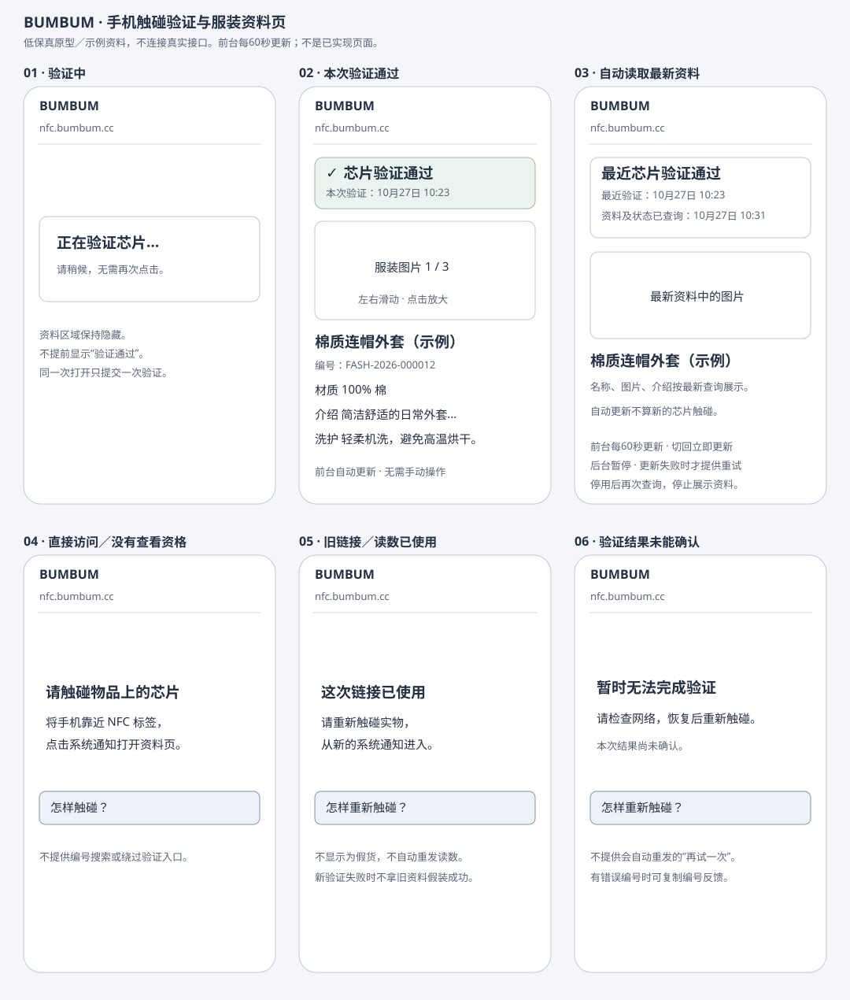

# 服装用户体验：触碰验证、资料与持续查看

适用范围：当前main已有能力的产品规范，沿用既有批准规则；本次仅重组，不新增验收或部署。待改行为在[独立提案](../../PRD.md#10-管理后台优化与功能补全审核稿)审核，不能用提案覆盖这里的现行行为。任务看[TODO](../../TODO.md)，验收/合并证据看[CHANGELOG](../../CHANGELOG.md)，逐接口实现范围看[API概览](../../API_CONTRACT.md#04-当前能做到哪一步)。

原功能定位：F2-01/F2-06对应第1节，F2-02的已交付基础资料对应第2节；未交付扩展从根PRD后续范围查阅。

## 1. 动态验证与短时许可

目标：手机真实触碰后，系统核验本次动态读数，为对应物品提供五分钟查看许可。共用验证覆盖服装和饰品；用户手机页面仍优先交付服装，不同时展开饰品编辑、养成或完整用户体验。

- 仅接受已登记、绑定关系正确、密钥与配置完成、芯片可用且物品启用的全新有效读数。配置核验不是用户触碰，必须另取新读数。
- 成功后可在许可有效期内重复获取对应资料；不证明购买资格、访问者身份或所有权，不提供短信认领、长期登录或养成。
- 正在验证时等待本次结果，不自动重复提交；旧链接、重复或乱序读数提示重新触碰，不直接判定假货。
- 原触碰查看凭证与持续查看资格是不同权限，不能凭旧读数重新取得新的查看资格；五分钟凭证期限不等于用户正常阅读时长。持续查看的用户行为以[第4.2.4节](fashion-touch.md#2-手机资料页与持续查看)为准，接口契约和实现机制分别见 API_CONTRACT 与技术附录。
- 未配置完成、物品未启用、停用、验证不通过、许可过期和服务故障分别提示。服务故障不能展示为假货，失败不能展示成功资料。
- 验证成功但资料加载失败时，说明资料未加载完成；原许可仍有效时可重试获取资料，不重复验证原链接。
- 超时可能发生在服务器已经接受之后，不自动重发验证请求；结果无法确认时提示重新触碰。五分钟到期后，原许可不能继续向服务器获取资料，不自动续期；不因此清空已成功取得并正在阅读的资料。
- 仅展示对应项目允许公开的物品资料和是否已认领，不展示芯片内部编号、计数器、密钥、手机号或订单号；没有维护的扩展内容显示暂无。

验收分五组：正确读数及物品对应；重复/乱序/并发只接受一次；未就绪/停用及错误读数拒绝；查看许可的有效期、对应物品和状态重查；保存失败无半完成、超时无假成功和重启后防重复仍有效。自动接口检查、真实卡检查、手机页面与公网部署分别取证。

## 2. 手机资料页与持续查看

**目标与确认边界**

让用户用普通手机网络完成“碰卡 → 点击系统通知 → 网页自动验证 → 查看对应服装资料”，不再复制链接到电脑或操作命令行。成功事件按[对应规范](admin-management.md#4-工作台有效触碰统计)计入对应环境的工作台统计；不是按页面刷新、图片切换或芯片自身读数差值计数。

cece 已确认：本次只做验证与资料查看，不显示认领等未来功能入口；先做简洁可用版，再按需要接入 Figma。正常阅读不因五分钟到期而被打断，整页刷新始终重新向服务器读取最新资料，不采用“恢复上次公开资料副本”代替查询。前台每 60 秒自动更新、切回立即更新、后台暂停及失败反馈等产品规则已确认；不提供常驻手动更新按钮。本节只定义产品行为和验收边界；接口契约见 API_CONTRACT 第 9 节，实现机制见 TECH_SPEC 第 5.5 节及技术附录第 17 节，当前任务状态见 TODO。

**阅读、资料刷新与重新验证的分工**

原触碰查看凭证的五分钟期限不是用户阅读时长；“同一旧读数不能重复验证”和“已有查看资格时刷新读取最新资料”是两条独立规则。前台必须重新获取最新资料及当前可查看状态，不能依赖旧资料副本冒充最新结果；刷新和自动查询不得重新提交原触碰读数或增加计数。接口契约与实现机制见 API_CONTRACT 第 9 节及技术附录第 17 节。

| 核心业务规则 | 规则 |
|---|---|
| 首次碰卡 | 用这次新读数验证；只有成功后才能查看对应物品，按一次成功事件计数 |
| 正常阅读 | 不计时关闭、不遮挡、不因原临时许可五分钟到期而清空，不出现阅读倒计时 |
| 再次碰卡 | 执行一次新的芯片验证；通过后更新最近芯片验证时间及对应资料，按新成功事件计数 |

自动更新、刷新、资料变更、停用和资格撤销后的页面行为集中在下方“资料页与交互细节”及“异常页面与重试边界”表中，避免同一规则维护两份。

查看最新资料与重新证明持有实物分开：刷新可以确认资料和可查看状态，但不能证明用户刚刚又碰了芯片。刷新后保留原“最近芯片验证时间”，另显示“本次资料读取时间”，不把资料查询时间写成新的验证时间，不宣称持续监测实物。

**持续查看的权限边界**

- 首次真实验证成功后，为当前浏览器本次访问建立仅限对应物品的持续查看能力；不要求用户登录，也不直接开放按物品编号任意查询。
- 持续查看不具备认领、转赠或其他写操作权限，不自动续期未来认领操作的资格；不把现有五分钟触碰凭证直接改成永久通用凭证。
- 不能只凭可手工替换的物品编号、前端变量或历史验证时间获得查看权限；每次查询由服务器核对当前资格、绑定和物品状态，不依赖本地资料副本授权。
- 刷新、浏览器返回或恢复当前页面时可以重新查资料，不应因为原五分钟凭证过期反复要求碰卡；不承诺跨设备、清除浏览器数据后仍可访问或个人收藏能力。访问资格如何保存、期限及撤销机制在技术方案说明，但不能暗中恢复已被否决的“五分钟后必须重碰”体验。
- 切换到新读数时先验证这次读数，不能用旧查看资格跳过验证；新验证失败不拿原物品资料假装本次成功。旧链接在没有相应查看资格时仍须重新碰卡，防旧读数重复验证规则保留。

公网部署依赖上述持续查看能力。接口契约集中在 API_CONTRACT 第 9 节，实现机制集中在 TECH_SPEC 第 5.5 节及技术附录第 17 节；本节不重复列出技术参数。公网部署仍须单独验收。

**低保真原型**

以下六幅是设计阶段保留的布局与状态示意，全部内容为示例，不是当前运行界面的截图；第03幅表达“刷新读取最新资料”。颜色和字形不是最终视觉规范，不提前扩展设计系统。

[打开原型大图](../images/mobile-tap-wireframe.svg)。正常资料页可上下滚动，图中下半部分仅示意，不压缩进固定高度。手机用户页独立使用自然页面滚动，不继承桌面管理端禁止body滚动的规则。

**资料页与交互细节**

| 区域／操作 | 行为 |
|---|---|
| 顶部品牌 | 显示BUMBUM；本次不设置导航、登录入口或未完成菜单 |
| 验证中 | 立即显示“正在验证芯片，请稍候”；隐藏资料及成功标识，同一次打开只提交一次，不提供重复提交按钮 |
| 本次验证成功 | 显示“芯片验证通过”和验证时间；表达本次芯片读数通过检查，不承诺整件商品绝对保真，不表示当前访问者是所有者 |
| 图片 | 沿用后台图片顺序；左右滑动切换，显示当前张数／总张数；单张时不显示切换控件，不自动轮播 |
| 图片放大 | 点击图片打开大图，左右滑动切换，明确关闭按钮；关闭回到原阅读位置，不重新验证、不增加次数 |
| 图片缺失或加载失败 | 保留稳定占位和“图片暂不可用”；其他资料继续显示，不将整页变成错误页，不重发验证 |
| 名称与物品编号 | 名称为主要标题，编号为次要信息；长名称换行，不用横向滚动截掉内容；资料正文按普通文字显示 |
| 材质、介绍、洗护说明 | 有内容才显示对应区块；保留正常分段和换行；未填内容不堆“暂无”占位 |
| 本次不展示 | 尺码表、溯源、品牌故事、购买渠道、所有权状态、认领、手机号、收藏、转赠、养成及后台操作；不留未来功能按钮 |
| 连续阅读 | 不因经过五分钟遮挡已取得资料；展示最近芯片验证时间和最近成功读取资料时间，不把查询资料当成再次碰卡 |
| 前台自动更新 | 页面可见时每60秒查询最新资料与状态；成功后整组更新内容和资料读取时间，不重发原验证读数、不增加计数。后台或锁屏时暂停，不弹全屏遮罩、不跳回顶部，不打断图片浏览 |
| 切回页面／网络恢复 | 返回前台时立即查询一次；断网期间停止无用请求，网络恢复后尝试查询；合并同时发生的触发，避免重复请求 |
| 整页刷新／返回恢复 | 凭已有查看资格向服务器重新获取最新资料，不自动重发原验证读数；整页刷新尚无可显示资料时用加载状态，不读取旧资料副本伪装最新 |
| 怎样重新验证 | 按钮只展开提示：“将手机离开标签，再靠近，点击新的系统通知”；不是模拟NFC扫描或自动重发旧请求的按钮 |
| 更新失败与重试 | 移除常驻“更新资料”按钮。后台更新失败可保留当前资料，但标明“资料更新失败，当前显示上次内容”及上次成功时间，不能更新时间或标作最新。失败时才提供“重试更新”，只查询资料、不重新验证；恢复成功后撤下错误提示 |
| 重新触碰 | 新链接进入验证中状态，新的验证成功后替换资料并按实际成功事件计数；本页不通过刷新制造新验证 |
| 长页面和可操作性 | 使用手机自然滚动、可读字号及明显的按钮状态；图片有名称说明，加载/错误状态能被辅助阅读识别，不仅用颜色区分 |

成功时不展示芯片内部编号、密钥、读数、手机号码或原始动态参数；不提供复制或分享验证链接入口，不把链接参数显示在错误提示或外部图片跳转地址中。

**异常页面与重试边界**

| 场景 | 文案与下一步 |
|---|---|
| 直接访问且没有对应物品查看资格 | “请用手机触碰物品上的NFC芯片”，可展开怎样触碰；无编号搜索或绕过验证入口 |
| 参数缺少或格式错误 | “链接信息不完整，请重新触碰物品”；不展示任何推测出来的物品资料 |
| 旧链接／读数已使用 | “这次链接已使用，请重新触碰实物，从新的系统通知进入”；不判定是假货 |
| 防伪检查未通过 | “本次芯片验证未通过，请重新触碰；仍有问题请联系物品提供方”；不泄露具体密钥或内部编号 |
| 未登记／未绑定／未配置完成 | “该物品暂未准备好，暂不可查看，请联系物品提供方”；不提供管理员操作入口 |
| 芯片或物品停用／归档 | 首次验证或之后查询均显示“该物品当前暂不可查看”，停止展示资料，不写“是假货”；查询前不能保证自动感知后台变化 |
| 新验证时断网、超时或服务故障 | “暂时无法完成验证，请检查网络，恢复后重新触碰”；结果未确认，不自动重发可能已成功的验证请求，不显示假成功 |
| 请求过于频繁 | 提示稍后再触碰，按服务返回的等待时间显示；等待结束不自动提交旧读数 |
| 验证成功但资料未能显示完整 | 明确说明“芯片已验证，资料暂未完整加载”，可在已有查看资格下重新读取；不得重复验证旧读数或只因原五分钟许可到期就强制重碰 |
| 自动更新时断网／超时／服务故障 | 已有资料保留并标为上次内容，显示更新失败与“重试更新”；初次加载或整页刷新没有内容时只显示读取失败。网络恢复后再查，不把服务故障说成芯片验证失败 |
| 持续查看资格不存在或被撤销 | 根据服务器结果提示“本次查看资格不可用，请重新触碰”；不得将普通五分钟到期当作这种情况。物品已停用时优先说明当前不可查看，避免引导反复触碰 |
| 饰品通过验证 | “芯片验证通过，当前版本暂不支持展示该类物品”；不误报假货，不混入服装版式。后端已接受的新有效事件仍按既有口径计数 |

错误页有后端错误编号时提供“复制错误编号”，不复制完整链接或凭证。未得到成功验证和对应资料时，不填入示例服装或前一次其他物品内容。无人工客服渠道时不放不可用的“在线客服”按钮。

**公网链路与环境要求**

- 入口沿用已确定的https://nfc.bumbum.cc/tap，优先保留当前测试卡链接；用户用正常手机移动网络可访问，不依赖电脑、同一Wi-Fi或命令行。
- 用户页面只访问必要的用户接口，不能借公开域名访问管理页面或管理接口；管理端原有IP及登录限制继续保留，不整体取消限制。
- 触碰发生在哪套环境，只增加该环境后台的统计；手机访问云端不自动同步电脑本地数据，资料页刷新和图片浏览不增加有效次数。
- 云端物品、绑定、密钥、配置核验和卡上实际配置必须对应；本地通过不推定云端已有同样数据，不自动导入本地整库或重新配卡。
- 初次公网交付按小范围测试准备；测试体验标识与正式品牌文案在部署前确认。域名、证书、服务器现状及配置由技术方案列出核对项；代码、部署、数据准备和真实手机验收分别取证，实际部署另行授权。

**验收五组**

1. 真机正常流程：移动网络碰已配置且物品启用的服装卡，点击通知后自动验证并显示正确资料，无须登录或命令行；验证中不提前成功，同一次打开只提交一次。
2. 资料及图片：名称编号对应、长文可读；多图切换和放大关闭可用，空字段隐藏；缺图不阻断文字，尺码表及未来功能入口不出现。
3. 阅读与刷新：正常阅读超过五分钟资料仍在；此后后台修改服装资料，页面前台通常60秒内自动显示最新内容，切回和整页刷新也取得最新资料，无需再碰卡；后台或锁屏暂停查询。之后停用，下一次查询停止展示资料。芯片验证时间不变，资料读取时间更新；自动更新失败保留内容并明确标旧；整页刷新无资料时显示失败，网络恢复后再查。更新不抢滚动位置、不打断看图。
4. 异常与计数：旧链接、错误读数、停用、未就绪及网络/服务异常提示正确；一次新验证成功加一次，刷新/自动更新/重试更新/看图不加，验证成功但页面显示失败也不冲销已接受事件。
5. 公网隔离与保留：手机可访问，用户域名无法访问管理功能；对应云后台能查询成功事件，重启后资料与记录仍保留。本地、自动检查和服务器实测分别记录，不把其中一项当作全部通过。

## 3. 实现、人工验收与部署分别取证

接口是否实现看[API概览](../../API_CONTRACT.md#04-当前能做到哪一步)；五分钟短许可与持续查看Cookie的接口分别看第1、9节，精确期限和撤销机制看技术方案，不能把服装资格直接当作新业务的规则。历史香港实卡/公网验收不代替杭州新业务及实卡验收；当前部署与待验证项从[杭州手册](../HANGZHOU_DEPLOYMENT.md#62-杭州基础接管完成范围与后续运维验证)查阅。本次文档整理没有重新运行手机、实卡或线上测试。
