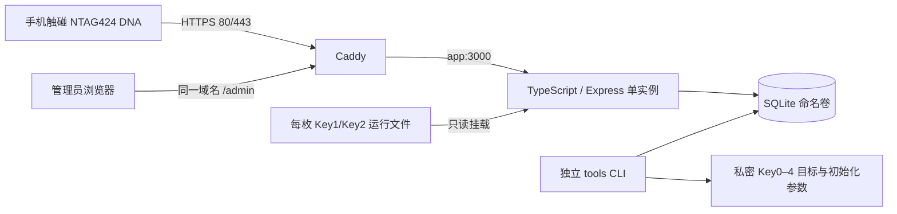

# bumbum 数字服装 NFC MVP：技术文档

整理日期：2026-10-23（北京时间）；文档1.0；核对软件v1.2.1，基线提交`6b333f4`。本文描述本地保留的历史交付代码；2026-10-23远端main仅含README，不能从它取得此源码。现场状态见[交接记录](HISTORY-AND-STATUS.md)。

## 1. 产品目标与范围

为每件实体服装建立独立档案，管理员登记标签、绑定服装、维护内容和所有者登记信息。消费者用手机触碰NTAG424 DNA，按系统通知打开网页，服务器校验芯片动态信息，再展示当前绑定服装。

同款两件服装仍是两个实例编号，不能用一个款号替代每件服装身份。

### 已实现

- 服装新增、查询、编辑、发布/下架；名称、编号、品牌、款号、颜色、尺码、材质、描述、养护、HTTPS图片地址。
- 标签真实UID登记、独立随机入口、绑定/解绑、启用/停用、人工写入核对。
- 所有者手机号由管理员登记和变更，公开页仅显示是否登记；变更原因与审计记录。
- 管理员密码登录、退出、空闲会话过期、登录失败限速；无默认管理员密码。
- 固定入口及动态SUN/SDM验真；PENDING→ACTIVE启用；最近成功校验记录。
- SQLite增量迁移、独立管理员初始化、健康检查、在线备份、新文件恢复及签名计数水位维护。
- 原MySQL兼容分支保留；当前NFC准备/计数维护CLI以SQLite为执行路径。

### 当前不包含

交易支付、NFT/区块链、用户注册/短信、自助认领/转让、多角色权限、图片上传系统、Excel批量导入、主密钥派生、管理独立域名、自研原生iOS App。用户明确本阶段不考虑真标签移植/防拆问题。

## 2. 部署架构



- 应用监听容器内`0.0.0.0:3000`，主机不公开3000。Caddy代理`app:3000`，对外TCP80/443。
- Compose项目名`bumbum`；`compose.sqlite.yaml`叠加`compose.nfc.yaml`，使用`.env.sqlite`。
- 生产不运行第二套MySQL；SQLite文件在本地持久卷，不能放OSS或普通网络共享盘作为活动数据库。
- 单app实例；当前不提供多机共享SQLite、自动数据库高可用或无停机升级保证。
- 数据库、备份、Caddy证书与配置使用持久卷。NFC密钥是主机私密目录绑定挂载，必须另行备份。

## 3. 技术栈与版本

| 项目 | 代码锁定/已测试值 |
|---|---|
| 应用 | 1.2.1；部署标签`bumbum:1.2.1-sdm` |
| Node | 24.19.0-bookworm-slim |
| SQLite | 上述Node内置node:sqlite；历史测试查询为3.53.3 |
| Express / Zod / mysql2 | 5.3.0 / 4.6.7 / 3.24.5 |
| TypeScript / tsx / Playwright | 7.0.2 / 4.23.15 / 1.64.0 |
| Caddy | 2.11.2-alpine |
| 构建 | 多阶段Dockerfile，npm ci，package-lock.json完整性锁定 |
| 开发测试平台 | Linux amd64；Apple Silicon部署须单独验证目标架构 |

- Node镜像digest：`sha256:a9f5f7c91a432850b2a8a7797adf5eadb6c733ceed61167806cee7ea7fbc29df`。
- Caddy镜像digest：`sha256:834468128c7696cec0ceea6172f7d692daf645ae51983ca76e39da54a97c570d`。
- Dockerfile frontend：`sha256:4edf897a3ffa55b89f906fc8cc78afdb3f1834cc9c7083565e611a8a7d5fe99e`。

依赖锁定可重复安装，不表示永远无漏洞。历史审计0已知漏洞是当时结果，应在后续升级重新审计。镜像构建不读取真实数据库、实际.env或芯片密钥。

## 4. 代码组织

| 位置 | 职责 |
|---|---|
| src/app.ts | 页面、管理API、认证/Origin、公开字段、错误响应 |
| src/server.ts | 0.0.0.0监听、退出时关闭数据库 |
| src/db.ts / src/sqlite.ts | 数据库适配、SQL方言、事务、SQLite连接保护 |
| src/security.ts | scrypt密码散列、令牌HMAC |
| src/ntag424.ts | AES-CMAC、SDM解密校验、严格参数解析、NDEF模板/偏移生成 |
| src/nfc.ts | 密钥文件校验、绑定/发布状态、计数事务及成功记录 |
| src/nfc-maintenance.ts | 随机目标密钥准备、计数水位导出/合并 |
| src/sqlite-maintenance.ts / src/cli.ts | 迁移、检查、备份、恢复、管理员及NFC维护命令 |
| public/ | 管理页面脚本、公开页脚本、CSS；不是React/Next.js项目 |
| migrations/sqlite/ | 001初始业务结构、002动态验真结构 |
| tests/ / scripts/ | 隔离测试、浏览器/容器验收及开发辅助 |

## 5. 数据模型与业务约束

| 表 | 主要内容 |
|---|---|
| garments | 唯一item_code、服装资料、DRAFT/PUBLISHED/ARCHIVED、owner_phone、version |
| tags | 唯一真实UID、唯一entry_code、唯一可空garment_id、enabled、人工核对、version |
| admins | 用户名、scrypt password_hash |
| admin_sessions | 管理员、token_hash、过期和最近访问时间 |
| login_attempts | IP+用户名散列、失败次数、窗口起点 |
| audit_logs | 管理员、操作对象、前后值、原因、请求编号、时间 |
| schema_migrations | 迁移名、SHA256 checksum、completed |
| nfc_tag_configs | tag_id、profile、PENDING/ACTIVE、密钥指纹、最大计数、最近成功时间/次数 |
| nfc_verifications | 成功校验的tag_id、counter、当时状态、时间；同tag+counter唯一 |

一个标签最多绑定一件服装，一件服装最多绑定一个标签；绑定可空。绑定变化不转移服装原有所有者登记。UID/入口码创建后不可通过普通编辑修改；无服装/标签永久删除接口。

编辑使用version乐观并发控制，旧版本返回409。关键写入和审计同事务提交。SQLite使用WAL、外键、STRICT表、busy_timeout、BEGIN IMMEDIATE和文件锁，配合进程内队列；并非简单删除MySQL的FOR UPDATE。

运行连接authorizer禁止DDL、改管理员/迁移、改删审计和验真记录、删除服装/标签，限制验真配置可改列。维护CLI使用独立维护连接。**这不是SQLite数据库账号隔离，拥有主机/root/数据库文件权限的人仍可绕开连接层保护。**

## 6. 三类网址及身份编号

| 项目 | 格式 | 意义 |
|---|---|---|
| UID | 7字节，14位大写十六进制 | 芯片真实身份，不能误用随机防冲突ID |
| 标签ID | UUID | 后台数据库记录；nfc-prepare使用它 |
| 入口码 | 16字节随机数的32位小写十六进制 | 公开网址定位标签，不是密钥 |
| 普通固定入口 | `/t/<entry_code>` | 未配置动态验真的标签，302至档案 |
| 档案 | `/g/<garment_id>` | 只展示档案，不显示本次验真通过 |
| 动态验真 | `/v/<entry_code>?…` | 直接展示本次校验结果及服装，不签发永久正品页面 |

有NFC配置的标签不能靠旧/t入口绕过动态校验。入口码保持稳定，动态参数每次读取变化；域名或路径变动可能要求重新配置芯片，不可随意更改。

v1.2.1接受且仅接受一组完整参数，顺序不限、值为十六进制：

```text
p=<32字符密文>&m=<16字符MAC>
picc_data=<32字符密文>&cmac=<16字符MAC>
```

拒绝混搭、重复/额外/数组参数、编码歧义、长度错误。后两名称是别名，不改变密码学校验。

## 7. 动态验真算法与事务

Profile为`NTAG424_AES_ENCRYPTED_V1`，使用AES模式，不支持本阶段的LRP、TagTamper或额外加密文件数据。

1. 入口码查找标签、NFC配置，检查标签启用。
2. 加载只读运行密钥文件，核对tagId/UID/profile/格式/600权限及数据库指纹；拒绝全零运行密钥。
3. 用Key2 AES128-CBC、零IV、无PKCS填充解密16字节PICCData。
4. 验证标记C7、真实UID；读计数是3字节小端整数。
5. 用Key1计算会话MAC密钥：`CMAC(Key1, 3CC300010080 || UID[7] || CounterLE[3])`。
6. 对空输入计算CMAC，取完整结果下标1、3、5…15得到8字节SDMMAC；常量时间比较。
7. 检查计数严格大于已接受最大值，检查服装已绑定且PUBLISHED。
8. 同事务更新最大计数、成功次数/时间，并追加验真记录；追加失败则回滚计数。
9. PENDING只显示待管理员启用；管理员在最近30分钟有成功校验等条件满足时启用ACTIVE。

SHA256指纹基于Key2字节后接Key1字节计算，不保存钥值。初始最大计数-1，可接受合法0；计数24位上限16777215，不允许回绕后自动接受。

HEAD和带prefetch/prerender标记的请求不消费读数；验真GET有有界进程内IP限流（60次/分钟，最多5000个活动桶）。持久防重放依赖数据库，不依赖进程内限流。

### 能力边界

- 防止已接受的同计数/较旧读数再次通过；未使用的合法链接仍可能被转发抢先使用，不能防实时中继。
- 服务器校验时间不是芯片签发时间；App的“真实”标志不等于服务器成功。
- 不验证服装物理真伪、所有者身份、同意或标签是否移植；该阶段用户已排除防拆。
- 恢复旧数据库可能回退计数，因此必须按运维手册保护最终计数水位。

## 8. 密钥现状

当前每标签独立执行5次`randomBytes(16)`，生成Key0–4。不是UID派生，也没有主密钥；不能凭UID恢复随机密钥。

- Key0管理；Key1为SDMFileReadKey；Key2为SDMMetaReadKey；Key3/4当前SDM未使用，实际其他文件权限另行核实。
- runtime文件仅Key1/2，主机目录`secrets/nfc-runtime`，容器`/run/nfc-keys`只读。
- personalization文件包含目标Key0–4及plan，容器仅tools挂载`/provision`；不注入app。
- 目标文件不证明已写入芯片；当前Key0曾由App口令模式修改，最终状态须另记。密钥文件不能提交Git、打入镜像或贴入聊天。
- 主密钥方案目前只做过设计讨论，见[后续方案](ROADMAP.md)。

## 9. 主要HTTP接口

| 方法/路径 | 用途 |
|---|---|
| GET /health | 数据/迁移相关表的基础就绪检查，不是对所有标签密钥做全量验真 |
| POST /api/admin/login；POST /api/admin/logout；GET /api/admin/me | 登录、退出、当前管理员 |
| GET/POST /api/admin/garments | 搜索分页、新增 |
| GET/PATCH /api/admin/garments/:id | 详情、编辑 |
| PATCH /api/admin/garments/:id/owner | 手机号和变更原因，带version |
| GET/POST /api/admin/tags；GET/PATCH /api/admin/tags/:id | 标签列表、登记、详情、状态/备注 |
| PUT /api/admin/tags/:id/binding | 绑定/解绑、原因及version |
| POST /api/admin/tags/:id/write-verification | 人工回读标记，不替代加密验真 |
| GET /api/admin/tags/:id/nfc | 配置状态、最近20次成功校验 |
| POST /api/admin/tags/:id/nfc/activate | 管理员启用动态验真 |
| GET /api/admin/audit-logs；GET /api/admin/audit-logs/:id | 审计列表脱敏、单条完整管理详情 |
| GET /api/public/garments/:id；GET /g/:id | 公开白名单档案 |
| GET /t/:entryCode；GET /v/:entryCode | 固定映射、动态验真 |

公开响应不包含手机号、UID、入口码、密码、管理审计等。档案图片使用可信HTTPS URL；描述按纯文本转义，加载失败有占位图。

## 10. 认证、部署与日志

- 管理员密码scrypt+随机盐；令牌32字节随机，数据库仅存SESSION_SECRET的HMAC-SHA256令牌散列。
- 会话空闲30分钟；生产Cookie为HttpOnly、Secure、SameSite=Strict，未设置Domain；当前同域名、Path=/，尚未实现后台域名隔离。
- 管理写API严格检查Origin等于PUBLIC_BASE_URL origin。用户名+IP在15分钟窗口内5次错误后限速。
- 全站动态响应no-store，设置CSP、no-referrer、nosniff；生产Caddy设置HSTS。
- app/tools非root，app镜像根文件系统只读（/data可写），cap_drop ALL、no-new-privileges；app重启策略unless-stopped，日志10MB×3。
- Caddy只开放80/443，证书/配置持久化；默认无访问日志，错误日志过滤request对象。应用错误日志仅安全类型、代码、位置、requestId，不打印SQL/原始网址/密钥。
- SQLite不需要RDS账号、白名单或PEM CA。MySQL分支仍需要运行/迁移账号分离与TLS，但不属于本轮SQLite操作路径。

## 11. 历史测试证据与当前验收

| 软件阶段 | 历史实际证据 |
|---|---|
| 1.1.0 | SQLite18业务+2诊断=20；浏览器2；MySQL兼容17；生产Compose/严格测试TLS/重启/备份恢复 |
| 1.2.0 | NFC17、SQLite20、MySQL17、浏览器3，共57；独立容器及Caddy日志、旧库恢复验证 |
| 1.2.1 | NFC19、SQLite20，共39项针对性测试；构建及picc_data/cmac容器HTTPS/重启/恢复验收 |

数字对应不同版本与测试范围，有大量重叠，不能相加成“96项独立测试”。本次资料整理未重新执行这些业务测试或远程检查用户ECS。

软件验证不等于现场验收。用户已确认的芯片设置和仍待完成的公网闭环见[交接记录](HISTORY-AND-STATUS.md)。

## 12. 开发复现入口

在独立开发环境，使用锁定Node版本，不在生产目录做故障注入：

```bash
npm ci --cache /tmp/bumbum-npm
npm run build
npm run test:nfc
npm run test:sqlite
npm run test:sqlite:browser
```

浏览器默认使用系统Chromium，可用CHROMIUM_PATH指定。原MySQL回归需Docker，先`bash scripts/local-db.sh`，再`bash scripts/test.sh`。该本地库与生产分离。

本地服务`npm run dev:sqlite`；真实管理账号由独立CLI创建，不把测试账号搬到线上。不要假设云环境的后台进程会跨任务保存。
