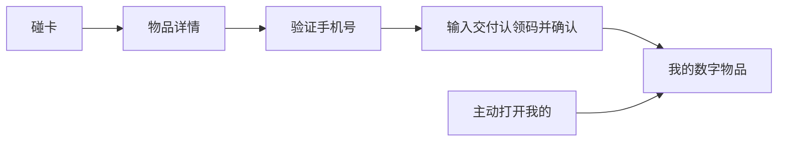

# 数字物品 H5 首版：查看、认领与我的物品

cece 已确认本稿的首版范围、一次性认领码和预览交互。本稿是产品规格，交付状态见 [TODO](../../TODO.md)。管理端的实体、芯片和装配流程见 [后台重构方案](admin-make-rebuild.md#assembly)，字段见 [后台字段表](admin-rebuild-fields.md)。

## 1. 首版目标与入口

顾客碰卡后能看懂物品及随附权益；交付对象能认领；已认领的用户以后能从「我的数字物品」找到它。两个主要入口为「物品详情」和「我的」。登录与认领从当前页面进入。服装优先用于验收，普通手串的专属体验继续按 [手串探索](../BRACELET_NFC_EXPLORATION.md) 判断。

首版展示权益说明、适用状态和本年换新用量，换新与转售继续由后台办理。用户自助办理、完整流转时间线和专属体验属于后续独立方向。

## 2. 页面与操作状态

| 页面 | 信息、状态与操作 |
|---|---|
| 碰卡后物品详情 | 先显示「正在验证芯片」。通过后显示主图、名称、发行和编号、材质养护、权益简介及「本次芯片验证通过」。资料按允许公开的字段展示，缺失的选填内容可省略。未封版时编号显示「待核定」。 |
| 物品详情的认领入口 | 当前可认领时显示「认领这件物品」。尚未开放时显示「暂未开放认领」。已有持有人时，访客只见「已认领」，登录且为本人时可以进「我的物品」。 |
| 验证异常与持续查看 | 旧链接或当前认领资格过期时引导重新碰卡。芯片停用、验证失败和系统暂不可用分别提示。资料持续查看与认领资格独立，持续查看沿用 [现行验证和阅读规则](../product/fashion-touch.md#2-手机资料页与持续查看)。 |
| 手机号登录／注册 | 同一表单输入手机号与短信验证码。已注册手机号登录原账户，首次验证通过建立稳定 UID。从认领进入时返回当前物品和认领步骤，从「我的」进入时打开列表。发送失败保留手机号并允许重试，验证码无效或过期分别提示，沿用同手机号 60 秒内最多发送一次的要求。 |
| 首次认领 | 显示物品主图、名称、发行编号和本账户的脱敏手机号。输入交付时收到的认领码，点击「确认认领」。成功时提示「已认领到我的数字物品」，主按钮为「查看我的物品」。 |
| 我的数字物品 | 未登录时显示手机号登录入口。空列表提示「碰一下你的物品，即可开始认领」。有记录时列出当前持有物品的主图、名称及编号；详情展示当前实体摘要、认领时间、适用权益、本年换新用量。账户页显示脱敏手机号及退出入口。 |
| 从「我的」打开详情 | 显示「你持有这件物品」和档案资料；实时芯片验证结果只用于本次碰卡进入的页面。持有人信息仅本人可见，公开资料限于物品与允许展示的认领状态。 |

## 3. 发放、确认与异常恢复

1. 后台核对首次交付后发放一次性认领码，售出交付与赠送交付均适用。通过现有交付渠道交给接收人。发放与补发记录物品、操作人、时间、交付依据和码的状态引用。
2. 认领码从发放起 **30 天有效**。遗失或过期时，由后台重新核对交付后补发，旧码同时失效。已存在持有关系时按争议流程处理。
3. 确认时校验同一物品的近期有效碰卡资格、已验证的手机号账户、可用认领码及当前认领状态。创建持有关系、写入历史和核销认领码一起提交。并发只能有一个当前持有人；同一账户重试时返回已确认的结果。
4. 日志与审计使用码的状态、引用和脱敏身份。原码、短信验证码及完整手机号属于受限凭证或数据。

| 情况 | 提示与恢复 |
|---|---|
| 认领资格过期 | 「请重新碰一下物品，再继续认领。」保留登录状态，新碰卡通过后恢复当前认领步骤。 |
| 认领码错误或与物品不匹配 | 「认领码与这件物品不匹配，请核对交付时收到的认领码。」留在表单重输。 |
| 码过期、失效或遗失 | 「请联系 BUMBUM 核对交付后补发。」运营在核对后补发或按持有争议处理。 |
| 已被认领或同时提交 | 本账户已经持有时进入「我的物品」。其他账户看到「这件物品已认领，如有疑问请联系 BUMBUM」。 |
| 提交后断网、结果未知 | 显示「正在核对认领结果」。恢复后查询当前归属，成功则进入成功页，仍具备认领资格时恢复表单。 |

## 4. 后台预览的页面规格

入口与侧栏规则见 [后台预览](admin-make-rebuild.md#h5-preview)。侧栏复用 H5 的展示规则，顶部明确标识「预览」。用当前物品已保存的公开资料配合预设状态。

| 视角 | 可以检查什么 |
|---|---|
| 访客 | 主图、名称、发行编号、材质养护、权益简介。 |
| 待认领 | 认领入口、手机号验证、认领码表单、确认页。切换使用预设数据。 |
| 持有人 | 当前实体摘要、认领信息、适用权益和本年换新用量。持有人身份使用模拟数据。 |

预览权限只允许读取和切换展示状态。真实短信、认领、归属变动及触碰统计走各自的用户流程。未装卡物品可预览资料，待核定编号按原状态展示。

## 5. 验收路径

| 核对场景 | 通过标准 |
|---|---|
| 从真实碰卡到资料 | 已授权的测试卡与所见物品一致，读数异常、旧链接、停用和系统失败可区分，访客可正常读资料。 |
| 首次认领与回访 | 合格交付对象验证手机号、用一次性码认领，退出后重新登录能从「我的」找到同一件物品。 |
| 认领异常与并发 | 错码、过期、补发、重复提交、两个账户同时提交及断网恢复均有明确结果，归属和核销一致。 |
| 后台预览 | 三种视角可达，使用保存的资料并标明模拟状态，关闭后恢复后台原分区与滚动。预览前后短信、归属与触碰统计可核对一致。 |

模拟批次验证页面与状态。真实短信、实卡和测试环境中的完整链路分别取证，验收与发布按项目协作规范进行。
