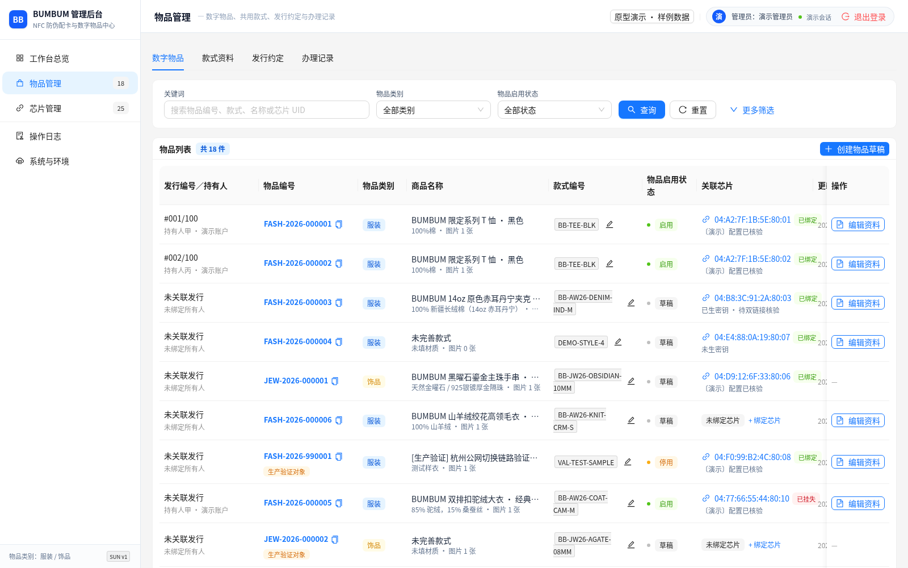
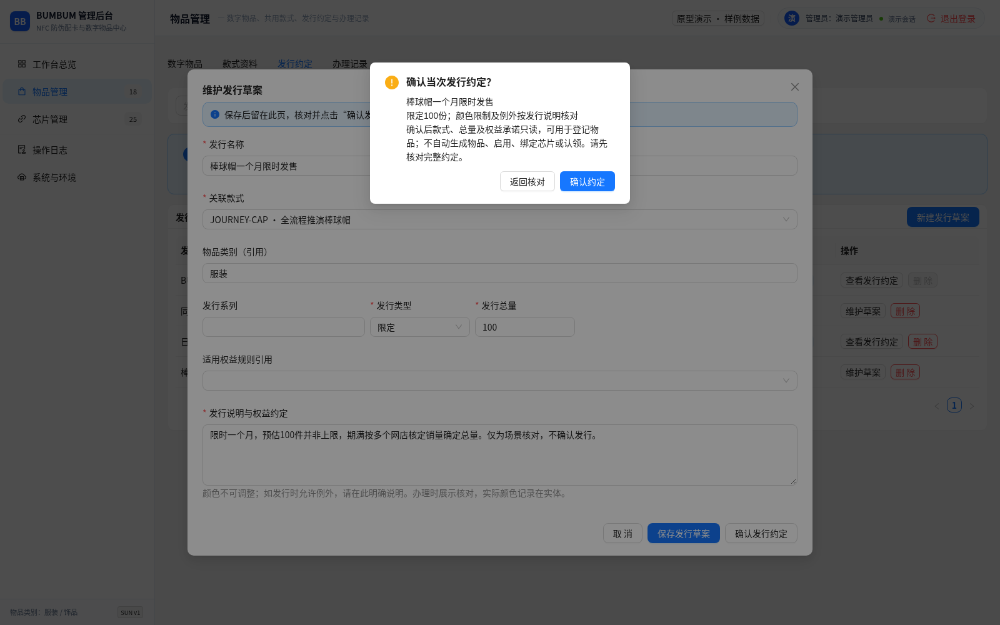
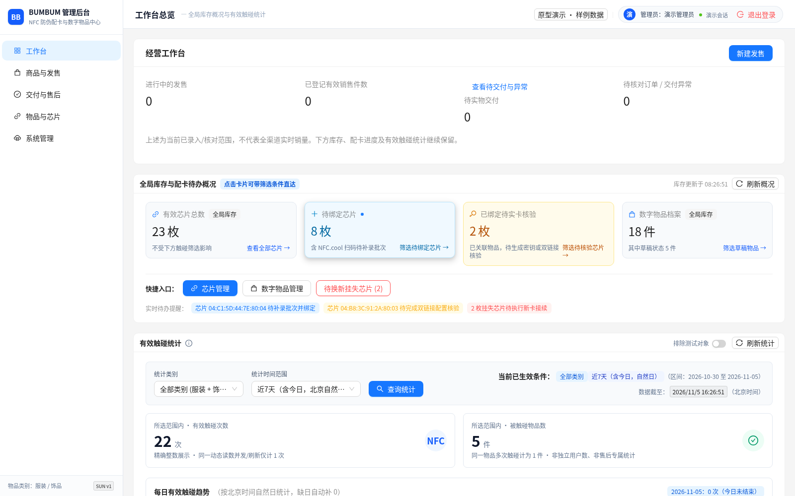
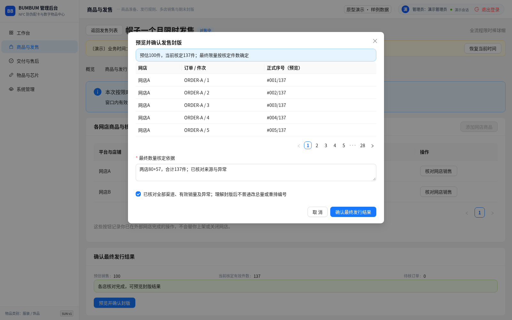

# 通用商品发售与交付：完整经营流程与后台任务架构

## 1. 目标、现状与批准边界

本稿解决cece从准备发售一款商品，到多渠道接单、生产、首次交付、发行总量确定及后续售后的完整经营路径。后台以管理员当下要完成的任务组织入口；商品款式、发行、单件身份、实体、芯片和归属仍各自保存准确事实。款式/发行的职责分离不要求操作者跨菜单拼流程。

cece已确认：手串限量50个数字身份，换新沿用原身份、不增发；手串/T恤/帽子必须共用通用流程。随后授权的首交原型已交付，但cece指出分段测试不足以证明整体顺畅，要求重新梳理操作、菜单及信息层级。最新帽子例子已澄清：款式和加工厂已确定，预计100个仅为预估，可超过；多个网店共同销售，一个月实际售出数量决定最终发行总量。

上述业务事实已确认。cece随后要求保留数据统计，并明确“按照上述改动重新调整原型”，本稿导航、持续发售页面及限时定量/编号/封版交互因此进入隔离原型实施范围。原型可交互不等于正式政策、后端技术或人工验收通过；有效付款/退款口径由本次发售明确填写，真实首次启用/认领及争议处理仍需另行定稿。仅修改独立原型与相关文档，不改正式应用/H5、API、schema、密钥/实卡或部署。D接续规则仍由[独立提案](replacement-resale.md)承接。

## 2. 改动前设计的根本断点

本次以固定[原型版本](https://github.com/ilcece/bumbum/tree/3f0a648624162ae423f9745897226b25258fd3e6)从首页新建帽子款式并进入发行设置。以下来自本次云端Chromium界面观察，未将固定100份或非限定冒充限时定量走完测试。

| 当前行为 | 经营者遇到什么问题 | 设计上的原因 |
|---|---|---|
| 物品管理默认打开数字物品，新建动作是“创建物品草稿” | 商品尚未准备上线，先面对单件身份；首次使用不知款式和发行在哪 | 主入口先服务资产维护，没有先服务商品发售 |
| 款式、发行、办理记录分3个页签；销售准备又藏在办理记录内 | 保存商品后没有自然的“继续准备发售”，需要自行跳转、选择并核对关联 | 把数据对象边界直接变成了经营步骤之间的隔断 |
| 销售计划只引用款式；“数字发行”汇总该款式所有已确认发行 | 同款多次发售时，无法明确这次销售承接哪个发行承诺 | 缺本次发售的统一上下文，销售安排与发行没有明确一对一/关联范围 |
| 发行只有限定/非限定，限定总量必填，确认后总量只读 | 预估100、一个月实际卖出137的场景一开始就无法表达 | 将发布规则和确定最终发行结果合成同一动作 |
| 到配卡再跳数字物品、芯片列表，默认类别/筛选需重新选择 | 操作者得记住刚处理的订单、款式、身份，再返回找原单 | 关联跳转没有完整携带工作上下文 |
| 后台主要以已存在对象与操作记录展示进度 | 难以回答“这次发售做到哪了、下一步该干什么、还有哪些异常” | 缺贯穿整次发售的持续工作页面 |

该截图说明默认工作层级；数字身份仍有维护价值，但不能承担商品发售的唯一主入口。

该截图中的100为原型默认值，不是cece已确认的发行上限；本次没有点击最终确认。当前缺销售窗口、预估量与最终总量分别核定的界面。

## 3. 经营主线与信息职责

**主线：准备商品 → 建立本次发售 → 确认规则及各店上架 → 多店销售/接单 → 按需生产与交付 → 到期结束销售/对账封版 → 持续使用与售后。** 销售与履约可以并行，不能画成必须先结束一个月销售才能开始生产的一条直线。

| 信息 | 回答的问题 | 维护位置与引用 |
|---|---|---|
| 商品款式 | 卖什么；名称、图片、材料、适用规格和样品依据 | 共用商品档案；新建发售可当场新建或选择已有，所有单件引用 |
| 本次发售 | 这次何时、在哪卖、如何确定数量、承诺什么、怎样交付 | 贯穿全程的发售工作区，明确关联一个款式及当次发行规则 |
| 发行规则与封版结果 | 提前承诺的规则是什么，最终发行结果是多少 | 同一发售内分区维护；规则发布与结果封版独立，不能复制两套可改总量 |
| 外部订单与履约 | 哪个店的哪件商品卖给谁、工厂接没接、做到哪了 | 发售关联的外部订单/件次与交付任务；支付和真实客户地址继续在网店 |
| 数字物品 | 某一件稳定身份及最终编号 | 独立档案，关联发售和对应订单件次；准备/售后不重建身份 |
| 实体与芯片 | 这次生产交付的实物、规格、质量及认证入口 | 本次交付快照，引用数字身份；新旧实体/芯片事实保留 |
| 所有权与权益 | 谁拥有、何时生效、售后可用什么 | 受控归属及权益记录；购买人/收件人/碰卡人不自动等于所有人 |

“发售工作区”是现有商品、发行、订单引用和交付信息的任务组合，不代表现在批准新建同名数据库表、项目管理平台或完整电商系统。

## 4. 本轮原型的信息架构与页面容器

以下为cece授权后调整的隔离原型结构。入口数量不是评判标准；这里用5个一级入口覆盖日常经营、专业维护与系统管理。

| 一级入口 | 二级内容 | 使用目的及默认位置 |
|---|---|---|
| 工作台 | 进行中的发售、待交付与异常、继续上次工作；统计摘要 | 首屏优先回答当前待做事项；“新建发售”为主要动作，芯片登记等常用操作可快捷进入 |
| 商品与发售 | 商品款式、发售批次 | 准备新品时从这里开始；款式是长期档案，发售是本次经营任务，不放在单件身份下面 |
| 交付与售后 | 首次交付任务、换新/转售、异常 | 日常跨发售处理生产/到货/配卡/发货/接续；按待办阶段筛选，关联回原发售和订单 |
| 物品与芯片 | 数字物品档案、芯片库存与配卡 | 查询具体身份或专业批量扫描/登记/配置；上下文进入时直接定位目标，不从空筛选重选 |
| 系统管理 | 操作日志、系统与环境 | 运维与审计，不占据商品经营主线的位置 |

工作台同时保留经营、库存/配卡及有效触碰统计。经营统计区分预估量、有效销售件数、最终发行量、实物交付及异常；发售概览增加规格销量/履约阶段与仅属于当次发行的触碰次数、物品数和趋势。待封版显示待核定，不以0或100冒充结果；已交付不冒充已认领。数据来自样例/人工登记，不标为全渠道实时数据。触碰范围按北京时间今日、近7日/30日和累计区分，配卡核验不计入用户有效触碰。

### 4.1 “新建发售”如何开始

入口为“工作台→新建发售”，或“商品与发售→新建发售”。首屏明确显示“先选择或新建这次要卖的商品”，可以录入款式和商品内容；保存后直接进入本次发行/销售设置，自动带入刚保存的款式。

商品款式列表也保留“新建商品”和行内“发起一次发售”，服务先批量准备商品再安排发售的习惯。两种入口进入同一工作区，不复制商品或发行记录。已有款式再售时引用原款式，新建当次发售；是否允许再次发行受原承诺约束，不能把换新当作再次发行。

### 4.2 发售详情是持续工作的主页面

采用可保存并持续返回的完整页面，使用4个页签：“概览／商品与发行／销售与封版／订单与交付”。本次按授权整体调整该主容器；现有800px物品详情及专业配卡弹窗继续复用，不把一个月经营过程塞在1120px多步弹窗里。

- **概览：** 商品名称及本次发售名称、销售窗口/当前阶段、规则确认状态、销售/发行/交付各自数量、异常与明确的下一步。按钮随任务变化，不同时摆一排没有先后的完成动作。
- **商品与发行：** 共用款式、样品/供货引用，当次承诺、发行方式、权益和用户可见资料预览。共用商品修改有引用影响提示，已公布承诺保持保护。
- **销售与封版：** 多个店铺商品映射、各店订单同步/人工核对时间、结束销售确认、有效销售件数及差异、封版预览与结果。封版后留查证与历史，不提供普通随手改总量。
- **订单与交付：** 本次发售订单汇总及件次，按待生产/生产中/待验收/待配卡/待发货/运输中/已交付/异常定位；可按工厂批次合并处理，但保留逐件对应。

从本次发售打开交付、身份或配卡时，带发售/订单/款式/目标物品上下文；完成后可“返回本次发售”，保留筛选和位置。全局交付工作区操作同一份任务；同一交付不因不同入口创建两条办理记录。历史供回查，待办供行动，不能混称“办理记录”。

## 5. 帽子限时发售的完整推演

本例的100仅为预估，不是任何强制上限。以“最终核定137件”为演示结果，137是假设，用于验证超过预估仍能自然完成；不代表实际销量或已确认的退款政策。

| 时间/任务 | 操作者实际怎么做 | 系统保存/展示什么，下一步去哪 |
|---|---|---|
| 准备发售 | 新建发售，选择/录入已定稿帽子款式、图片、材料、颜色/帽围等适用规格；引用封样和工厂供货依据 | 商品档案和本次发售草稿；不先创建100个数字物品，也不要求先登记芯片 |
| 设置本次规则 | 选择“限时发售，期满按实际销量定量”，设置明确开始/结束时间、预估100、有效售出定义、交期/权益和当次承诺 | 预估100、最终总量待核定。100可用于备料和产能提醒，不能作为编号上限或阻断第101件 |
| 关联销售渠道 | 把多个网店的商品/规格映射到同一次发售，核对对外承诺一致 | 每个渠道的店铺、商品引用及上架确认；同一款不能因为在多个店卖就重复建款/重复发售 |
| 开始销售 | 确认对外规则，在网店上架后登记各店已开始销售 | 锁定的是规则，不是最终总量；后台确认不冒称已自动发布到各店 |
| 日常接单 | 汇总各店订单，核对付款/有效性、要求规格与收件安排，按件形成履约任务 | 按平台+店铺+订单+明细+件次去重；按商品件数统计，不把订单数当件数；标核对截止时间，未同步时不称全渠道实时数 |
| 按需投产 | 从该发售待生产任务给工厂生产清单，保存工厂已接单及交期；可合并生产 | 已下达、已接单、生产中、后来寄货/到货分别保存；工厂未寄货也能保存接单事实 |
| 到货与数字准备 | 到货逐件验收，失败保留每轮依据并返工；合格后建立/核对稳定身份、登记/关联芯片，受控配卡及出厂检查 | 从本任务进入既有配卡能力；实体规格、验收及原始芯片映射留快照，不靠操作人记编号往返查找 |
| 销售期内交付 | 按承诺安排滚动发货，不因最终总量尚未核定阻止生产；期内编号展示按第6节建议处理 | 两段物流及实物事实独立，显示已准备/已交付/待首次认领等真实状态；不凭手机号/物流签收授予归属 |
| 到期结束销售 | 核对各店均已停售；若某店仍售出，列明超期订单并处理 | 销售结束、对账中、封版分别表示；后台时钟到期不冒称已关闭外部网店 |
| 多店对账 | 汇总全部渠道，截至约定时点核定有效售出件数，查重复、取消/退款中、迟付、错归发售、缺订单及已交付冲突 | 例：核定137件；展示各店小计及异常。数量有缺口/待决冲突时不能直接封版，人工核对结论留依据 |
| 确认封版 | 核对预估100、最终137、订单/身份对应和未完结异常，明确确认 | 最终限量137份，记录依据和确认时间；不得因超过预估而拒绝137，不把核定结果伪装为原来就承诺137 |
| 持续交付与售后 | 继续处理未交付任务；从订单或数字物品受理换新/转售，查看首次及历次实体/芯片/归属 | 售罄/停售不等于履约完成；换新沿原身份、增加实体历史，不把实物制作次数加到137 |

设计、竞品搜集、采购及工厂合同原件先用外部文档/引用，不建立供应链全平台。多个网店的订单起步可人工登记/受控导入，不把自动抓单、实时库存同步、自动派工或物流接口作为这版前提。

## 6. 发行规则、最终总量及编号怎样配合

### 6.1 三种发行方式共用主流程

| 发行方式 | 开始销售前明确什么 | 总量何时确定 |
|---|---|---|
| 固定总量 | 如手串最多50个数字身份，既有保护继续适用 | 规则确认时已确定，不能普通减少或追加承诺 |
| 限时按销量定量 | 销售窗口、渠道范围、统计口径与期末核定方法；预估不作上限 | 到期对账并确认封版；本例可能是137，不是100 |
| 非限定 | 不设永久总量上限，但仍有明确发行关联、稳定身份及单件编号 | 不生成虚假的限定总量 |

方式按本次承诺选择，不能按“帽子/衣服/手串”写死。旧T恤100件、帽子20个仍只是各自样例的计划数，不借新帽子例子替它们决定永久上限。

### 6.2 承诺确认与结果封版分开

开始销售前确认的是“哪段时间、哪些商品、按什么口径确定最后数量”等规则。封版时保存的是依这些规则核定的结果。允许最终结果晚于开始销售确定，不意味着可以在销售中任意修改已承诺的口径。

预估销售量、暂核销售件数、待核异常、最终发行总量、身份准备/正式发行数及实物交付数各有口径。封版不能只把各店当前数字简单相加；一次重复导入、付款回调或换新不能多算一个发行身份。各渠道数据未齐时明确提示核对范围，不假称统一防超卖能力；本例本就没有100的硬上限。

### 6.3 销售期内交付与正式编号：原型演示规则

为支持原有“下单后按需生产、滚动发货”，建议数字身份业务编号先稳定；该新模式的**正式限量序号及最终分母在封版时一次确定**。销售期用户看到“发行总量核定中”，不能先印成#001/100或宣称永久非限定。封版后形成#001/137等正式展示，稳定身份/芯片不重建；正式序号确定后不可因售后重排。

改动前原型要求新建物品立即登记正式序号；本轮仅对新限时定量模式允许先建稳定身份、正式编号待封版，固定50等原规则不撤回。若实体包装需印正式序号/总量，应等封版后制作该部分并安排交付；不能提前印100再后台改137，也不把这种包装约束强加给所有品类。

建议统计口径为：约定销售窗口内达到付款条件、截至核定时点没有已生效取消/全额退款的商品件数；定金/尾款、支付跨截止线及退款核定时点须在销售前定稿。已交付/已认领身份与退款冲突、退款中或来源不清进入对账异常，核清后才能封版，不能直接删除身份或转移归属来凑数。建议封版后的退款/换新不重写已公布的发行总量，是否再售及身份后续归属另按规则处理。

本节编号及期内展示已按本轮指令制作原型；付款/退款政策不能仅由合成示例代替定稿。首次启用/访问资格及认领仍须与当前技术约束一起定稿，不能把“可记录物流”说成完整用户使用已闭环。

## 7. 信息、操作与状态的落位规则

- **款式资料在商品准备时维护。** 单件页引用共用资料；单件具体规格、验货和物流只在本次实体/履约维护。发行承诺单独冻结，不能随共用介绍更新而改变。
- **本次发售持续可找。** 一眼可见当前阶段、缺什么、下一步、关联渠道及所有交付任务；后续日常继续不必每次重走新建向导。
- **批量处理不抹掉逐件对应。** 生产按同厂/规格/批次合并，发货允许合包；每件仍回查订单、身份和芯片。起步仅提供有实际需要的批量动作，不建设排产引擎。
- **状态不互相替代。** 发售草稿/销售中/已结束/对账中/已封版；生产/验收/发货/实际收到；身份准备/正式编号；芯片配置/物品启用；未认领/已归属分别显示。已上架不等于启用，已发货不等于认领，已封版不等于全部交付。
- **资料展示与生效分别解释。** 商品编辑预览、已对外承诺、最终限量结果及单件启用独立；本轮不扩建通用发布平台或模版引擎。
- **异常和恢复就在原任务。** 显示原因、核对依据、恢复原步骤；每次质检及配卡/交付对应保留快照。失败保留输入、未知结果先核对、离开保护及审计继续保留；取消的弹窗草稿不能下次静默提交。
- **所有权由授权路径建立。** 建议首交任务明确列出“待启用/待认领”及办理入口；启用时点、首次当前实体生效和认领凭据在产品/技术定稿后接通。买家、收件人及使用者不同不要求伪造持有人；换新/转售沿既有D规则，不另造一套所有权编辑。

## 8. 现有原型怎样整体改，哪些保留

| 部分 | 整体调整方向 | 保留与合并边界 |
|---|---|---|
| 默认首页与一级导航 | 先突出发售、交付和异常；按第4节重组 | 复用Make视觉、Ant Design/Pro方向及现有认证，不重画设计系统 |
| 款式/发行/销售计划 | 从“新建发售”连贯维护，销售安排明确关联当次承诺 | 保留各信息职责和保护；不让操作者独立建立互相脱节的同义记录 |
| 办理记录里的销售准备折叠区 | 移入发售主页面，不再作为唯一创建/查找发售的入口 | 首交事实迁入同一任务上下文，已有记录和引用不删除 |
| 首交多步弹窗 | 发售全程用持续页面；具体一次验收/配卡/发货用适合的表单或既有弹窗 | 不再用一条强制串行进度条代表销售、生产和封版并行关系 |
| 数字物品与芯片全局列表 | 保留为档案/库存与专业维护入口 | 任务内进入时带目标和返回路径；复用真实安全/唯一性及登记配卡逻辑 |
| 发行确认 | 固定总量维持原保护；新模式增加规则确认、对账、封版的产品定义 | 不把“已确认”按钮直接改成任意可修改最终总量 |
| 换新/转售与实体/所有权历史 | 从同一交付/售后工作区及对象详情进入 | 已确认的身份不增发、转售新实体/芯片、年度及隐私边界不撤回；细则由D承接 |

前轮已复现的“工厂接单无法独立保存、复验覆盖旧证据、异常弹窗残留旧输入”应在对应节点一起整改，但修这3处不等于本次整体设计已经解决。不建设品类专用模块、完整订单支付中心、自动工厂调度、供应链/合同系统或通用审批/字段引擎。

## 9. 完整场景验收与实施顺序

验收从清晰的经营任务开始，以操作者是否能自然找到下一步、上下文是否延续及业务结果是否准确结束；自动脚本不能靠预置身份、改浏览器存储、熟记内部页签或跳过未知步骤来代替整个流程。

| 验收组 | 连续走法 | 必须看到的结果 |
|---|---|---|
| 1 准备与开始发售 | 从工作台新建本次发售，录款式→规则→多个网店商品→核对对外内容→登记已开始销售 | 不要求先有单件/芯片；保存后自然继续；每步所需字段与后续引用明确 |
| 2 销售、生产与滚动交付 | 跨店同单号/同单多件、超过预估100、部分生产/部分到货、验收返工→建档配卡→发货/收到→待启用/认领 | 去重按店铺及件次；101件正常；工厂接单可先保存；批次/单件可回查，返回不丢工作上下文 |
| 3 到期对账与封版 | 多店到期核对、某店未关闭、迟付/退款中/重复/错归批次→核清→例137确认 | 未停售/来源未齐/冲突未解决明确阻断；预估100与最终137并列解释；身份/正式编号和公开展示对应 |
| 4 使用及售后连续性 | 新首单按已定启用/认领规则生效→从该身份受理换新或转售→核验后正式接续 | 不使用已有持有人样例冒充接续；稳定身份/正式序号和最终总量不变，新实体/芯片及归属历史正确 |
| 5 发行方式与异常回归 | 将同一流程分别用于固定50手串、T恤100计划、帽子20计划；在关键步骤失败/未知/离开/刷新 | 只改业务数据与发行方式，不写品类专用分支；未定口径不自动推断；无假成功、重复发行或丢历史 |

实施顺序：已按cece授权整体调整独立原型，使用正常UI从新建发售走到多店137件封版，并复用原有配卡完成一件销售期内交付。接下来由cece验收经营路径，再细化正式技术方案与构建。全部画面可点及自动测试通过都不替代人工验收。

销售前必须定稿的3组关键问题：有效售出及退款/跨截止线统计口径；销售期内正式编号/实体包装与交付方式；首次启用/当前实体生效/归属认领。第5–7节给出建议与异常去向，不在实施时临时替cece选择。

## 10. 文档职责与本轮证据范围

本文件集中维护通用经营主线及任务架构；[重构提案](admin-make-rebuild.md)承接正式整合范围；[后台规范](../ADMIN_UI_GUIDELINES.md)维护已授权的视觉与容器；[原型说明](../../prototypes/admin-make/README.md)提供当前操作和验证证据。PRD只留导航，TODO记录待人工验收，CHANGELOG保存决定及证据。

前轮两张截图属于改动前浏览器观察，保留用于解释断点。本轮云端Chromium从正常UI新建款式/发售、多店登记80+57件，独立保存工厂接单、返工复验、建档配卡并返回原交付、发货/实际交付，然后各店停售对账，按137件确定正式编号与总量。没有预置本场景身份、配置芯片或写浏览器存储，密钥/Webhook及推进期满时间使用带标记演示控件。真实支付、工厂、物流、实卡、首次认领和新身份后续售后未验证；既有换新/转售另作回归，不能冒称新首单已贯通用户认领。

